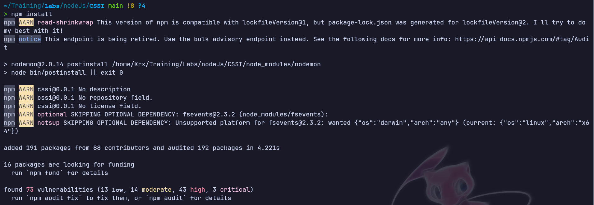
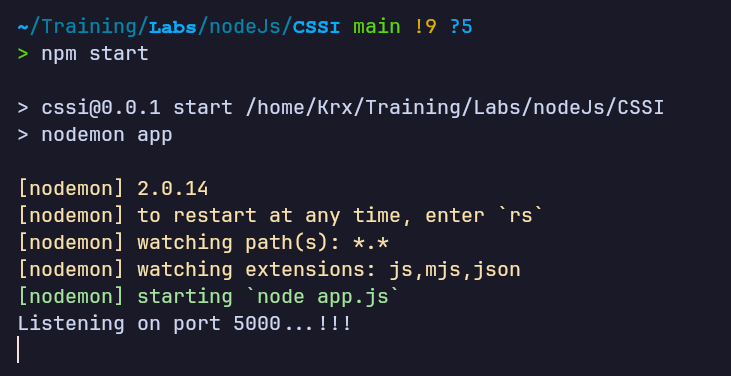
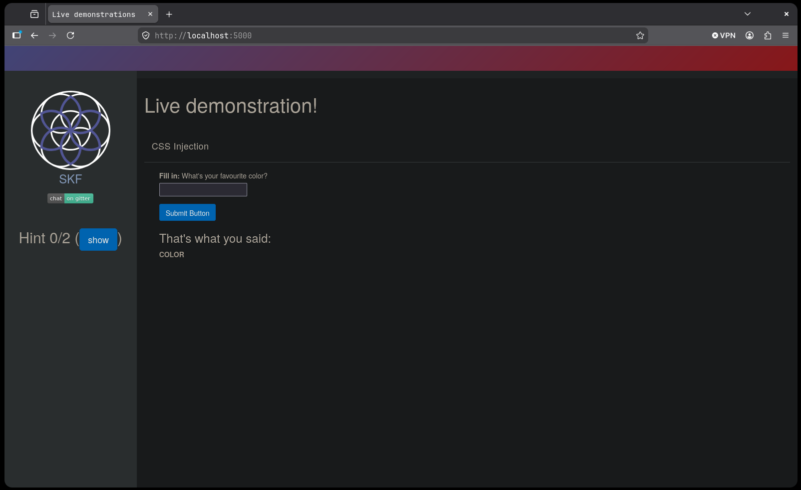
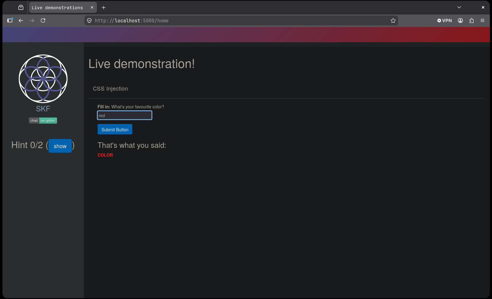
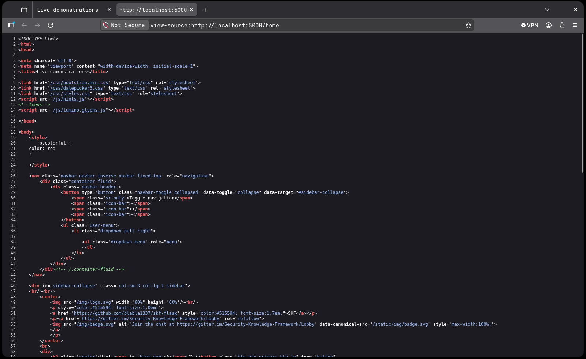
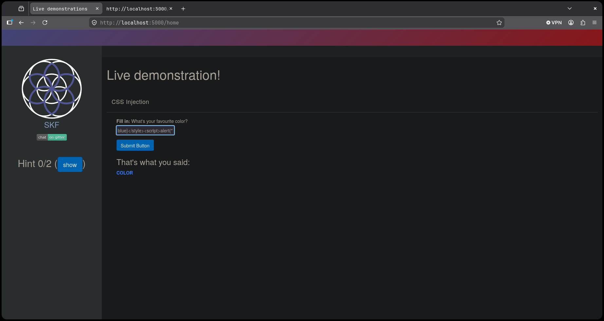
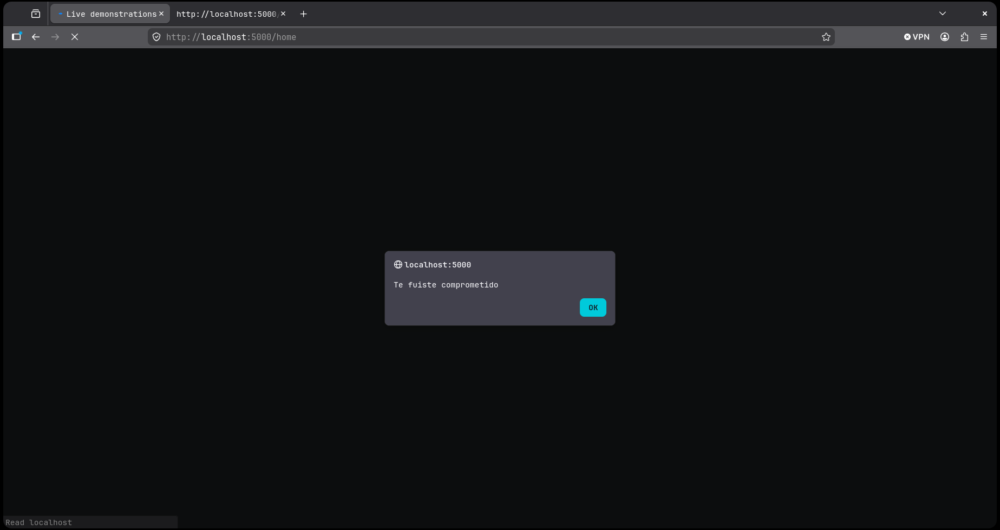
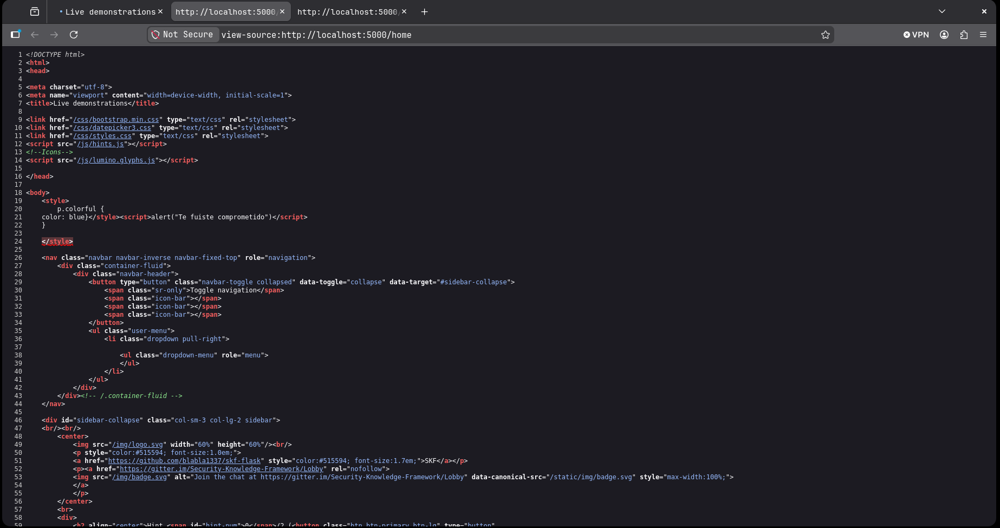

# CSS Injection (CSSI) — skf-labs
**Dificultad:** Fácil | **SO:** Linux (Arch Linux, entorno local) | **Fecha:** 19/10/2026 | **Autor:** krinoxx | **Plataforma:** [skf-labs (blabla1337)](https://github.com/blabla1337/skf-labs)

## Índice
- [Reconocimiento](#reconocimiento)
- [Enumeración web](#enumeración-web)
- [Acceso inicial](#acceso-inicial)
- [Escalada de privilegios](#escalada-de-privilegios)
- [Lecciones aprendidas](#lecciones-aprendidas)
  - [Desde el punto de vista del atacante](#desde-el-punto-de-vista-del-atacante)
  - [Desde el punto de vista del defensor](#desde-el-punto-de-vista-del-defensor)

## Reconocimiento

El laboratorio es una aplicación Node.js del repositorio skf-labs (carpeta `nodeJs/CSSI`) que se ejecuta en local, por lo que no hay fase de descubrimiento de red: el objetivo es `http://localhost:5000`. El primer paso es instalar las dependencias con `npm install`.

#### Captura 01 — Instalación de dependencias



La instalación avisa de que el `package-lock.json` se generó con una versión de lockfile más moderna que la de mi npm, y reporta 73 vulnerabilidades en las dependencias (13 low, 14 moderate, 43 high y 3 critical). Son dependencias antiguas propias del laboratorio, un recordatorio de que conviene ejecutar este tipo de apps solo en un entorno aislado.

A continuación arranco la aplicación con `npm start`, que lanza `nodemon app`.

#### Captura 02 — Arranque de la aplicación



`nodemon` ejecuta `node app.js` y la aplicación queda escuchando en el puerto 5000.

## Enumeración web

Al abrir `http://localhost:5000` aparece la página "Live demonstration!" con el título "CSS Injection": un formulario que pregunta por el color favorito y, debajo, el texto "That's what you said: COLOR".

#### Captura 03 — Página inicial



Para entender el comportamiento envío un valor legítimo, `red`. La palabra COLOR pasa a mostrarse en rojo y la URL cambia a `/home`, así que el valor introducido afecta directamente al estilo de ese texto.

#### Captura 04 — Entrada legítima (red)



Reviso el código fuente de la página (`view-source:http://localhost:5000/home`) para ver dónde acaba mi entrada.

#### Captura 05 — Código fuente con el valor reflejado



En las líneas 19-24 la aplicación genera un bloque `<style>` con la regla `p.colorful { color: red }`. El valor que escribí se inserta tal cual dentro de la declaración CSS, sin validación ni codificación, y el bloque se cierra justo después. Es el punto de inyección.

## Acceso inicial

Como la entrada se refleja dentro de un bloque `<style>`, se puede salir de la regla CSS con `}`, cerrar el bloque con `</style>` y escribir HTML nuevo a continuación. El payload utilizado es:

```html
blue}</style><script>alert("Te fuiste comprometido")</script>
```

Lo introduzco en el campo del formulario.

#### Captura 06 — Payload introducido



El texto COLOR se muestra en azul, lo que confirma que el valor `blue` se aplicó a la regla antes de que mi cierre de llave terminara la declaración. Al cargar la página, el navegador ejecuta el script inyectado.

#### Captura 07 — Ejecución del script (alert)



Aparece el cuadro de alerta con el mensaje "Te fuiste comprometido", lo que demuestra ejecución de JavaScript arbitrario en el contexto de `localhost:5000`. Es decir, la inyección CSS escala a un XSS reflejado.

Para ver el motivo en el HTML devuelto, vuelvo a revisar el código fuente.

#### Captura 08 — Código fuente con el payload inyectado



El bloque `<style>` queda cerrado por mi payload (`blue}</style>`), seguido de la etiqueta `<script>` con el `alert`. Los restos de la plantilla original (`}` y el `</style>` final, que el visor marca como etiqueta sobrante) quedan después y el navegador los tolera. La aplicación no aplica ninguna defensa.

## Escalada de privilegios

No aplica. El laboratorio se ejecuta en un entorno propio y local, y el objetivo es demostrar la vulnerabilidad web (inyección CSS que deriva en XSS), sin fase de escalada en el sistema.

## Lecciones aprendidas

### Desde el punto de vista del atacante

- Cualquier lugar donde la entrada del usuario se refleje es candidato a inyección, y el contexto importa: aquí no era HTML ni un atributo, sino el interior de una regla CSS.
- Revisar el código fuente (`Ctrl+U` / `view-source:`) tras enviar un valor de prueba inocuo revela en qué contexto cae la entrada y qué caracteres hacen falta para salir de él.
- Una inyección CSS puede ser más grave de lo que parece: si no se codifican `<` y `>`, cerrar el bloque `<style>` permite inyectar etiquetas nuevas y llegar a XSS.

### Desde el punto de vista del defensor

- No insertar nunca datos del usuario dentro de bloques `<style>` ni de atributos `style`. Si hay que personalizar un color, aplicarlo con una clase CSS predefinida elegida según un valor de una lista cerrada.
- Validar la entrada con una lista blanca (por ejemplo, colores permitidos o un patrón `#RRGGBB` estricto) y rechazar cualquier otro carácter, en especial `}`, `<`, `>` y comillas.
- Codificar la salida según el contexto y usar el autoescape del motor de plantillas.
- Aplicar una Content Security Policy restrictiva, sin `unsafe-inline` en `script-src` y `style-src`, para limitar el impacto aunque la inyección exista.
- Mantener actualizadas las dependencias: el `npm audit` del laboratorio muestra 73 vulnerabilidades, algo inaceptable en un entorno real.

---

*Writeup educativo en entorno controlado.*
