# Session Puzzling — OWASP SKF Labs
**Dificultad:** Media | **SO:** Linux (contenedor Docker) | **Fecha:** 17/10/2026 | **Autor:** krinoxx | **Plataforma:** [owasp-skf-lab (blabla1337)](https://github.com/blabla1337/owasp-skf-lab)

## Índice
- [Reconocimiento](#reconocimiento)
- [Enumeración web](#enumeración-web)
- [Acceso inicial](#acceso-inicial)
- [Escalada de privilegios](#escalada-de-privilegios)
- [Lecciones aprendidas](#lecciones-aprendidas)

## Reconocimiento

El laboratorio se distribuye como imagen Docker oficial del proyecto OWASP SKF (Security Knowledge Framework), bajo el tag `sessionpuzzle`. Se descarga y se levanta en local, publicando el puerto 5000 solo en loopback:

```
docker pull blabla1337/owasp-skf-lab:sessionpuzzle
docker run -dit -p 127.0.0.1:5000:5000 blabla1337/owasp-skf-lab:sessionpuzzle
```

Se confirma con `docker ps` que el contenedor está arriba y escuchando en `127.0.0.1:5000`.

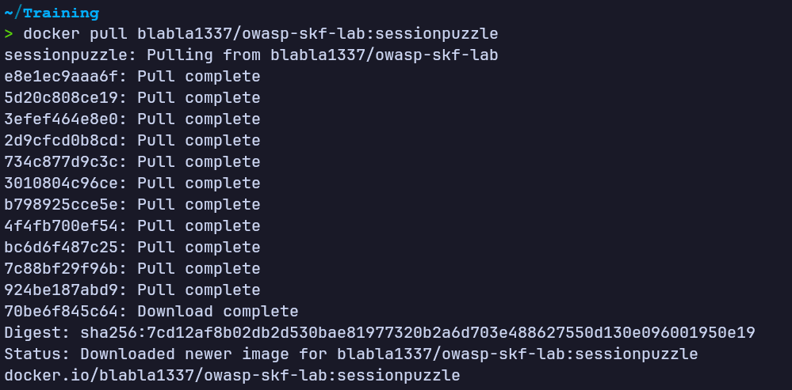

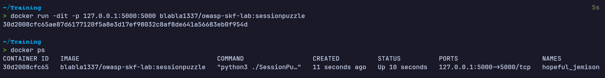

## Enumeración web

Al acceder a `http://localhost:5000` se presenta un formulario de login estándar ("Session Puzzling!") con campos de usuario y contraseña, sin más superficie visible a primera vista.

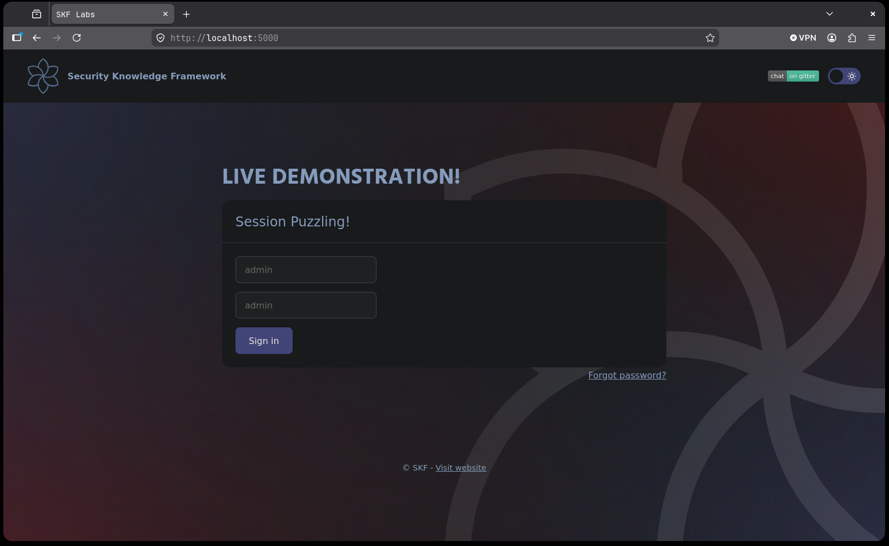

Explorando los enlaces disponibles aparece un flujo de recuperación de contraseña en `/forgot`, que solicita únicamente un nombre de usuario para iniciar el proceso.

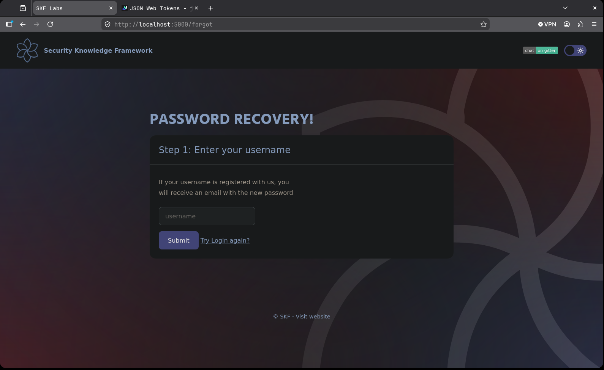

## Acceso inicial

Interceptando con Burp Suite el envío del formulario de `/forgot` con `username=admin`, se observa que el servidor responde con un `Set-Cookie: session=<JWT>`. Este JWT se genera como parte del flujo de recuperación de contraseña.

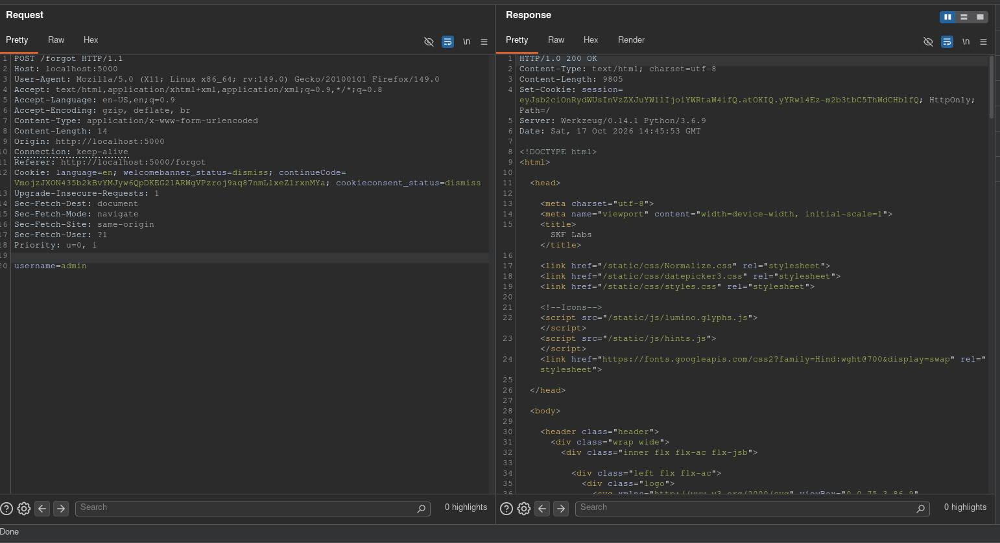

Decodificando ese JWT en jwt.io, el header de la cookie revela `{"log": true, "username": "admin"}`. El payload no es legible por estar cifrado/firmado, pero el dato relevante es que la aplicación ya marca la sesión como `log: true` para el usuario `admin`, pese a no haberse completado ningún login real — solo se ha iniciado el proceso de "olvidé mi contraseña".

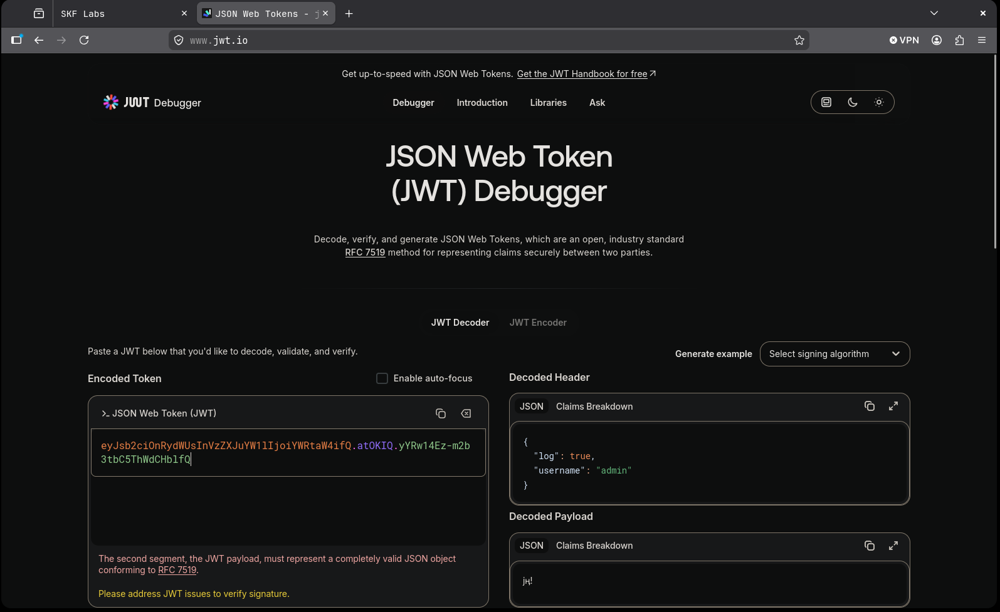

Esa misma cookie `session` queda almacenada en el navegador tras la petición a `/forgot`, visible en el panel de Storage de las DevTools.

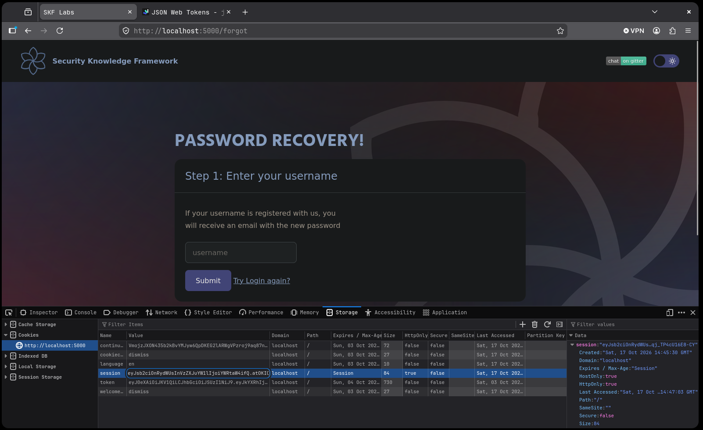

Navegando directamente a `/dashboard` con esa cookie todavía activa, la aplicación concede acceso completo como `admin`, mostrando el panel con información "Confidential level C info" (tabla de cargos y salarios). La aplicación reutiliza el mismo objeto de sesión para estados lógicamente distintos (recuperación de contraseña vs. sesión autenticada), confundiendo ambos contextos — el fallo clásico de *session puzzling*.

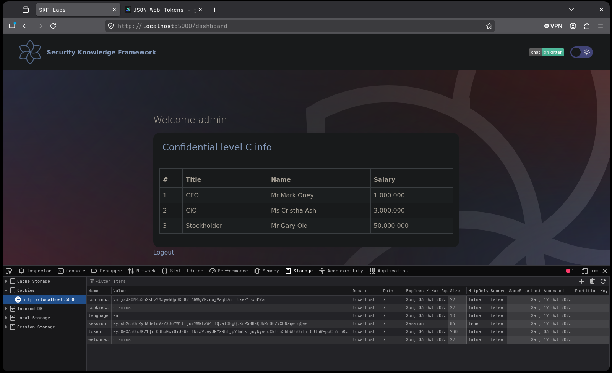

Para confirmar el comportamiento, se repite el acceso desde otro punto de entrada: tras un intento de login con usuario y contraseña (sin que esta última sea necesariamente correcta), al forzar la navegación a `/dashboard` la aplicación vuelve a conceder acceso aprovechando la cookie de sesión ya puesta por el flujo de `/forgot`. Nótese en la captura que la barra de direcciones aún muestra `/login`, pero el contenido renderizado es ya el dashboard autenticado — confirmación adicional de que el servidor valida la sesión por el contenido del JWT (`log: true`, `username: admin`) y no por el paso de login efectivamente completado.

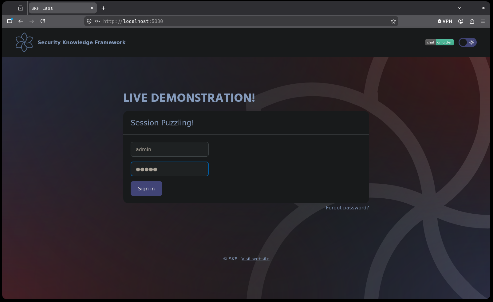

Decodificando el nuevo JWT generado en este segundo intento, se confirma que mantiene la misma estructura de header (`log: true`, `username: admin`), reforzando que cualquier cookie de sesión emitida por el flujo de recuperación es indistinguible, para el backend, de una sesión de login legítima.

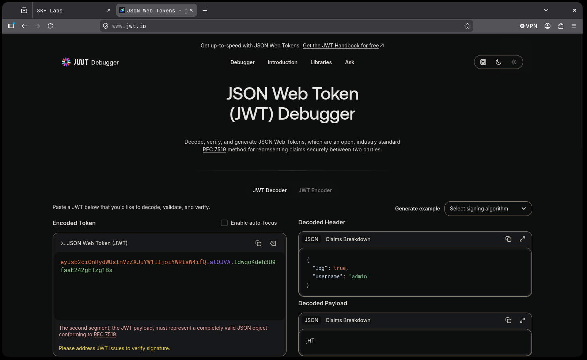

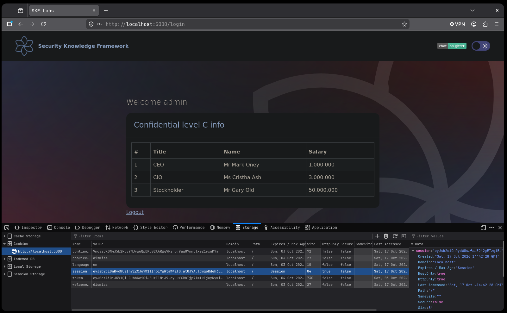

## Escalada de privilegios

No aplica en este laboratorio: el objetivo es exclusivamente el bypass de autenticación mediante *session puzzling*, y el acceso obtenido como `admin` ya corresponde al nivel máximo de privilegio expuesto por la aplicación (panel de administración con datos confidenciales).

## Lecciones aprendidas

### Desde el punto de vista del atacante
- Cuando una aplicación usa un único objeto/clave de sesión para distintos flujos (login, recuperación de contraseña, verificación en dos pasos, etc.), conviene comparar las cookies emitidas en cada flujo: si comparten estructura o claves (`log`, `username`...), es un indicio de *session puzzling*.
- Decodificar siempre los JWT de sesión (jwt.io o similar) para entender qué claims está usando el backend para decidir el estado de autenticación.
- Probar el acceso directo a rutas protegidas tras *cualquier* interacción que genere una cookie de sesión, no solo tras un login exitoso.

### Desde el punto de vista del defensor
- No reutilizar el mismo objeto de sesión (ni la misma clave en el almacén de sesiones) para procesos de distinta naturaleza lógica (recuperación de contraseña ≠ sesión autenticada).
- Verificar en cada endpoint protegido el claim específico y completo que certifica un login real (p. ej. un paso explícito de autenticación completada), no solo un flag genérico como `log: true`.
- Invalidar o regenerar la cookie de sesión al finalizar cada subflujo (como el de recuperación de contraseña) en lugar de dejarla activa y reutilizable para otros contextos.

*Writeup educativo en entorno controlado.*
